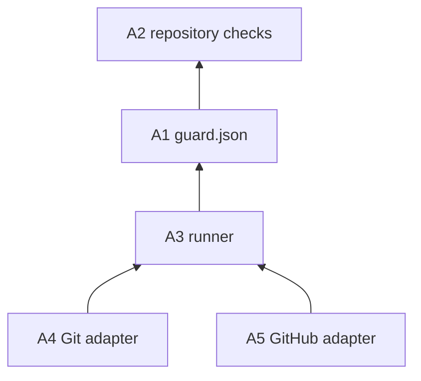
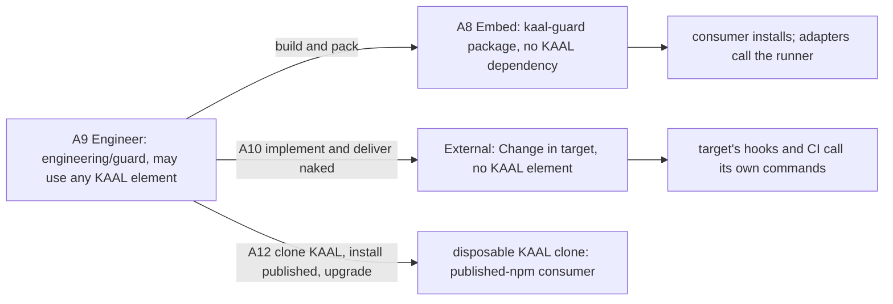

# Guard: Architecture (where)

Architecture places Guard's functions, gives each one positive ownership, and fixes its boundaries, relationships and dependencies. How each function is implemented is Code's, written in DO; the Changes that deliver it are in [Change](change.md). Each element names, in brackets, the Requirements it serves.

## Elements

- **A1 Check list** [F1, F7]. `guard.json`, at the repository root, is owned by the repository. It says which checks exist, their commands, where they run, which facts they need, which checker is trusted and which outcomes are named. It knows nothing of how a check decides.
- **A2 Checks** [F1, F9]. The checks and their test content are the repository's. They know nothing of Git, GitHub or Guard beyond the facts F9 gives them.
- **A3 Runner** [F2, F3, F7, F9, F10, N2, N4]. The runner, in the package at `lib/runner.mjs`, runs a set of checks and reads their verdicts. It knows nothing of branches, remotes, pull requests, GitHub, the adapters or KAAL. It reads a Git object only to take a trusted checker from the base commit (F7).
- **A4 Git adapter** [F4, F6]. The `pre-push` hook, shipped in the package as `templates/pre-push`, passes Git facts to the runner and acts on its verdicts. It knows nothing of GitHub and names no check.
- **A5 GitHub adapter** [F5, F6, F10]. A workflow job passes pull request facts to the runner and acts on its verdicts. Reporting to GitHub (annotations and the step summary, `run --github`) and the static coverage check (`verify`) sit beside the runner, in `lib/github.mjs`. A new consumer is offered `templates/guard.yml`.
- **A6 Lifecycle** [F8, N3]. `init`, `upgrade` and `remove`, in the package at `lib/lifecycle.mjs`, own exactly the files recorded under `managed` and the `core.hooksPath` they set. Nothing else in a repository is theirs.
- **A7 Dependency direction** [F3, F6]. The command (`bin/kaal-guard.mjs`) and the adapters depend on the runner; the runner depends on `guard.json`; `guard.json` names the checks. Nothing depends on an adapter, and the runner depends on neither A5 nor the templates.
- **A8 Package independence** [N6]. The `kaal-guard` package, in `packages/kaal-guard/`, depends on no KAAL element except `kaal-core` (N12). Only the lifecycle (A6) imports it, lazily, and only through `kaal-core/agent`. It references no Engineering path or KAAL Engine. It carries its own tests in `test/`.
- **A9 Engineer** [N7, N5]. `engineering/guard/` holds Guard's engineering documentation, the Engineering-only outer tests and, later, the External tooling. It may use any useful KAAL element. Nothing it uses becomes a package dependency.
- **A10 External** [F8, N5]. The External tooling, in `engineering/guard/external/`, produces and delivers a naked Guard Change for a target from the target's own commands. It uses no package internals and leaves no KAAL element in the target.
- **A11 KAAL integration** [N7, F5, F10]. KAAL is Guard's first consumer and installs the package from its workspace. Its lineage, Change Isolation and branching checks become entries in KAAL's `guard.json`, with their checkers trusted and `4` named held. Guard joins KAAL's existing workflows without replacing or consolidating them:
  - KAAL adopts Guard as an executor, not as a manager. **KAAL-owned:** the `checks` of `guard.json`, the check scripts and their policy, `.githooks/pre-push`, which holds KAAL's branching policy (it resolves each push's target), and every workflow's orchestration (names, OS matrices, triggers, trusted checkouts). **Guard-managed:** nothing; KAAL's `guard.json` has no `managed` or `config`. **Executed by Guard, not managed:** the hook's call to `kaal-guard run --local`, each job's `kaal-guard run --check` step and the `Guard` job's `verify`. KAAL keeps all three as they are and adopts no managed asset (N8, F17). The target is consumer-owned, not Guard-managed and not mixed, because Guard's templates cannot carry what KAAL's surfaces hold: the hook resolves each push's target by KAAL's branching policy, and the workflows carry the OS matrices, `pull_request_target` trusted checkouts and check identities KAAL's rulesets require (N7). Managing either would move KAAL policy into Guard or lose an identity. KAAL therefore needs no adoption of pre-existing assets, and migration stays separate from the published-version upgrade;
  - each existing job keeps its name, OS matrix and triggers: `Hosting (Windows/Linux/macOS)`, `Acceptance (Windows/macOS)`, `Workspaces`, `Acceptance`, `Engineering`, `Change Isolation`, `Promotion Source`, `Branching` and `Branching audit`;
  - only the step that runs the check changes, to `kaal-guard run --check <name>`;
  - CodeQL and Dependency Review are GitHub's own checks and stay outside Guard.

- **A12 Consumer acceptance** [F11–F18, N8, N9]. Engineering's acceptance of a published version, with KAAL as the consumer, in `engineering/guard/consumer/`. It belongs to Engineer (A9) and may use Hosting and Testing. Each run clones KAAL's commit into a disposable directory and changes nothing in KAAL's working tree. In the clone only:
  - the development dependency is replaced by a published `@kaihacksai/kaal-guard` from the registry, and the lockfile records the registry's integrity;
  - `core.hooksPath` is set as a KAAL developer sets it, and a local bare remote lets Git run the hook on a real push;
  - the clone moves to a candidate version, back to the earlier one, and forward again; for KAAL that is a package-code update only (F11), since KAAL has and adopts no managed asset;
  - `init` and `remove` run with KAAL's real `guard.json`, to show how Guard treats an existing integration (F17, F18).

  The managed-asset cases (F12–F14, F16) need a consumer that has managed assets. KAAL has none and adopts none, so A12 creates a minimal repository beside the clone: a simulated consumer with its own check and no integration of its own, where `init` installs both assets. A12 needs the network to reach the registry. That is A12's, not the package's, so N2 still holds for the package. What KAAL's real CI and branch protection show is A11's evidence, from the development package; A12 claims none of it.

- **A13 Skill source** [F19, F20, N11]. The Embed Skill is in the package at `skills/kaal-guard/`, and the package ships it (`files`). Its text names the package's commands. It assumes no host, as KAAL's Agent Skills do, and Engineering checks it with `kaal-engineer-skill` (A9). The package itself never depends on that check.
- **A14 Skill placement** [F23, F24, F26, N10, N12]. The lifecycle (A6) asks Core to install, upgrade and remove each deployment of the Skill. It reads the Skill source and the repository's provider declaration, and passes them to Core's Agent interface, which realizes the deployments through Hosting and returns what it wrote, kept and pruned. Core keeps its own record of what it manages; the lifecycle only mirrors the deployed paths into `guard.json`. The lifecycle holds no provider convention of its own. The Skill's text depends on no location. It shows the optional pointers Core returns and never writes an instruction file.
- **A15 Reminder** [F21, F22]. The reminder is reporting, so it sits with the command and the GitHub reporting (A5). It reads the Skill paths recorded under `managed`, or else the package's copy. The runner (A3) and the hook (A4) are unchanged, and the hook shows the reminder only because it forwards `kaal-guard`'s output.
- **A16 External Skill** [F25, F26, N12]. The External tooling (A10) carries its own variant of the Skill as a template. At delivery it asks Core's Agent Realization, from KAAL's workspace, for the target's deployments and pointers, writes the deployments with the hook and the workflow, and lists the pointers in `GUARD.md`. It uses no package internals, and no Core element reaches the target.

## Relationships

