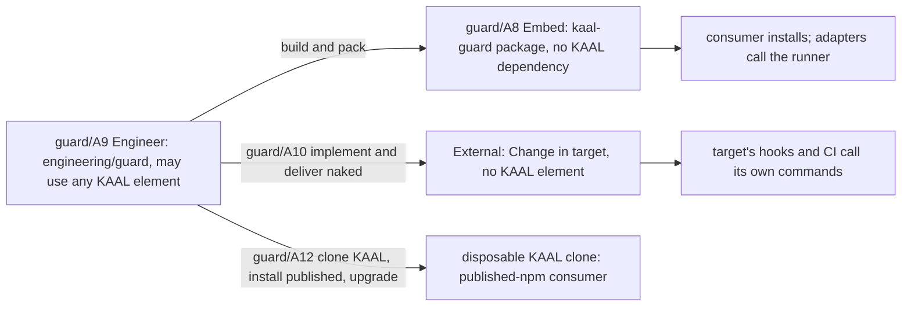

# Guard: Architecture, Engineering's part (where)

Guard's product Architecture, the elements guard/A1–guard/A8, guard/A13–guard/A15 and guard/A17–guard/A19, is authoritative in the package: [`packages/kaal-guard/docs/architecture.md`](../../packages/kaal-guard/docs/architecture.md). This page holds only the elements of KAAL Engineering's own use and delivery of Guard. Each names, in brackets, the Requirements it serves. The Changes that deliver them are in [Change](change.md).

## Elements

- **guard/A9 Engineer** [guard/N7, guard/N5]. `engineering/guard/` holds Guard's engineering documentation, the Engineering-only outer tests and, later, the External tooling. It may use any useful KAAL element. Nothing it uses becomes a package dependency.
- **guard/A10 External** [guard/F8, guard/N5]. The External tooling, in `engineering/guard/external/`, produces and delivers a naked Guard Change for a target from the target's own commands. It uses no package internals and leaves no KAAL element in the target.
- **guard/A11 KAAL integration** [guard/N7, guard/F5, guard/F10]. KAAL is Guard's first consumer and installs the package from its workspace. Its lineage, Change Isolation and branching checks become declarations in KAAL's `.kaal/config/guard/`, with their checkers trusted and `4` named held. Guard joins KAAL's existing workflows without replacing or consolidating them:
  - KAAL adopts Guard as an executor, not as a manager. **KAAL-owned:** its check declarations, the check scripts and their policy, `.githooks/pre-push`, which holds KAAL's branching policy (it resolves each push's target), and every workflow's orchestration (names, OS matrices, triggers, trusted checkouts). **Guard-managed:** nothing; KAAL has no Guard installation record and no Guard checkout state. **Executed by Guard, not managed:** the hook's call to `kaal-guard run --local`, each job's `kaal-guard run --check` step and the `Guard` job's `verify`. KAAL keeps all three as they are and adopts no managed asset (guard/N8, guard/F17). The target is consumer-owned, not Guard-managed and not mixed, because Guard's templates cannot carry what KAAL's surfaces hold: the hook resolves each push's target by KAAL's branching policy, and the workflows carry the OS matrices, `pull_request_target` trusted checkouts and check identities KAAL's rulesets require (guard/N7). Managing either would move KAAL policy into Guard or lose an identity. KAAL therefore needs no adoption of pre-existing assets, and migration stays separate from the published-version upgrade;
  - each existing job keeps its name, OS matrix and triggers: `Hosting (Windows/Linux/macOS)`, `Acceptance (Windows/macOS)`, `Workspaces`, `Acceptance`, `Engineering`, `Change Isolation`, `Promotion Source`, `Branching` and `Branching audit`;
  - only the step that runs the check changes, to `kaal-guard run --check <name>`;
  - CodeQL and Dependency Review are GitHub's own checks and stay outside Guard.
- **guard/A12 Consumer acceptance** [guard/F11–guard/F18, guard/N8, guard/N9]. Engineering's acceptance of a published version, with KAAL as the consumer, in `engineering/guard/consumer/`. It belongs to Engineer (guard/A9) and may use Hosting and Testing. Each run clones KAAL's commit into a disposable directory and changes nothing in KAAL's working tree. In the clone only:
  - the development dependency is replaced by a published `@kaihacksai/kaal-guard` from the registry, and the lockfile records the registry's integrity;
  - `core.hooksPath` is set as a KAAL developer sets it, and a local bare remote lets Git run the hook on a real push;
  - the clone moves to a candidate version, back to the earlier one, and forward again; for KAAL that is a package-code update only (guard/F11), since KAAL has and adopts no managed asset;
  - `init` and `remove` run with KAAL's real configuration, to show how Guard treats an existing integration (guard/F17, guard/F18).

  The managed-asset cases (guard/F12–guard/F14, guard/F16) need a consumer that has managed assets. KAAL has none and adopts none, so guard/A12 creates a minimal repository beside the clone: a simulated consumer with its own check and no integration of its own, where `init` installs both assets. guard/A12 needs the network to reach the registry. That is guard/A12's, not the package's, so guard/N2 still holds for the package. What KAAL's real CI and branch protection show is guard/A11's evidence, from the development package; guard/A12 claims none of it.
- **guard/A16 External Skill** [guard/F25, guard/F26, guard/N12]. The External tooling (guard/A10) carries its own variant of the Skill as a template and writes it at the canonical location with the hook and the workflow. Where Core's realization is available in KAAL's workspace, the tooling may ask it at delivery for the target's further deployments and pointers, write the deployments, and list the pointers in `GUARD.md`. It uses no package internals, and no Core or Hosting element reaches the target.
- **guard/A20 Engineering/Product boundary** [guard/N14, guard/N6].
  - **What `engineering/guard/` holds.** It holds what is Engineering's:
    - the Capability, `Guard.md`;
    - Engineering's identifiers, guard/I4, guard/I6, guard/F25, guard/N5, guard/N7–guard/N9, guard/A9–guard/A12 and guard/A16, each citing the product identifiers it relies on;
    - plans and the Change map, `change.md` and `run.md`;
    - engineering evidence: RED and GREEN records, and the Defect register with its Test Case traces;
    - the manifest generator;
    - the tests that verify the verifier (guard/T101–guard/T106, guard/T108–guard/T110);
    - consumer acceptance against the registry (guard/A12);
    - KAAL as a consumer (guard/A11);
    - the External tooling (guard/A10, guard/A16).
  - **The authority check.** guard/T111, in `engineering/guard/acceptance/`, fails on any of these:
    - an identifier defined twice;
    - a product identifier defined outside the package;
    - a delivered case citing an undefined identifier;
    - a line shaped like a definition that is not in a canonical form.
  - **The canonical definition forms.** These are the only ways to define a Guard identifier:
    - guard/I, F, N and A: the identifier opens its line in bold, at the top level: `**guard/F1 …` or `- **guard/A1 …`;
    - a product Test Case: a row of the package's trace in `docs/testing.md`, between its markers: `| guard/T61 | …`;
    - an Engineering Test Case: a row of Engineering's plan that gives its title: `| guard/T101: …`, or `| guard/T33–guard/T35: …` for several;
    - a Defect: a row of Engineering's register: `| guard/D1 | …`.

    Every other place an identifier appears is a citation, including Engineering's evidence rows: `| guard/T36 | GREEN |`, `| guard/T36, guard/T42 | …` or `| guard/T65–guard/T68 | …`. Some forms look like a definition but are not canonical. guard/T111 refuses them, so a definition cannot hide in another layout. They are: an identifier in bold or underscores anywhere else, at any list depth, in a quote or in a table cell; a heading that opens with an identifier; and a table row that opens with one in any other form.
  - **External's templates.** guard/N14 requires them to be derived from the package's assets and checked against those, by guard/T112. Both come in `guard/C105`. Today they are maintained by hand and are not checked against the package's.

## Relationships

## Configuration options (guard/C23)

This section records the options `guard/C23` considered and the configuration it plans. Approving `guard/C23` accepts it. The resulting obligations are guard/F1, guard/F18, guard/F28 and guard/F29. The Owner asked on #336 (comments 6384007398 and 6384194537) for location and format to be reconsidered from Intent, now that Guard ships the `kaal-guard` Skill. `0.0.1`'s root `guard.json` is one candidate, not a premise. Three concerns are separated here, each with its own owner and lifecycle:

| Concern | Owner | Lifecycle |
| --- | --- | --- |
| **Declarations**: what to guard, meaning each check's command, `runs`, `facts`, `trusted` and `outcomes` | the repository | written by people and agents. Guard only validates them |
| **Lifecycle state**: which files are Guard's (repository scope) and Guard's setup of the hook path (checkout scope) | Guard | written only by Guard's deterministic functions, each where its lifecycle lives (guard/F29) |
| **Skill resources**: `SKILL.md` and its optional `scripts/`, `references/` and `assets/` | Guard, as a managed asset | installed, upgraded and removed by the lifecycle, and deployed further by Core (guard/A14, guard/A17) |

**Criteria**, from the Owner's list:
- migration from `0.0.1`, now settled by the Owner as none;
- how hooks and CI find the configuration;
- separation of lifecycle state;
- schema validation;
- checks owned by the consumer;
- independence of Embed and External from KAAL;
- Core's provider deployments of the Skill.

**Location of the declarations**

| Option | For | Against |
| --- | --- | --- |
| L1: root `guard.json` (`0.0.1`) | Discovery stays today's upward search for `guard.json` | It keeps the declarations beside Guard's state at the root, which is the mix the Owner questioned |
| L2: inside the Skill installation, under `.agents/skills/kaal-guard/`, kept apart from the Skill resources | One Guard home, and an agent finds the declarations next to the Skill. The Agent Skills standard does not reserve a configuration name, so this is allowed | Consumer-owned live files sit inside a directory Guard manages and Core deploys. Core would have to deploy only the standard resources and exclude them (a `core/C3` rule). `remove` would leave a directory with no `SKILL.md`, so the ownership mix moves one level down |
| L3: a location of its own, apart from the Skill: `.kaal/config/guard/`, the Owner's choice (#339, 6384298262) | The ownership of every directory is clear: Guard's Skill resources in one place, the repository's declarations in another. Core deploys the Skill unchanged | Two Guard paths instead of one, and a new name to settle |

**Format of the declarations.** The format follows who maintains it:

| Option | Fits when | Notes |
| --- | --- | --- |
| J: JSON, created, validated and edited by Guard's deterministic Skill scripts or commands | Guard's functions maintain it | Guard has no command that edits checks today, and KAAL's checks are written by hand |
| M: one Markdown file per check, with typed frontmatter for the declaration and a body for that check's resolution guidance | people and agents maintain it directly | This matches the frontmatter direction on #337 (`core/C5`). The body gives guard/I7 guidance for each check, while the verdict comes only from the frontmatter and the exit status. Guard, with no dependencies, needs a strict frontmatter parser of its own and conforms to Core's schema without a runtime dependency, as `contract.json` does |
| C: a conventional configuration format, such as YAML or TOML, in one file | people maintain one list | It is readable, but it has no natural place for per-check guidance, and it needs a parser |

**Lifecycle state.**
- S1: inside the declarations, as in `0.0.1`.
- S2: a separate JSON file that only Guard writes, beside the declarations or at Guard's own path.
- S3: the installation record of Core's Installation Contract (`core/C3`) when Core manages the installation, and S2 when Guard runs standalone.

S2 and S3 are compatible if Core's record and Guard's file hold the same fields.

**How hooks and CI find the configuration.**
- P1: one fixed rule from the repository root.
- P2: an explicit path that the hook and workflow Guard writes pass to it. A consumer's own workflows, such as KAAL's, would need the same path or fall back to P1.

P2 with P1 as the fallback keeps `kaal-guard run --check <name>` working unchanged in KAAL.

**Migration from `0.0.1`.** The Owner settled this on #336 (6384215003). `0.0.2` is a deliberate breaking change within `0.0.x`. There is no automatic migration, no dual format and no rollback to `0.0.1`. No external consumer is known, and if one appears, its transition is assessed separately. The release notes of `guard/C19` document the breaking changes and the fresh `0.0.2` setup. KAAL runs the development package, so KAAL's own configuration is converted in the same Change as `guard/C25`, and KAAL's CI never sees a format it cannot read.

**Planned configuration**, as the Owner directed on #339 (6384298262):
- **L3, `.kaal/config/guard/`.** The repository's Git-tracked declarations live there, one file per check. `.kaal/` is a namespace, not a runtime dependency on Core. Guard's Skill resources stay at `.agents/skills/kaal-guard/`: reusable instructions, not live configuration. Core deploys the Skill without exceptions.
- **M, under `core/C5`.** The declarations follow Core's deterministic-frontmatter contract, and Guard parses them itself. Each check's body gives guard/I7 the per-check guidance it lacked. Verdicts stay deterministic: frontmatter and exit status only. KAAL Engineering checks conformance with `core/C6`. J is not chosen, because people and agents maintain the declarations, not Guard's functions.
- **State in two scopes, not one file** (guard/F29). The semantics differ:
  - *What this repository installed* (repository scope) is a tracked installation record, `.kaal/state/guard/installation.json`, which only Guard writes. It registers each asset's path, SHA-256 and writing version, and it travels with every clone. It is kept distinct from the package's **catalogue** of known published content in `contract.json`: the catalogue says what Guard has ever shipped, and the record says what this repository registered. Matching published bytes does not make a file Guard's. A **provenance header in each asset** was considered and rejected. It needs one rule per format, because the hook's shebang must stay first, the workflow must stay valid YAML, and `SKILL.md` must begin with its frontmatter, and it would alter supplier formats Guard does not own.
  - *The checkout-scope setup* (`core.hooksPath`) is local by nature, and it is recorded in the Git metadata of the configuration scope Guard wrote:
    - Git's common directory for the shared configuration. That is `$(git rev-parse --git-common-dir)`, because `--git-path kaal/…` resolves per worktree.
    - The worktree's own metadata, `$(git rev-parse --git-path …)`, when `extensions.worktreeConfig` lets Guard set it per worktree.
    - Both behaviours were observed with Git 2.43.
- **P2 with P1 as the fallback** (guard/F28). The fallback is the fixed convention at the repository's top level, not an upward search, so both adapters resolve the same declarations.
- **No migration**, as the Owner ruled. `0.0.1`'s root `guard.json` is refused, naming the fresh setup (guard/F15).
- **Embed and External** deliver their integration without a persistent Core dependency.
