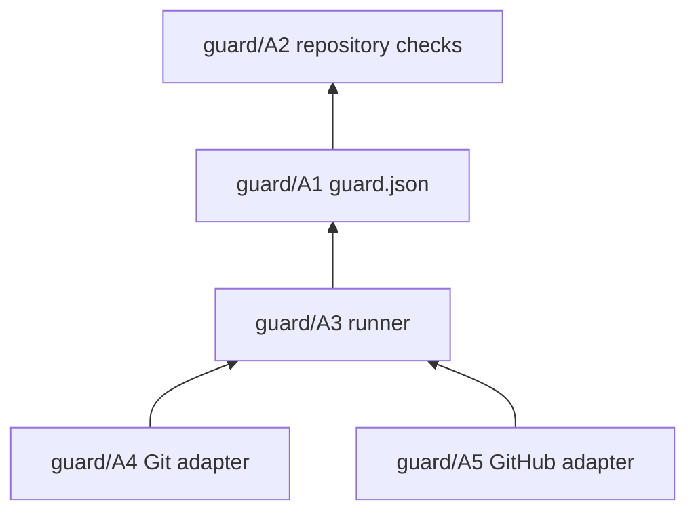
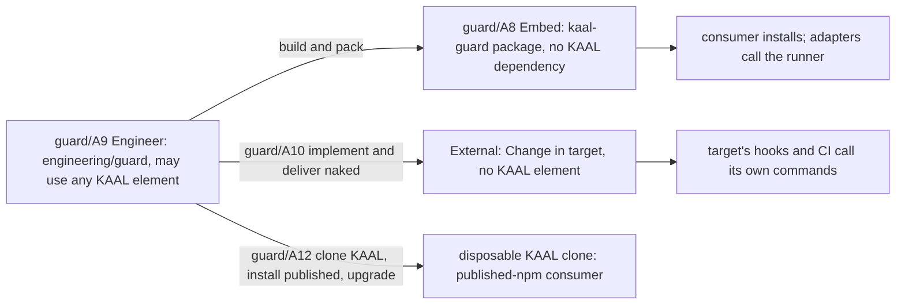

# Guard: Architecture (where)

Architecture places Guard's functions, gives each one positive ownership, and fixes its boundaries, relationships and dependencies. How each function is implemented is Code's, written in DO; the Changes that deliver it are in [Change](change.md). Each element names, in brackets, the Requirements it serves.

## Elements

- **guard/A1 Check list** [guard/F1, guard/F7]. `guard.json`, at the repository root, is owned by the repository. It says which checks exist, their commands, where they run, which facts they need, which checker is trusted and which outcomes are named. It knows nothing of how a check decides.
- **guard/A2 Checks** [guard/F1, guard/F9]. The checks and their test content are the repository's. They know nothing of Git, GitHub or Guard beyond the facts guard/F9 gives them.
- **guard/A3 Runner** [guard/F2, guard/F3, guard/F7, guard/F9, guard/F10, guard/N2, guard/N4]. The runner, in the package at `lib/runner.mjs`, runs a set of checks and reads their verdicts. It knows nothing of branches, remotes, pull requests, GitHub, the adapters or KAAL. It reads a Git object only to take a trusted checker from the base commit (guard/F7).
- **guard/A4 Git adapter** [guard/F4, guard/F6]. The `pre-push` hook, shipped in the package as `templates/pre-push`, passes Git facts to the runner and acts on its verdicts. It knows nothing of GitHub and names no check.
- **guard/A5 GitHub adapter** [guard/F5, guard/F6, guard/F10]. A workflow job passes pull request facts to the runner and acts on its verdicts. Reporting to GitHub (annotations and the step summary, `run --github`) and the static coverage check (`verify`) sit beside the runner, in `lib/github.mjs`. A new consumer is offered `templates/guard.yml`.
- **guard/A6 Lifecycle** [guard/F8, guard/N3]. `init`, `upgrade` and `remove`, in the package at `lib/lifecycle.mjs`, own exactly the files recorded under `managed` and the `core.hooksPath` they set. Nothing else in a repository is theirs.
- **guard/A7 Dependency direction** [guard/F3, guard/F6]. The command (`bin/kaal-guard.mjs`) and the adapters depend on the runner; the runner depends on `guard.json`; `guard.json` names the checks. Nothing depends on an adapter, and the runner depends on neither guard/A5 nor the templates.
- **guard/A8 Package independence** [guard/N6]. The `kaal-guard` package, in `packages/kaal-guard/`, depends on no other KAAL element, declares none, imports none and references no Engineering path or KAAL Engine. It carries its own tests in `test/`.
- **guard/A9 Engineer** [guard/N7, guard/N5]. `engineering/guard/` holds Guard's engineering documentation, the Engineering-only outer tests and, later, the External tooling. It may use any useful KAAL element. Nothing it uses becomes a package dependency.
- **guard/A10 External** [guard/F8, guard/N5]. The External tooling, in `engineering/guard/external/`, produces and delivers a naked Guard Change for a target from the target's own commands. It uses no package internals and leaves no KAAL element in the target.
- **guard/A11 KAAL integration** [guard/N7, guard/F5, guard/F10]. KAAL is Guard's first consumer and installs the package from its workspace. Its lineage, Change Isolation and branching checks become entries in KAAL's `guard.json`, with their checkers trusted and `4` named held. Guard joins KAAL's existing workflows without replacing or consolidating them:
  - KAAL adopts Guard as an executor, not as a manager. **KAAL-owned:** the `checks` of `guard.json`, the check scripts and their policy, `.githooks/pre-push`, which holds KAAL's branching policy (it resolves each push's target), and every workflow's orchestration (names, OS matrices, triggers, trusted checkouts). **Guard-managed:** nothing; KAAL's `guard.json` has no `managed` or `config`. **Executed by Guard, not managed:** the hook's call to `kaal-guard run --local`, each job's `kaal-guard run --check` step and the `Guard` job's `verify`. KAAL keeps all three as they are and adopts no managed asset (guard/N8, guard/F17). The target is consumer-owned, not Guard-managed and not mixed, because Guard's templates cannot carry what KAAL's surfaces hold: the hook resolves each push's target by KAAL's branching policy, and the workflows carry the OS matrices, `pull_request_target` trusted checkouts and check identities KAAL's rulesets require (guard/N7). Managing either would move KAAL policy into Guard or lose an identity. KAAL therefore needs no adoption of pre-existing assets, and migration stays separate from the published-version upgrade;
  - each existing job keeps its name, OS matrix and triggers: `Hosting (Windows/Linux/macOS)`, `Acceptance (Windows/macOS)`, `Workspaces`, `Acceptance`, `Engineering`, `Change Isolation`, `Promotion Source`, `Branching` and `Branching audit`;
  - only the step that runs the check changes, to `kaal-guard run --check <name>`;
  - CodeQL and Dependency Review are GitHub's own checks and stay outside Guard.

- **guard/A12 Consumer acceptance** [guard/F11–guard/F18, guard/N8, guard/N9]. Engineering's acceptance of a published version, with KAAL as the consumer, in `engineering/guard/consumer/`. It belongs to Engineer (guard/A9) and may use Hosting and Testing. Each run clones KAAL's commit into a disposable directory and changes nothing in KAAL's working tree. In the clone only:
  - the development dependency is replaced by a published `@kaihacksai/kaal-guard` from the registry, and the lockfile records the registry's integrity;
  - `core.hooksPath` is set as a KAAL developer sets it, and a local bare remote lets Git run the hook on a real push;
  - the clone moves to a candidate version, back to the earlier one, and forward again; for KAAL that is a package-code update only (guard/F11), since KAAL has and adopts no managed asset;
  - `init` and `remove` run with KAAL's real `guard.json`, to show how Guard treats an existing integration (guard/F17, guard/F18).

  The managed-asset cases (guard/F12–guard/F14, guard/F16) need a consumer that has managed assets. KAAL has none and adopts none, so guard/A12 creates a minimal repository beside the clone: a simulated consumer with its own check and no integration of its own, where `init` installs both assets. guard/A12 needs the network to reach the registry. That is guard/A12's, not the package's, so guard/N2 still holds for the package. What KAAL's real CI and branch protection show is guard/A11's evidence, from the development package; guard/A12 claims none of it.

- **guard/A13 Skill source** [guard/F19, guard/F20, guard/N11]. The Embed Skill is in the package at `skills/kaal-guard/`, and the package ships it (`files`). Its text names the package's commands. It assumes no host, as KAAL's Agent Skills do, and Engineering checks it with `kaal-engineer-skill` (guard/A9). The package itself never depends on that check.
- **guard/A14 Skill placement** [guard/F23, guard/F24, guard/F26, guard/F27, guard/N10, guard/N12]. The lifecycle (guard/A6) installs, upgrades and removes the Skill as a managed asset at its canonical location, as the contract (guard/A17) states. It holds no provider convention and reads no provider declaration. The Skill's text depends on no location. It never writes an instruction file.
- **guard/A15 Reminder** [guard/F21, guard/F22]. The reminder is reporting, so it sits with the command and the GitHub reporting (guard/A5). It reads the Skill paths recorded under `managed`, or else the package's copy. The runner (guard/A3) and the hook (guard/A4) are unchanged, and the hook shows the reminder only because it forwards `kaal-guard`'s output.
- **guard/A16 External Skill** [guard/F25, guard/F26, guard/N12]. The External tooling (guard/A10) carries its own variant of the Skill as a template and writes it at the canonical location with the hook and the workflow. Where Core's realization is available in KAAL's workspace, the tooling may ask it at delivery for the target's further deployments and pointers, write the deployments, and list the pointers in `GUARD.md`. It uses no package internals, and no Core or Hosting element reaches the target.
- **guard/A17 Installation contract** [guard/F27, guard/N12]. `contract.json` is in the package, and the package ships it. It is Guard's instance of Core's Installation Contract schema, which Guard neither copies nor imports. The lifecycle (guard/A6) reads its assets and rules from it, so no second list of assets exists in Guard's code. Core reads the same file when it realizes Guard. KAAL Engineering (guard/A9) runs Core's conformance Test Cases against it, at engineering time only.

## Relationships

## Configuration options (guard/C23)

This section is a comparison, and nothing in it is decided. The Owner asked on #336 (comments 6384007398 and 6384194537) for location and format to be reconsidered from Intent, now that Guard ships the `kaal-guard` Skill. `0.0.1`'s root `guard.json` is one candidate, not a premise. Three concerns are separated here, each with its own owner and lifecycle:

| Concern | Owner | Lifecycle |
| --- | --- | --- |
| **Declarations**: what to guard, meaning each check's command, `runs`, `facts`, `trusted` and `outcomes` | the repository | written by people and agents. Guard only validates them |
| **Lifecycle state**: `managed`, `config` and `writers` | Guard | written only by Guard's deterministic functions |
| **Skill resources**: `SKILL.md` and its optional `scripts/`, `references/` and `assets/` | Guard, as a managed asset | installed, upgraded and removed by the lifecycle, and deployed further by Core (guard/A14, guard/A17) |

**Criteria**, from the Owner's list:
- migration from `0.0.1`, now settled by the Owner as none;
- how hooks and CI find the configuration;
- separation of lifecycle state;
- schema validation;
- checks owned by the consumer;
- independence of Embed and External from KAAL;
- Core's provider deployments of the Skill.

**Location of the declarations**

| Option | For | Against |
| --- | --- | --- |
| L1: root `guard.json` (`0.0.1`) | Discovery stays today's upward search for `guard.json` | It keeps the declarations beside Guard's state at the root, which is the mix the Owner questioned |
| L2: inside the Skill installation, under `.agents/skills/kaal-guard/`, kept apart from the Skill resources | One Guard home, and an agent finds the declarations next to the Skill. The Agent Skills standard does not reserve a configuration name, so this is allowed | Consumer-owned live files sit inside a directory Guard manages and Core deploys. Core would have to deploy only the standard resources and exclude them (a `core/C3` rule). `remove` would leave a directory with no `SKILL.md`, so the ownership mix moves one level down |
| L3: a location of its own, apart from the Skill, for example `.guard/` or `.agents/kaal-guard/` | The ownership of every directory is clear: Guard's Skill resources in one place, the repository's declarations in another. Core deploys the Skill unchanged | Two Guard paths instead of one, and a new name to settle |

**Format of the declarations.** The format follows who maintains it:

| Option | Fits when | Notes |
| --- | --- | --- |
| J: JSON, created, validated and edited by Guard's deterministic Skill scripts or commands | Guard's functions maintain it | Guard has no command that edits checks today, and KAAL's checks are written by hand |
| M: one Markdown file per check, with typed frontmatter for the declaration and a body for that check's resolution guidance | people and agents maintain it directly | This matches the frontmatter direction on #337 (`core/C5`). The body gives guard/I7 guidance for each check, while the verdict comes only from the frontmatter and the exit status. Guard, with no dependencies, needs a strict frontmatter parser of its own and conforms to Core's schema without a runtime dependency, as `contract.json` does |
| C: a conventional configuration format, such as YAML or TOML, in one file | people maintain one list | It is readable, but it has no natural place for per-check guidance, and it needs a parser |

**Lifecycle state.**
- S1: inside the declarations, as in `0.0.1`.
- S2: a separate JSON file that only Guard writes, beside the declarations or at Guard's own path.
- S3: the installation record of Core's Installation Contract (`core/C3`) when Core manages the installation, and S2 when Guard runs standalone.

S2 and S3 are compatible if Core's record and Guard's file hold the same fields.

**How hooks and CI find the configuration.**
- P1: one fixed rule from the repository root.
- P2: an explicit path that the hook and workflow Guard writes pass to it. A consumer's own workflows, such as KAAL's, would need the same path or fall back to P1.

P2 with P1 as the fallback keeps `kaal-guard run --check <name>` working unchanged in KAAL.

**Migration from `0.0.1`.** The Owner settled this on #336 (6384215003). `0.0.2` is a deliberate breaking change within `0.0.x`. There is no automatic migration, no dual format and no rollback to `0.0.1`. No external consumer is known, and if one appears, its transition is assessed separately. The release notes of `guard/C19` document the breaking changes and the fresh `0.0.2` setup. KAAL runs the development package, so KAAL's own configuration is converted in the same Change as `guard/C25`, and KAAL's CI never sees a format it cannot read.

**The owner's recommendation**, for the Owner to decide:
- **L3.** Ownership stays clear, and Core can deploy the Skill without exceptions.
- **M, after `core/C5`.** The declarations are maintained by hand, and the body gives guard/I7 the per-check guidance it lacks. If a dependency-free parser is judged too costly, J, with Guard's own validation script, is the fallback.
- **S2, aligned with S3.** The fields are agreed with `core/C3`.
- **P2 with P1 as the fallback.**
- **No migration.** `0.0.1`'s root `guard.json` is refused, naming the fresh setup (guard/F15).
