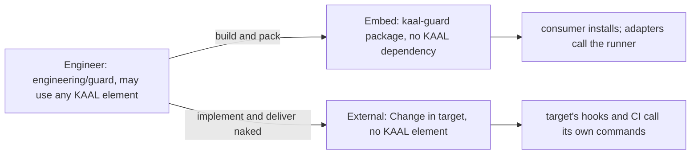

# Guard: Architecture

## Components

| Component | Responsible for | Knows nothing of |
| --- | --- | --- |
| `guard.json`, owned by the repository | which checks exist, their commands, where they run | how a check decides |
| the checks, owned by the repository | test content and acceptance contracts | Git, GitHub, Guard |
| the runner, in the package | running a subset of checks and reading their verdicts | branches, remotes, pull requests, GitHub, KAAL |
| the Git adapter, `.githooks/pre-push` | passing Git facts and running the `local` checks | GitHub |
| the GitHub adapter, a workflow job | passing pull request facts and running one `ci` check | Git hooks |
| the External tooling, in Engineering | producing and delivering a naked Guard Change for a target | the package's internals |

The adapters depend on the runner, the runner reads `guard.json`, and `guard.json` names the checks. Nothing depends on an adapter. The runner reads a Git object only to take a trusted checker from the base commit (G7).

## Package layout

```
bin/kaal-guard.mjs     the command: run, verify, init, upgrade, remove
lib/runner.mjs         the runner: runs checks, reads verdicts
lib/github.mjs         GitHub reporting for `run --github`: annotations and the step summary
lib/lifecycle.mjs      init, upgrade and remove, with managed-file ownership
templates/pre-push     the Git adapter
templates/guard.yml    the GitHub adapter offered to a new consumer
test/                  the package's own multi-loop TDD tests
```

`lib/runner.mjs` imports neither `lib/github.mjs` nor anything under `templates/`.

## Realizations



KAAL is the first consumer. It installs the `kaal-guard` package from its workspace, exactly as any consumer would. KAAL's lineage, Change Isolation and branching checks become entries in KAAL's `guard.json`, with their checkers marked trusted (G7) and `4` declared as held.

## CI migration (KAAL)

Guard integrates into KAAL's existing workflows. It neither replaces nor consolidates them.

- Each existing job keeps its name, OS matrix and triggers: `Hosting (Windows/Linux/macOS)`, `Acceptance (Windows/macOS)`, `Workspaces`, `Acceptance`, `Engineering`, `Change Isolation`, `Promotion Source`, `Branching` and `Branching audit`.
- Only the step that runs the check changes, to `kaal-guard run --check <name>`.
- CodeQL and Dependency Review are GitHub's own checks, not repository-owned, and stay outside Guard.
- A single `guard.yml` is only the starting point `init` offers a new Embed consumer.
