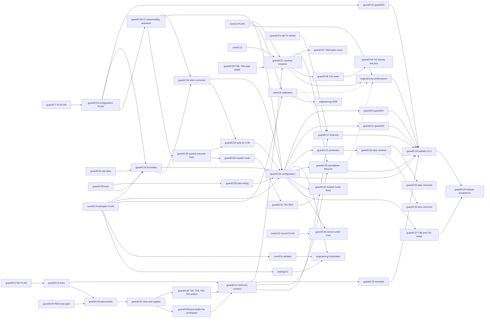

# Guard: Change

In FANATIC, C is Change: KAAL's existing bounded delivery unit, carried by a pull request. This document holds Guard's Changes, their dependencies, scope, verification and stopping conditions. Nothing is implemented before the Owner authorizes it.

Code is not the subject of this document. It remains the implementation *how*: it is written in DO, test first, to turn the planned outer tests from RED to GREEN, and its own inner Code tests, the fourth loop, evolve with it ([Testing](testing.md)). Code has no identifier series and no structural trace to Architecture: the Architecture conformance tests are what hold it to Architecture. Guard is developed in KAAL Engineering.

The Changes lift what already works in KAAL: the exit-status verdicts, the narrow-adapter rule ("supply facts, act on the exit code") and the trusted checker read from the target ref all run today in `.githooks/pre-push` and the workflows.

## Change map, in dependency order

Each Change depends on the Changes above it and lands only after them. A Change carries zero or more Intents: that is its only traceability link. Its Requirements, Architecture and Tests are reached through those Intents and are not linked again. A Change may carry none, as bounded technical or corrective work does.

| Change | Carries | Scope | Verified when |
| --- | --- | --- | --- |
| **guard/C0a** PLAN | guard/I1–guard/I6 | The Guard Capability Node, these six concerns, and both parts of the outer acceptance boundary. No Guard code. | The outer tests are RED as [Testing](testing.md#red-evidence) reports, and the Owner accepts the boundary. |
| **guard/C0b** Boundary | — | The `Guard Acceptance Boundary` job, for pull requests into `kaal/guard`. It travels alone. | It fails a test DO Change that touches the boundary. It lands before any DO Change. |
| **guard/C1** Runner | guard/I1, guard/I2 | The runner and `kaal-guard run`, with `guard.json`, named outcomes and GitHub reporting. | The outer tests that need only `run` are GREEN. |
| **guard/C1b** Check output | guard/I2 | The runner runs each check synchronously with its output inherited: the check's output goes, unchanged and as it runs, to the hook's terminal or the CI log, and Guard neither captures nor interprets it. Guard's evidence is the exit status, with a trusted checker's provenance (guard/F2, guard/F7). No Guard logging framework, no new dependency. It lands before guard/C3c, whose test lanes print thousands of lines. | Guard's inner tests show a check's output passing through on standard error, Guard's standard output holding only its verdict lines, and the verdict taken from the exit status alone; the outer tests GREEN before stay GREEN. |
| **guard/C2** KAAL Git adapter | guard/I4 | KAAL's `.githooks/pre-push` calls Guard with KAAL's `guard.json`. It travels alone. | KAAL's hook gives today's verdicts on today's scenarios, through Guard. |
| **guard/C3a** KAAL installs Guard | guard/I4 | KAAL installs `kaal-guard` from `packages/kaal-guard` as a development dependency, as an Embed consumer would, and `.githooks/pre-push` calls the installed `kaal-guard run --local`. It is not a workspace, so Guard's outer tests stay out of KAAL's Workspaces and Acceptance lanes, which run every workspace's tests and `test/acceptance/` scenarios. | guard/T5 is GREEN; the hook's verdicts are guard/C2's. |
| **guard/C3b** KAAL CI checks | guard/I4 | KAAL's `guard.json` lists its `ci` checks, and each Guard-run job's logic moves, unchanged, into a KAAL-owned check: the test lanes as their npm scripts, Change Isolation, Promotion Source, Branching and the Branching audit as scripts in `engineering/github/`. The branching checkers are `trusted`, taken from the revision KAAL supplies as `base`: the default branch's tip, as today. | guard/T33 is GREEN; each moved check gives the job's verdicts on today's scenarios, run through Guard. |
| **guard/C3b2** Checks run from the default branch | guard/I4 | Change Isolation reads its checker from the target commit through Git, as the other branching checks already read theirs, so every pull-request check can run from a checkout of the default branch. | Change Isolation gives the job's verdicts on today's scenarios when run from a default-branch checkout. |
| **guard/C3c** KAAL CI integration | guard/I4 | KAAL's existing jobs call `kaal-guard run --check`; names, matrices and triggers are unchanged; the `Guard` job is added and runs Guard's own tests. The `pull_request_target` jobs check out the default branch, where GitHub always takes their workflow from. It travels alone. | Every pre-migration check identity still reports, through Guard (guard/T34): the `push` and `pull_request` jobs and the Branching audit on `kaal/guard`; the `pull_request_target` jobs once they are on the default branch. |
| **guard/C4a** Verify | guard/I2, guard/I4 | `kaal-guard verify` in `lib/github.mjs`: per `ci` check, whether a workflow job declares it in Guard's declared form ([Run](../../packages/kaal-guard/docs/requirements.md)), by name or through `- { check: <name> }` matrix lines (guard/F10). Declared integration only; it infers nothing from scripts or other YAML. | Guard's inner tests show a declared, a matrix-declared and an undeclared `ci` check, every form outside the contract declaring nothing, and a pass claiming declared integration only. On KAAL's tree, `verify` names the two jobs whose invocation sits in a script, Change Isolation and the Branching audit; guard/C4c moves each to a step of its own. |
| **guard/C4b** Lifecycle | guard/I5 | `init`, `upgrade` and `remove` in `lib/lifecycle.mjs`, `managed` in `guard.json`, and the adapter templates `templates/pre-push` and `templates/guard.yml` (guard/F8). | The outer tests of `init`, `upgrade`, `remove` and `verify` are GREEN, guard/T24 among them. |
| **guard/C4c** KAAL runs verify | guard/I5 | KAAL's `Guard` job also runs `kaal-guard verify`, and the Change Isolation and Branching audit jobs invoke Guard in a step of its own, in the declared form, with their facts computed in the step before. Names, triggers and matrices are unchanged. It travels alone. | `verify` passes on KAAL's tree, and guard/T35 is GREEN. |
| **guard/C4d** Embed docs | guard/I3, guard/I5 | The consumer docs shipped in the package. | The packed package alone passes its outer tests on Linux, macOS and Windows, ready to publish as `kaal-guard@0.0.1`. |
| **guard/C5** External | guard/I6 | The External tooling and its instructions. | A delivered Change works in a fresh target and contains no KAAL element. |
| **guard/C6** Package identity | guard/I5 | The package is named `@kaihacksai/kaal-guard` (guard/N6); the command, the Capability and the repository keep their names. It lands as two Changes: the outer tests expecting the scoped name, which touch only the boundary and travel alone, then the package manifest, KAAL's development dependency and lockfile, the consumer docs and the hook line `init` prints. It is not part of guard/C5: an External delivery leaves no package dependency at all. | guard/T30 names the scoped package, and the packed package alone passes its outer tests on Linux, macOS and Windows. |
| **R1** Release | — | Publication of `@kaihacksai/kaal-guard@0.0.1`, a bounded Change of its own: the packed contents inspected, a clean install and its tests verified, and a publishing workflow with the npm bootstrap and Trusted Publishing steps proposed to the Owner. Its workflow travels alone. No release framework, and no change to Guard's runtime. | The Owner accepts the proposal. Nothing is published and no npm credential is created without the Owner's explicit authorization. |

### Consumer upgrade

KAAL is the consumer of its published package, in a disposable clone (guard/A12). KAAL's own development dependency, hook, workflows and `guard.json` do not change (guard/N8).

| Change | Carries | Scope | Verified when |
| --- | --- | --- | --- |
| **K1** PLAN | guard/I5 | guard/I5 extended to the consumer upgrade and adoption, guard/F11–guard/F18, guard/N8–guard/N9, KAAL's adoption assessment in guard/A11, guard/A12, and the planned tests guard/T36–guard/T44 with their intended evidence. No code and no test file. | The Owner accepts the plan. |
| **K2** Harness | guard/I5 | The guard/A12 harness and guard/T36–guard/T44, from `0.0.1` to a `packed` candidate. The boundary rule applies: the tests land as a PLAN Change of their own, before the harness. | Each test's evidence is recorded as found. Each suspicion is established as a Defect or refuted by its test. |
| **K3** Fix | guard/I5 | One bounded package Change for each Defect K2 establishes ([Testing](testing.md#defects)) and the Owner selects, turning its Test Case from RED to GREEN. The tests already exist, so each is a DO Change outside the acceptance boundary. The [K3 Change map](#k3-change-map) gives each one's scope, dependencies and order. | The Defect's Test Case is GREEN against a `packed` candidate, guard/T40 stays GREEN, no other outer test turns RED, and the package's outer tests stay GREEN on Linux, macOS and Windows. The Defect is then recorded as corrected. |
| **K4** Consumer job | — | A non-required job running guard/A12 on the three OSes, so a registry outage cannot block a merge. It travels alone. A separate Engineering decision, not part of K1–K3. | Proposed to the Owner; not authorized. |
| **K5** Publish | — | `0.0.2` through the Guard Release workflow, only with the Owner's authorization and only carrying a K3 Change. | The registry tarball equals the workflow's packed artifact. |
| **K6** Release acceptance | guard/I5 | The `0.0.2` gate: guard/T36, guard/T40, guard/T42, guard/T43 and guard/T64 with the `registry` `0.0.2` (restated in `guard/C30`; see [First release and later upgrades](#first-release-and-later-upgrades)). | All GREEN with `registry` evidence. Only then is the `0.0.2` Release accepted. |

### K3 Change map

This PLAN Change is `guard/C7`. In FANATIC a Change's durable identity is `guard/C<number>`; K3 and K3a–K3d remain only as aliases, and the full map of Guard's Changes is planned in `guard/C12`.

Each K3 Change corrects one Defect in `packages/kaal-guard` and lands in `kaal/guard` on its own. `guard/C23` withdrew `guard/C8`. `guard/C10` now depends on `guard/C23`, and `guard/C9` and `guard/C11` on `guard/C25`, because they record lifecycle state.

| Change | Corrects | Scope | Depends on |
| --- | --- | --- | --- |
| ~~**`guard/C8`** (K3a) Consumer bytes~~ Withdrawn by `guard/C23`, since guard/D4 is retracted | guard/D4 (guard/T44) | Guard edits only its own top-level entries in the text of an existing `guard.json`, inserting, replacing or deleting them, and keeps every other byte. It writes nothing when its entries are unchanged. A `guard.json` that Guard creates keeps today's format. `init`, `upgrade` and `remove` all write through this. | nothing |
| **`guard/C9`** (K3b) New assets | guard/D1 (guard/T38) | In `upgrade`, a managed path that is missing and unregistered is installed under `init`'s rule and registered. A file at that path that the installation record does not register is reported as left untouched. Restated by `guard/C23`. | `guard/C25` |
| **`guard/C10`** (K3c) Existing integration | guard/D3 (guard/T43) | `init` and `upgrade` apply guard/F17's rule: they read only Guard's declared integration contract, as `verify` does, and write the workflow for what remains undeclared, or none. They report each recognized declaration as executed by Guard but not managed. The command layer reads the declarations and passes them to the lifecycle, so the lifecycle still imports no adapter (guard/A7, guard/T29). | `guard/C23` |
| **`guard/C11`** (K3d) Writer version | guard/D2 (guard/T39) | `init` and `upgrade` register each asset's version and SHA-256 in the installation record (guard/F29), and `upgrade` reports the versions it moves between. Restated by `guard/C23`. | `guard/C25` |

This PLAN Change also amends guard/F14, guard/F17 and guard/F18, so K3c and K3d need no PLAN Change of their own, and no planned test changes:
- **K3c and guard/F17.** The rule is limited to Guard's declared contract. In KAAL every `ci` check and the consistency check are declared, so `init` installs no workflow there and reports nine declarations as not managed. guard/T43 asserts that unchanged. The rule's limit is that a consumer job running a check in another form, or a job named like Guard's but declaring nothing, is not recognized. Guard does not interpret GitHub workflow semantics, and KAAL's CI orchestration stays KAAL's (guard/A11).
- **K3d and guard/F14.** Writer provenance is per asset, matching the per-asset SHA-256. It is a separate entry because changing `managed` to hold objects would make `0.0.1` treat every asset as modified on rollback, which breaks guard/F16 and guard/T41.
- **K3 and Guard's installation contract (#335).** K3 imports nothing of Core or Hosting. Its guarantees are standalone ones, and they are the ones an installation contract states: K3a fixes Guard's ownership record to `managed`, `config` and `writers`; K3b installs from the lifecycle's one list of assets, which B3 later moves into the contract; K3c recognizes integration by its declared invocation, not by who wrote it; and K3d records a Guard version, not an installer's, so an asset Core writes from Guard's contract records the same writer. Node stays as it is in K3; Node 24 is B5's.
  - **Mixed versions.** A kept, consumer-modified asset keeps its earlier writer while the others move forward.
  - **Older `guard.json`.** An asset with no writer reads as `0.0.1`.
  - **Rollback.** `0.0.1` keeps the unknown `writers` entry but does not update it, and `remove` under `0.0.1` leaves it behind. The next newer `upgrade` re-records each asset. That is the stated limit.
  - guard/T39 holds as written: after `upgrade`, every unmodified asset records the installed version, and the report names `0.0.1` and that version.

The evidence stays bounded:
- Each Test Case runs against a `packed` candidate, directly and on Linux, as in K2b. Consumer evidence on macOS and Windows needs K4 or a run by hand.
- No version is bumped in K3. So `packed` still carries version `0.0.1`, and guard/T37 and guard/T41 still cannot show an asset's content moving between versions. That waits for K5 and K6.

### guard/C23 Configuration contract

The Owner stopped K3a's DO on #336. Two rulings set the frame:
- **6384007398.** Guard owns its configuration contract and its validation, not the consumer's formatting. It may retract a Requirement, a Test Case or a Defect whose contract was wrong, provided it keeps the evidence.
- **6384194537.** Guard's configuration tells Guard what to guard. Location and format are reconsidered through BASS, with the `kaal-guard` Skill in view. Lifecycle state is kept apart unless that is justified. The format follows who maintains it.

`guard/C23` is the PLAN Change that does this:
- guard/I1 states the model.
- guard/F18 keeps only obligations that hold for every option. Its byte-for-byte wording is superseded, and the old text is kept.
- guard/D4 is retracted and guard/T44 with it, and their evidence is kept ([Testing](testing.md#defects)).
- The options are compared in [Architecture](architecture.md#configuration-options-guardc23), against the Owner's criteria, and the configuration is planned there:
  - `.kaal/config/guard/<name>.md`, Git-tracked, with frontmatter under `core/C5` and a guidance body;
  - state in two scopes: a tracked installation record, `.kaal/state/guard/installation.json`, kept apart from the package's catalogue of published content; and the checkout state, in the Git metadata of the configuration scope Guard wrote;
  - an explicit `--config` path, with the fixed convention as the fallback;
  - strict refusal of undefined members, with diagnostics and a stated extensibility rule.
- guard/F1, guard/F18, guard/A1, guard/A6 and every Requirement that named `guard.json` are restated, and guard/F28 and guard/F29 are added.

It plans the configuration, and approving it accepts that plan. Implementation waits for `guard/C24` and `guard/C25`. Migration was settled by the Owner (#336, 6384215003): `0.0.2` breaks `0.0.1` deliberately, with no migration, dual format or rollback to `0.0.1`. The compatibility contracts are reassessed accordingly:
- guard/I5, guard/F15 and guard/F16 are bounded to `0.0.2` and later.
- guard/F14 no longer reads an unrecorded writer as `0.0.1`.
- guard/T37–guard/T39 and guard/T41 are superseded and re-planned between candidates ([Testing](testing.md#defects)).
- `guard/C11`'s constraint that `managed` keep its `0.0.1` shape falls away.

`run.md`, the package README and the Skill text still describe `guard.json`. They change with the code in `guard/C25`.

The K3 map is reconciled:
- `guard/C8` is withdrawn, and #336 closes unmerged as its record.
- `guard/C9` and `guard/C11` record lifecycle state, so they are rebuilt on `guard/C25`'s state file. `guard/C11`'s rule that `managed` keep its `0.0.1` shape falls away, because the state leaves the declarations.
- `guard/C10` changes no state, so it is unaffected.

| Change | Scope | Depends on |
| --- | --- | --- |
| **`guard/C23`** PLAN | The planned configuration: guard/I1, guard/F1, guard/F18, guard/A1 and guard/A6 restated; guard/F28 and guard/F29 added; guard/T61–guard/T73 planned; guard/D4 and guard/T44 retracted; and this map. No code and no test file | — |
| **`guard/C29`** Guard lane | `engineering/lanes/guard.mjs` and its tests: the required Guard jobs' outer suite is chosen from the form KAAL declares its own checks in, and the lane fails closed, never falling back, when it cannot choose; `test:guard` and `test:guard:plan` | — |
| **`guard/C28`** Lane wiring | The Guard, Guard (macOS) and Guard (Windows) jobs run the lane and its tests. `.github` only | `guard/C29` |
| **`guard/C24`** PLAN of the boundary | The new suite written as whole files in each boundary directory's `plan/`, beside the established suite, which is unchanged and stays the required gate: guard/T61–guard/T73 written, guard/T37–guard/T39, guard/T41 and guard/T44 retired there, and their RED evidence recorded with `test:guard:plan`. It travels alone | `guard/C23`, `guard/C22`, `core/C5`, `guard/C29` |
| **`guard/C25`** Configuration | `.kaal/config/guard/` in the package: the frontmatter parser and schema, the content catalogue in `contract.json`, the installation record, the scoped checkout state, `--config` and discovery, refusal with diagnostics, the two-candidate harness, and the consumer docs and Skill text. It is kept to what `guard/C24`'s tests need. KAAL's `guard.json` becomes `.kaal/config/guard/` in the same Change, which switches the required lane to the planned suite: `guard/C25` merges only with it GREEN | `guard/C24`, `guard/C28`, `core/C5`, `guard/C35`, `guard/C36` |
| **`guard/C31`** Promotion | The planned suite replaces the established files at the top of each boundary directory; `plan/` stays until `guard/C32`. It travels alone | `guard/C25` |
| **`guard/C32`** Lane unwired | The Guard jobs run the top-level suite directly again. `.github` only | `guard/C31` |
| **`guard/C33`** Plan removed | Each boundary directory's `plan/` deleted. It travels alone | `guard/C32` |
| **`guard/C34`** Lane removed | `engineering/lanes/guard.mjs`, its tests and its scripts deleted | `guard/C32` |

### CI responsibility (`guard/C35`)

The Owner reviewed `guard/C25` on #352 (6386490520): Guard provides the machinery for the consumer to register checks and integrate them into its own hooks and CI, and the consumer owns its Test Cases, commands, workflows and the assignment of execution. Guard may validate registrations, execute explicitly assigned checks and report recognized integration, but never infers missing CI responsibility and takes it over. `runs: [ci]` states scope; it triggers nothing.

The PLAN conflicted with that in two places, and `guard/C25`'s DO had followed it:
- guard/F17 had the workflow Guard installs carry a job for each `ci` check no other workflow declares, installed by a bare `init`. `guard/C25` realized it as `kaal-guard list --undeclared` feeding a dynamic matrix that `verify` read as coverage.
- guard/F13 had `upgrade` install any asset the repository lacks, the workflow included.

`guard/C35` restates guard/F8, guard/F10, guard/F13 and guard/F17 and the declared forms in [Run](../../packages/kaal-guard/docs/requirements.md): Guard's workflow is one fixed, catalogued content the consumer opts into with `init --ci`, never installed beside a workflow that already declares a check, and never by `upgrade`; without the opt-in, missing coverage is reported with the step to add. `guard/C36` corrects the planned tests ([Testing](testing.md#planned-outer-tests)). `guard/C25` then drops `list --undeclared` and the dynamic matrix, and keeps its GREEN configuration work.

**Initialization, registration and activation (Owner, #355, 6386981735).** Initialization prepares Guard, registration declares what it may execute, and activation decides where it executes; the consumer owns every activation. `guard/C35` adds guard/F30: `init` prepares the configuration and the installation record and activates nothing; `init --hook` and `init --ci` activate one surface each, and neither implies the other; `run --hook`, `run --ci` and `run --check <name>` execute; `remove --hook` and `remove --ci` undo one activation each, and `remove` both and the record, never touching a declaration or a Test Case. The registration word is `hook`, not `local`, because it names the surface that executes, while `run --check` and `run --ci` run on a developer's machine too; `local` is refused, naming `hook`. `upgrade` installs a new asset only for an activated surface. guard/F1, guard/F4, guard/F8, guard/F13, guard/F17 and guard/F29 follow, `guard/C36` carries the planned tests (guard/T76–guard/T78), and `guard/C25` realizes it.

**Trusted checker mode (Codex on #366, r4368693892).** `materialize` writes each trusted file's bytes but not its mode, so an executable checker named directly as the command cannot start. `guard/C40` restates guard/F7 to keep the mode the base records and plans guard/T81, with guard/D5 suspected. `guard/C41` writes guard/T81 and records it RED, which establishes guard/D5; `guard/C42` fixes `materialize`. guard/F7 is shipped in `0.0.1`, so this is a defect in published behaviour, not planned RED.

**The installation record under Core (the Owner on #373, review 5641784016).** `core/C10` asked who owns the record when Core installs a Capability, and the Owner chose Option A. The Capability's own record decides which of its canonical assets are its own, even when Core installed them. Core's record holds only Core's provider deployments. `core/F33` adopts Guard's record shape (`activated`, and `assets` mapping each path to `{ sha256, version }`), and Core adds no member to it. `guard/C43` restates guard/F29's last bullet to say so. It also aligns guard/F23, which still named `0.0.1`'s `managed` and `writers`. The Owner's two conditions are part of the restated bullet: Core never claims a file because its bytes match a catalogued content, and it keeps the record's Guard members unchanged. Guard's reader already refuses a member it does not define, so it needs no code change. The round trip between Core and the packed Guard is Engineering's scenario, after `core/C13`.

**One frontmatter parsing contract (Owner, #360, 6389758902).** `core/C11` recognizes a typed artifact with Graph's Form reader, which refuses a non-string key. KAAL's declarations with `outcomes: {4: held}` have an integer key, so KAAL's own Engine rejected them. The Owner chose one common contract over a second, lenient reader. `guard/C38` restates guard/F1: outcome statuses are double-quoted, `{"4": held}`, and an unquoted status key is refused, naming the quoted form; meaning and verdicts are unchanged. It plans guard/T79 and guard/T80. `guard/C39` writes them in the boundary, and `guard/C25` realizes the refusal and quotes KAAL's three declarations.

**Published-`0.0.1` consumer evidence (Owner, #352, 6386915109).** guard/T36 and guard/T42 install the published `0.0.1` in a KAAL clone. `guard/C25` converts KAAL to `.kaal/config/guard/`, which `0.0.1`'s root `guard.json` assumption cannot read, so they fail there. That is a version-specific fixture mismatch, not evidence against their obligations. Their failures are kept as explicit transitional evidence and are never counted GREEN, and `guard/C25` does not change them. `guard/C37`, a separate PLAN Change of the acceptance boundary, revises their consumer setup for the `0.0.2` configuration without weakening an assertion. `guard/C20` then proves both against the published `0.0.2` from the registry.

The lane is a bounded transition with planned removal (`guard/C32`–`guard/C34`), agreed on #344 (6385044079, 6385265377). It is not the KAAL-wide model for controlled RED on `kaal/*`, which belongs to another workstream.

`guard/C23` is not an interim correction. It is the configuration architecture for `0.0.2`, and nothing about location, format, ownership or discovery is left for a later PLAN Change.

### Agent guidance

guard/I7 is a separately scoped `0.0.2` improvement. It is planned here and nothing in it is authorized beyond its PLAN Change, `guard/C12`.

**One contract, two levels of realization** (guard/N12). Core owns CASE installation and registration, and may embed Guard. Core owns the Installation Contract Definition, its schema and its outer conformance Test Cases. Guard supplies its installer-neutral instance (guard/F27), and two installers realize it:

| Level | Who | Guarantees | Dependency |
| --- | --- | --- | --- |
| Contract | Core owns the schema and conformance Test Cases; Guard owns its instance | What an installation of Guard is: its assets, the Skill, ownership and lifecycle rules, the Node prerequisite and the provider requirement | none at run time; conformance is verified by KAAL Engineering |
| Standalone conformance | Guard's lifecycle | Local correctness within the contract: the hook, the workflow and the Skill at `.agents/skills/kaal-guard/`, with the reminder naming it | none; Embed keeps zero KAAL dependencies |
| Core enrichment | Core, through Hosting where Core chooses | CASE registration, provider-aware deployments and pointers, dependency and conflict handling, cross-Capability verification | Core reads Guard's contract; Guard never imports Core |

The two levels are not feature-equivalent. Standalone, Claude Code reaches the Skill through the reminder or a consumer's pointer (O1). Native discovery for Claude Code needs Core enrichment.

**Modes.**
- Engineering: KAAL realizes its own Skills, Guard's among them, through Core (#258), and runs Core's conformance Test Cases against Guard's instance.
- External: Engineering's tooling writes the canonical deployment, and may use Core at delivery for further ones. The target owns plain files.
- Embedding: none toward KAAL. The earlier `Guard → kaal-core` dependency is withdrawn, because no Guard behaviour needs it.

**Node.** `0.0.2` raises Guard's floor from 20 to 24, consistent with Core, Graph and Hosting. This is a breaking consumer prerequisite: guard/N1 documents it, and guard/T59 tests that an older Node is refused with that next step.

The Changes for this, with K3's and the release's, are mapped in [Change identities](#change-identities). KAAL stays a Guard executor (guard/A11): it receives Guard's Skill through Core's realization, not through Guard's lifecycle.

guard/C3 lands as four Changes, guard/C3a, guard/C3b, guard/C3b2 and guard/C3c, because `.github` travels alone (Change Isolation): guard/C3c's jobs need the command guard/C3a installs and the checks guard/C3b lists, and its `pull_request_target` jobs run from the default branch (GitHub's rule since December 2025), so their checks must run from a default-branch checkout (guard/C3b2) and can only be observed once promoted. The Owner accepted the first split on #293. guard/T35 needs `kaal-guard verify`, so the `Guard` job gains `verify` in guard/C4c, which travels alone, and guard/T35 turns GREEN there. guard/C4 lands as four Changes for the same reasons: `verify` (guard/C4a) comes before the job that runs it (guard/C4c), the lifecycle (guard/C4b) is the largest piece and is reviewed on its own, and the docs (guard/C4d) describe what guard/C4a and guard/C4b ship.

### 0.0.2 release boundary

The Owner set this boundary in Slack (#kaal, 2026-10-24); this section is its durable record. `0.0.2` ships first, and it is the machinery `guard/C23` planned: consumers declare checks in `.kaal/config/guard/<name>.md`, Guard validates and executes them deterministically through the local hook and GitHub CI, Embed and External deliver the canonical kaal-guard Skill, and a failure or a cannot-judge result directs the agent to actionable guidance. The release is complete only when its isolated Changes, their TDD evidence over several loops, the verification on three OSes and the `registry` acceptance (`guard/C20`) are all done.

**Accepted limitation.** In `0.0.2`, Guard does not establish that a registered consumer Test Case is unchanged since its accepted PLAN baseline. A changed test can still return GREEN, and that is not a Guard integrity guarantee. `guard/C19`'s release notes and the consumer guidance (run.md, the package README and the Skill) state this plainly.

**`0.0.3` hardening candidate.** `guard/C26` (Issue #340) coordinates Test Case integrity and registration with Testing (evidence semantics), Sealing (cryptographic integrity), Change (the accepted PLAN baseline) and Change Isolation (authorization). Guard invokes and reports; it neither duplicates their ownership nor re-baselines silently. It is outside the `0.0.2` critical path, and nothing in `guard/C19` or `guard/C20` depends on it.

### 0.0.3

A review of the published `0.0.2` on 2026-10-26 found five gaps; `guard/C76` plans their correction. The Owner chose that Guard detects and refuses a candidate that changes a trusted check's declaration (guard/D16, `guard/C79`), and that the README states the boundary that remains. guard/D17, the package's `npm test` running the retired suite, is corrected by `guard/C86` (see below). The lane's planned removal (`guard/C32`–`guard/C34`) follows. The three documentation gaps go to `guard/C80`. `guard/C26` (Issue #340) remains the `0.0.3` hardening candidate and is decided on its own.

**The correction of guard/D17 moves out of the boundary (`guard/C84`).** A boundary Change travels alone, so it cannot also remove guard/T98 from `red.json`, and the lane fails a registered Test Case that passes. `guard/C31` would turn guard/T98 GREEN the moment the planned suite sits at the top level, which the package's `test` script already runs. So guard/D17 is corrected by `guard/C86` instead, outside the boundary: the package's `test` script runs the planned suite in `plan/`, and `red.json` drops guard/T98 in the same Change. It follows `guard/C79`, since guard/T98 runs the whole suite. `guard/C31` then promotes the planned suite and touches only the boundary, `guard/C87` points the `test` script at the top level, and `guard/C33` deletes `plan/` after both.

**Scope of the `0.0.3` path (the Owner on #454, review 5653361664).** `guard/C31`–`guard/C34`, the planned suite's promotion and the transitional lane's removal, are on the `0.0.3` path. `guard/C26` (Issue #340) is a separately authorized hardening candidate: `guard/C79` takes none of its responsibilities, and neither `guard/C81` nor `guard/C83` depends on it. `guard/C18` stays proposed and unauthorized and gates nothing. Guard owns its behaviour and its Test Cases; Testing owns what `packed` and `registry` evidence mean, Sealing owns cryptographic integrity and Change Isolation owns authorization, and Guard implements none of them.

**Publication and release acceptance of `0.0.3`.** guard/T65–guard/T68 need two published versions of the same configuration line, so they could not gate `0.0.2` ([below](#first-release-and-later-upgrades)). `0.0.3` is the first version with a published predecessor in the line, so it is the first that can establish their `registry` evidence. Three kinds of evidence are kept apart, and publication never depends on evidence that only publication can produce:

| | Evidence | When | What it decides |
| --- | --- | --- | --- |
| (a) | `packed`, simulated (guard/N9): guard/T65–guard/T68 between two `packed` candidates, as since `guard/C25`; and between the published `0.0.2` from the registry as the older and the packed `0.0.3` candidate as the newer (`guard/C82`), after `guard/C81`'s version bump | before publication | whether Guard Release may be dispatched for `0.0.3` (`guard/C81`) |
| (b) | `registry`: guard/T65–guard/T68 between the published `0.0.2` and the published `0.0.3`, both installed from the registry (`guard/C82`) | after publication | nothing on its own; it is the evidence (c) reads |
| (c) | Release acceptance (`guard/C83`): guard/T65–guard/T68 GREEN with (b) | after publication | only then is `0.0.3` accepted |

The Test Cases and their assertions stay as they are. They show movement only when the newer version's managed workflow differs from the older one's, the newer manages a hook-surface asset the older lacks (guard/T66), and the newer's catalogue holds the older's content. A pair that does not meet this is blocked before its behavioural assertion: never GREEN, so it cannot accept `0.0.3`. The mixed pair in (a) shows before publication whether `0.0.3` meets it. If it does not, Guard Release is not dispatched for `0.0.3` until the Owner decides, and no asset is added only to make these tests observable.

**The managed workflow's own comment (`guard/C88`, the Owner on #476, review 5655507263).** `templates/guard.yml` says it runs everything "in one job", but it has two, `Guard` and `Guard checks`: a consumer-facing documentation defect in a managed asset. `guard/C88` corrects the comment in its own Change before `guard/C81`, and the catalogue holds both the `0.0.2` and the `0.0.3` content of `.github/workflows/guard.yml`, so `upgrade` recognises an unmodified `0.0.2` workflow and moves it. The correction is made for its own sake. Its side effect is that `0.0.3`'s managed workflow differs from `0.0.2`'s, which the pair needs for guard/T65, guard/T67 and guard/T68. guard/T66 still needs a hook-surface asset `0.0.3` lacks, and is not claimed as covered.

**Evidence (a) for `0.0.3` (`guard/C81`).** This was run on kaal/guard at 5460181 with the version bumped to `0.0.3`, on 2026-10-26 on Linux, with Node 24.22.1, npm 11.19.1 and Git 2.43.0. All of it is `packed` evidence, and none of it is `registry` evidence.

| Pair | Command | guard/T36, T40, T42, T43, T64 | guard/T65 | guard/T66 | guard/T67 | guard/T68 |
| --- | --- | --- | --- | --- | --- | --- |
| two `packed` candidates (simulated) | `node --test --test-concurrency=1 engineering/guard/acceptance/consumer/*.test.mjs` | GREEN | GREEN | GREEN | GREEN | GREEN |
| mixed: `registry` `0.0.2` → `packed` `0.0.3` | `GUARD_CANDIDATES=registry:0.0.2,packed node --test --test-concurrency=1 engineering/guard/acceptance/consumer/*.test.mjs` | GREEN | GREEN | blocked before behavioural assertion: the newer candidate adds no asset to the hook surface | GREEN | GREEN |

The mixed pair shows that `0.0.3` meets the precondition for guard/T65, guard/T67 and guard/T68, through `guard/C88`'s workflow difference, and does not meet it for guard/T66. So guard/T66 cannot be GREEN in `guard/C83`, and under [the rule above](#003) Guard Release is not dispatched for `0.0.3` until the Owner decides.

**The Owner's decision for `0.0.3` (#483, review 5656060084).** Guard `0.0.3` proceeds to promotion and Guard Release. For the `0.0.2`→`0.0.3` pair, guard/T66 is recorded as not exercised: it is neither GREEN nor a behavioural failure. Its behaviour stays exercised between simulated candidates, which is `packed` evidence. `guard/C83` accepts `0.0.3` on guard/T65, guard/T67 and guard/T68 with `registry` evidence, and records guard/T66 as not exercised for this pair. No asset is added to make it observable. guard/T66 is revisited when a genuine release adds a hook-surface asset.

**The pre-release review of `0.0.3` (`guard/C91`, the Owner's choice on 2026-10-26).** A review of main at 311e3d4, as an adopter, held the Release on one blocker and found three should-fix gaps. The Owner chose to correct all four before Guard Release, each in its own Change into kaal/guard, with the version still `0.0.3` and no template changed, so the catalogue's hashes stay as they are.

- guard/D18 (`guard/C92`). With `run --ci` or `run --hook`, the runner adds a check the base trusts back to the run only when the candidate deleted its declaration. A candidate that keeps the declaration but changes `runs` to drop the surface being run takes the check out of the run: it is never compared with the base, and the run passes. guard/T94–guard/T96 change `trusted`, `command` and `outcomes` and delete the declaration, but none changes `runs`. guard/T100 proves it, both for `ci` and for `hook`.
- **`guard/C93`.** Plain `init` still says Guard's workflow "runs every ci check in one job"; it has two, `Guard` and `Guard checks`, as `guard/C88` corrected in the workflow's comment.
- **`guard/C94`.** `verify` reads a step as Guard's declared form when the `run:` line only begins with the invocation, so `npx --no kaal-guard run --check unit --github || true` declares `unit` while the step can never fail. The invocation's end is anchored, as the `verify` form already is.
- **`guard/C95`.** Plain `init` says nothing about a registered surface file the repository no longer has, such as `.githooks/pre-push` while `core.hooksPath` still points at it, though the README says it is reinstalled and reported. Plain `init` lists it under still to do, naming the `init` that reinstalls it, and the README says the reinstall needs the surface's flag.

The lane and its `red.json` are gone (#501), so a Test Case written RED in the boundary would land as a red check, and none is marked `todo` or `skip`. guard/T100 is therefore an inner Code test, written in `guard/C92` beside the correction, and its RED run on the uncorrected runner is recorded in that Change's pull request. The same holds for the Code tests of `guard/C93`–`guard/C95`. Whether guard/T100 moves into the boundary later is the Owner's call.

**Publication and release acceptance of `0.0.3` (`guard/C83`).** Guard Release published `@kaihacksai/kaal-guard@0.0.3` on 2026-10-26 (run 40395111724, from main at bf57539, #509, the `npm` environment approved by the Owner), with provenance. Evidence (b) and (c) are recorded in [Testing](testing.md#release-acceptance-of-003-guardc83): between the published `0.0.2` and the published `0.0.3`, both installed from the registry, guard/T65, guard/T67 and guard/T68 are GREEN, and guard/T66 is not exercised for that pair, as the Owner decided on #483. `0.0.3` is accepted.

### Consumer verification (`0.0.4`)

The Owner directed on 2026-10-27 that Guard `0.0.4` becomes verifiable by any npm consumer, and that KAAL Testing states the reusable semantics (guard/I8). The proposal was aligned with Core, which owns kaal-testing, in #kaal (canvas F0CCGQ35B29). This PLAN carries it into Guard's documents.

**Option A, the Owner's decision.**
- **What ships.** The package ships its outer acceptance cases and a small entry, run through npm's own `npm explore <package> -- npm test`.
- **Why not B or C.** A `kaal-guard test` command (B) adds a surface for no gain the consumer needs. A harness delivered by KAAL Testing (C) would make Guard depend on another KAAL element (guard/N6), and kaal-testing is not published.
- **Reuse.** The 71 outer acceptance cases are reused unchanged.
- **Why the entry.** It is what a bare `npm test` cannot be: fail-closed, three-valued and self-checking (guard/F33–guard/F35).

**The Owner's decisions (#kaal, 2026-10-27).** The three options of the joint proposal are settled:
1. **Invocation: option A.** The consumer runs npm's own `npm explore @kaihacksai/kaal-guard -- npm test`. A package-owned command alias may be evaluated later and is not part of this decision.
2. **Scope: acceptance cases only.** Guard ships its product-owned consumer acceptance cases, not its engineering or unit tests.
3. **`cannot verify` exits 2.** The three results stay distinct: `verified` (0), `failed` (1) and `cannot verify` (2). A run in which no case executed is never `verified`.

The decisions authorize no implementation, version bump, release or publication. Guard's cases stay separate from Testing's reusable semantics, and the acceptance scenario stays an unrelated consumer, the installed distribution and a non-destructive run. This PLAN is the bounded authorization request: its approval authorizes `guard/C98` only, and the bump, the release and publication each still need their own.

**Order.**
1. testing/C9 PLAN, Core's Definition-only Change, lands first, because guard/N13 cites its identifiers.
2. `guard/C97`, this PLAN. Documents only.
3. `guard/C98` writes guard/T101–guard/T106 with their RED evidence, then the entry, the manifest, the `files` change and the README section.
4. `guard/C99` sets the version to `0.0.4`, with its release notes.
5. The promotion follows.
6. Guard Release publishes `0.0.4` (`guard/C100`), with the Owner's approval of the `npm` environment.
7. `guard/C101` records release acceptance.

**What release acceptance of `0.0.4` (`guard/C101`) requires:**
- guard/T101–guard/T106 GREEN against the `packed` candidate on Linux, macOS and Windows;
- after publication, guard/T101–guard/T103 and guard/T105 GREEN against `@kaihacksai/kaal-guard@0.0.4` installed from the registry, on Linux, with the registry's integrity recorded beside the lockfile's;
- the transition cases that apply GREEN for each supported source, `registry` `0.0.2` → `0.0.4` and `0.0.3` → `0.0.4`, guard/T118 included. `guard/C112` restated this requirement, which first named guard/T65, guard/T67 and guard/T68 between `0.0.3` and `0.0.4` alone. A case that is not applicable for a pair is reported so, and is not counted as passed.

**Limitations the README states:**
- The verification shows that the delivered cases pass on the consumer's machine, within their coverage. It does not show this repository's integration, its own checks, or complete correctness.
- The manifest detects a changed installed copy, but it is not npm provenance.
- Registry evidence is from Linux alone.

### The complete product (`0.0.4`)

On #536 (2026-10-27) the Owner set two principles. First, each package carries its complete, canonical consumer-facing specification and its Test Cases, owned by responsibility, not loop depth. Second, Engineering and Product are separated cleanly, with one authority for a shared concern. The Owner approved `guard/C98` as bounded and left the rest to this PLAN and its DO review. `guard/C102` applies the principles: guard/I9, guard/F37–guard/F40, guard/N14, guard/A19, guard/A20 and the planned guard/T107–guard/T112.

**Where each asset goes.** The layout proposed on #536 is the basis:
- **Product, delivered** (`packages/kaal-guard/`):
  - the product Intent, Requirements, Architecture, Testing and Limitations in `docs/`;
  - Operations in the README and the Skill;
  - `bin/`, `lib/`, `templates/` and `contract.json`;
  - the outer cases in `test/acceptance/`;
  - the inner Code tests in `test/unit/`;
  - the verification entry and its manifest.
- **Engineering, not delivered** (`engineering/guard/`): as guard/A20 lists.
- **Split documents.** `intent.md`, `requirements.md`, `architecture.md` and `testing.md` each split by identifier. Engineering keeps only its own identifiers and cites the product's.
- **The Defect register.** Its consumer statement goes to `docs/limitations.md`. Its RED traces stay Engineering evidence.

**Order.** It replaces steps 4 to 7 of [Consumer verification](#consumer-verification-004):
1. `guard/C102`, this PLAN. Documents only.
2. `guard/C103` moves the product contract into the package and adds the authority check:
   - guard/F37, guard/N14, guard/A19's documents and guard/A20;
   - guard/T107 and guard/T111, written RED first.

   External's derived templates and guard/T112 moved to `guard/C105`, as [Testing](testing.md#the-complete-product-004) records. `guard/C103` enforces guard/N14's Definitions. It does not meet Derived assets.

   Every identifier keeps its text and its number, and no accepted test is weakened.
3. `guard/C104` ships the inner loop and makes the verdict judge loops, coverage and applicability:
   - guard/F38–guard/F40;
   - guard/T108–guard/T110, written RED first;
   - `test/unit/`, the manifest's new members and the entry;
   - the coverage choice for each identifier no case cites today.

   It depends on `guard/C103`, because coverage needs the product identifiers in the package.
4. `guard/C99` sets the version to `0.0.4`, with its release notes.
5. The promotion follows, with its sync immediately before it.
6. `guard/C100` publishes, with the Owner's approval of the `npm` environment.
7. `guard/C101` records release acceptance. To what [Consumer verification](#consumer-verification-004) requires, it adds guard/T107–guard/T111 GREEN against the `packed` candidate on Linux, macOS and Windows. guard/T112 is not part of it: it comes with `guard/C105`.

All of it collects in `kaal/guard-verify` as one Guard `0.0.4` increment. This PLAN authorizes `guard/C103` and `guard/C104` only. The bump, the promotion, the release and publication each still need their own approval.

**`guard/C105`: External's derived templates, after `0.0.4`.** guard/N14 requires External's templates to be derived from the package's assets. `guard/C105` meets that requirement and does not weaken it.
- **Scope.** There are three pairs, each a template in `engineering/guard/external/templates/` and the product asset it derives from:
  - the hook, `pre-push`, with its `guard.sh`, from the package's `templates/pre-push`;
  - the workflow, `guard.yml`, from the package's `templates/guard.yml`;
  - the Skill, `skills/kaal-guard/SKILL.md`, from the package's `skills/kaal-guard/SKILL.md`.

  For each pair, the External tooling declares one transformation that produces the template from the product asset. The transformation carries what External does differently, the `guard.sh` runner and one CI job per check, as declared, reviewable steps rather than a copy kept by hand. `GUARD.md` has no product counterpart, so it is External's own asset and outside guard/N14's Derived assets.
- **The Test Case, written RED first.** guard/T112: for each pair, applying the declared transformation to the current product asset gives the template byte for byte. guard/T112 fails, naming the template, when a template has no declared transformation or differs from what the transformation gives. Its RED run is recorded in `guard/C105`'s pull request before the transformation lands. It runs in the `Engineering` job.
- **Accepted when** all of these hold:
  - guard/T112 is GREEN;
  - External's delivery cases, guard/T3, guard/T56, guard/T83 and guard/T93, stay GREEN with unchanged assertions;
  - guard/N14 records Derived assets as enforced.

  If a template cannot be produced from its product asset by a declared transformation, `guard/C105` does not narrow guard/N14 or its test. Instead it returns to the Owner as a PLAN that proposes how to amend guard/N14.
- **Approval.** `guard/C105` is not part of the `0.0.4` increment and is not authorized by this PLAN. It is raised as its own Change, under its own approval.

### Consumer-experience corrections (`0.0.4`, `guard/C107`)

On #544 (2026-10-28), the Owner's pre-release review of the packed `0.0.4` candidate from `afa9ca3` found no functional blocker. It did find three consumer-experience defects that must be corrected before publication, plus four documentation corrections. `guard/C107` is the PLAN for them, and `guard/C108` carries them out. Both collect in `kaal/guard-verify` into the same `0.0.4` increment, so `0.0.4` stays unpublished and gets no new version. The approved Changes `guard/C98`, `guard/C103`, `guard/C104` and `guard/C99` are not reopened. `guard/C108` is its own Change.

**What `guard/C108` changes.** Each correction comes with its Test Case, written RED first. Its RED run against `afa9ca3` is recorded in `guard/C108`'s pull request before the fix lands.

- **S1, temporary directories.** One verification run leaves about 150 directories (147 MB) in the operating system's temporary directory.
  - Every test-owned `mkdtemp` root is removed by the hook of the test or file that made it (`t.after` or `after`), so it is removed on failure too. That covers the delivered cases (`test/unit/`, `test/acceptance/`, `harness.mjs`) and Engineering's acceptance files (`package.test.mjs`, `delivery.mjs`).
  - guard/T113 runs the documented command twice against the packed candidate, with the child's temporary directory set to a fresh, empty directory: once passing and once with a planted failing case. After each run the directory is empty again.
  - Engineering's own acceptance files are not delivered, so no Test Case covers them. Their cleanup is shown in the pull request: one run of the `Guard` command under an empty temporary directory, listed before and after.
- **S2, sockets and FIFOs.** `snapshot()` reads every entry that is not a directory or link as a file. A Unix socket, such as Git's fsmonitor daemon's `.git/fsmonitor--daemon.ipc`, gives `cannot verify` with the wrong advice to reinstall. A FIFO hangs the run.
  - `snapshot()` hashes regular files only. Every other entry is recorded by its kind (`socket`, `fifo`, `char`, `block`, `other`) and never opened, so a change of kind still counts as a change.
  - The "verification itself could not complete" cause names the error and asks for this output to be reported. It no longer advises reinstalling. guard/F33 lists this cause.
  - guard/F35 states how such entries are compared.
  - guard/T114 runs on a consumer that holds a Unix socket and a FIFO. The run completes within its time limit, gives `verified`, exit 0, and does not name either entry. Replacing the FIFO with a regular file between snapshots gives `failed`, naming it.
  - Windows' file system has neither kind. So guard/T114 is registered on Linux and macOS only, and its evidence is recorded for those two hosts.
- **S3, a change during the run.** The verdict stays `failed`, exit 1, naming the changed paths. Its semantics are not changed here.
  - The next step changes from "restore those paths from version control" to: check whether you, an editor or a tool such as Git changed these paths during the run; if nothing did, report this output to the package's maintainers.
  - The README and guard/F35 say the project should stay idle during the run.
  - guard/T115 plants a delivered case that appends to a consumer file. The result is `failed`, exit 1, naming that path and the new next step, and no output line advises restoring anything.
- **S4, Git's background maintenance** (found by this PLAN's own CI, #545). Git 2.56 on the macOS runner runs automatic maintenance in the background after the fixture's commits. It creates and removes `.git/objects/maintenance.lock` while the files are being read, so guard/T101, guard/T102 and guard/T105 fail with `ENOENT` in Engineering's own snapshot. The product's `snapshot()` has the same race: a file that is listed and then gone before it is read ends the run as "could not complete", and a consumer whose Git maintains itself during a run gets `failed`.
  - `snapshot()` (the product's and Engineering's) records an entry that disappears between listing and reading as absent at that moment, and does not fail. A path that differs between the two snapshots is still named, under S3's next step, which already names Git.
  - The consumer fixture sets `maintenance.auto false` and `gc.auto 0`, so the cases do not race with Git. That is `guard/C110` (#546). It goes ahead of this PLAN because macOS CI is red without it.
  - guard/T117 calls the exported `snapshot()` with the file-system reads it uses passed in. A file is listed and then removed before it is read. The case checks that `snapshot()` completes and records the file as absent. Against `afa9ca3` it is RED, because `snapshot()` throws `ENOENT`.
- **N1–N4, documentation.**
  - N1: a run takes a few minutes, and on Windows up to about 11 (guard/T101 took 668 s in CI).
  - N2: under `npm explore`, npm may print its own lines after the summary line, so the summary is the last line the verifier prints, not the last line of output.
  - N3: the lockfile integrity is read from npm's hidden `node_modules/.package-lock.json`, not from the project's lockfile.
  - N4: the release notes say plainly that `upgrade` rewrites the version fields of the installation record even when no managed asset's bytes change.
- **The release notes for `0.0.4`** gain the S1–S3 corrections.

**The Product and Engineering Test Plans (the Owner, #545).** The package ships one consumer-facing Product Verification Test Plan: its `docs/testing.md`, its loops (Intent, Requirements, Architecture and Code), its delivered cases and the manifest `test/verify.json` derived from them. The publisher's Engineering and Release Acceptance Test Plan is `engineering/guard/testing.md` and its cases under `engineering/guard/`. It reuses the product's Test Cases by identifier, adds publisher-only cases, and is never shipped. `guard/C107` and `guard/C108` keep that line:
- guard/T113–guard/T117 are Engineering cases, in `engineering/guard/acceptance/package.test.mjs`, and do not ship.
- What `guard/C108` changes in the tarball is product behaviour (`test/verify.mjs`, the delivered cases' cleanup) and product documentation. The tarball gains no publisher plan, machinery or evidence.
- guard/T107 checks that no shipped document cites an Engineering path or a Change as its authority, and guard/T102 that the manifest names exactly what is installed. No case yet checks that the tarball holds no publisher material: the review checked it by hand. So `guard/C108` adds guard/T116: the packed candidate holds only the package's declared `files`, and no path from `engineering/`, no Engineering Test Plan and no release evidence.

`guard/C108` also corrects the product's wording of the 17 items it calls exemptions. They are not exemptions from Testing. They are obligations allocated to the publisher's Engineering Test Plan, and a consumer run does not verify them:
- In `docs/testing.md`, the section becomes "Allocated to the publisher's Engineering Test Plan", and its column "Verified instead" becomes "Allocated to". Each row says what the publisher runs, without claiming that it passed.
- The output line becomes `not verified by this run, allocated to the publisher: <id>: <where>`. The summary line's `exempted` becomes `allocated`, and the manifest's `exemptions` becomes `allocated`. The README, guard/F38, guard/A19 and guard/A20 follow.
- guard/F20 (Guidance) has no Test Case in either plan. It is the publisher's review of the Skill and the README. So it is reported as `unverified: no Test Case verifies it; the publisher reviews it with each release`, never as an allocation that passed. It still does not change the result, as today.
- The allocation rows say "before each release", which is true only as far as a release's evidence shows it. Until `guard/C109` gates it, they say "in the publisher's release evidence", and `guard/C100` supplies that evidence for `0.0.4`.
- guard/T108's assertions change in wording only: "allocated" instead of "exempted", and "not verified by this run" stays. Its semantics do not change: the item is visible, never counted as covered, and the run stays `verified`. guard/T108 also gains guard/F20's `unverified` line.

A generic Test Plan object is a later Testing improvement, outside this Change.

**N5, release assurance.** The 17 exemptions rest on the publisher's evidence. `guard/C100` therefore shows, in its pull request and before you approve the `npm` environment, the check runs of the exact SHA Guard Release packs: `Engineering`, and `Guard` on Linux, macOS and Windows. That is evidence for one release. It is not an enforced gate. A durable gate is investigated separately as `guard/C109`, after `0.0.4`.

**The release evidence for `0.0.4` (`guard/C100`).** The release SHA is main's f0d1eb9, the squash of the promotion #550. On it:
- `Engineering`, `Guard`, `Guard (macOS)` and `Guard (Windows)` are green (run 40682336282), as are Acceptance and Hosting on all three, Workspaces and CodeQL.
- `Branching audit` is red. It was already red on cb61006, before the promotion. Its cause is two `claude/*` branches reused after their pull requests merged, not this release.
- Guard Release, dispatched without `publish` (run 40686947122), packed f0d1eb9 and tested it on Linux. Its tarball `kaihacksai-kaal-guard-0.0.4.tgz` is 115,661 bytes, SHA-256 `ecd79c5bd251d2837c71688ba72798a1bcb140de36969347e2198e8982abaa4a`. This is the same digest the independent pre-publish review on #550 packed.
- Publication is Guard Release with `publish`, started by the Owner from main at f0d1eb9 and approved by the Owner in the `npm` environment. The Publish job re-packs and publishes only a tarball with that SHA-256.
- This evidence was reviewed by hand for this one release. Nothing enforces exact-SHA release gating yet; that is `guard/C109`.

**The findings for `0.0.4`, classified** (the independent consumer-side review on #550, comment 6468251754, and the review on #544). The #550 review found no blocker and no should-fix.

| Finding | Classification | Where |
| --- | --- | --- |
| S1 temporary directories, S2 sockets and FIFOs, S3 concurrent-change advice, S4 vanishing files | fixed before promotion; re-checked from the consumer side on #550 | `guard/C108` (#548), `guard/C110` (#546) |
| N1–N4 documentation | fixed before promotion | `guard/C108` |
| Publisher allocations and guard/F20 `unverified` | fixed before promotion: 128 delivered cases in four loops; of 69 product identifiers, 52 covered by the consumer's run, 16 allocated to the publisher's Engineering Test Plan and not verified by that run, guard/F20 verified by no Test Case. `verified` is scoped to the declared, applicable delivered suite, not to every product obligation | `guard/C108`; a `coverage.complete` indicator would be its own Change |
| n1 the same allocation sentence printed once per identifier | accepted for `0.0.4`, deferred | `guard/C111` |
| n2 "report to the package's maintainers" names no destination | accepted for `0.0.4`, deferred | `guard/C111` |
| n3 guard/T114 absent on Windows rather than visibly not applicable (a publisher case; the package is unaffected) | accepted for `0.0.4`, deferred | `guard/C111` |
| N6 package size, about 3.3× `0.0.3`'s, `test/verify.json` about 107 kB | carried limitation, accepted for `0.0.4`, deferred | `guard/C111` |
| N7 no `--version` or `--help` | carried limitation, accepted for `0.0.4`, deferred | `guard/C111` → `guard/C115` |
| M1–M3 from the `0.0.3` review, the templates unchanged | carried, accepted for `0.0.4`, deferred | `guard/C111`: M1 → `guard/C114`, M2 and M3 → `guard/C116` |
| Branching audit red on f0d1eb9 from two `claude/*` branches reused after their pull requests merged | disclosed repository hygiene, not a Guard finding; the branches stay until the Owner separately authorizes deleting them | outside Guard |

None of the deferred items is a blocker. None of them reopens `0.0.4` or calls for another promotion without a new blocking finding.

**Transition acceptance of `0.0.4` (`guard/C112`, PLAN).** The Owner set it out on #552: every Change has two acceptance concerns, each with its own Test Cases. The desired result asks whether the resulting installation meets the target's contract. The transition asks whether the actual source state reached it by an allowed path, keeping what must stay and changing only what must change.
- **Where `0.0.4` stands.** The desired result is GREEN. On the transition, `registry` `0.0.2` → `0.0.4` has guard/T65, guard/T67 and guard/T68 GREEN. `0.0.3` → `0.0.4` has guard/T67 GREEN, with guard/T65 and guard/T68 not applicable because the templates are identical. No executed case shows the outcome of that unchanged-template path. guard/T118 is that case.
- **Scope.** guard/T118 is written and run for both declared sources from the registry. guard/T65, guard/T66 and guard/T68 get declared applicability instead of preconditions coded as assertions. No assertion is weakened and no recorded result is rewritten.
- **Ownership.** Guard owns its migration mechanism and this producer evidence (guard/F11–guard/F16). This release's Change owns which cases apply to which pair, and acceptance (`guard/C101`). The generic semantics go to their owners as separate research and design questions. `guard/C112` uses only Guard-local terms and does not wait for them. Those semantics are applicability versus result, desired result versus transition, a target-declared migration member in the Installation Contract format, and recording an operational run.
- **Then.** `guard/C101` accepts `0.0.4` once the desired-result cases and guard/T118 are GREEN for each declared source.
- **Not here.** A product-facing migration contract changes the shipped docs, so it needs a new release: `guard/C113`, for `0.0.5`. In it the target declares, for each source, the path, its prerequisites, transformations, preservation, failure and recovery, and the verification after migrating. Recording a particular consumer's migration is operational, not Guard's.
- **Decision.** The Owner chose option B on #552. Desired-result acceptance and transition acceptance stay distinct, and both must be evidenced.
- **Authorization.** Option B authorizes preparing and reviewing this PLAN. It authorizes no DO, no acceptance of `guard/C101`, no promotion and no publication. Starting the DO takes the Owner's approval of this PLAN, and accepting `guard/C101` takes a separate decision.

**The deferred findings of `0.0.4`, triaged (`guard/C111`, PLAN).** `0.0.4` is accepted (`guard/C101`, #552). Its deferred findings become bounded Changes for `0.0.5`, each with its own PLAN and tests. This PLAN names them and sets their order; it changes no product file. M1–M3 come from the `0.0.3` review, which is not in the repository (the project's `engineering/guard-0.0.3-review.md`), so their text is recorded here:
- M1: `templates/guard.yml` checks out without `persist-credentials: false` before `npm ci` runs the pull request's install scripts. The token is read-only, so the impact is low.
- M2: hook activation is per clone, because `core.hooksPath` is local Git configuration. The README only hints at this.
- M3: the installation record is a tracked file anyone can edit, and ownership is decided by its SHA-256 alone. "Only Guard writes the record" is a convention the code does not enforce. It is not a privilege escalation.

| Change | Findings | What it does | Why bounded so |
| --- | --- | --- | --- |
| `guard/C114` | M1 | The managed workflow checks out with `persist-credentials: false`. The new content is catalogued, and the old content stays recognised | It is the only finding that touches a credential. It changes a managed asset, so `0.0.4` → `0.0.5` gives guard/T65, guard/T68 and guard/T118 a workflow to move, and makes them applicable |
| `guard/C115` | n1, n2, N7 | Consumer output and command surface: the allocation sentence once per group, not per identifier; a named destination for reports (`bugs` in `package.json`, named in the output); `kaal-guard --version` and `--help` | All three are what a consumer reads or types. None changes a verdict |
| `guard/C116` | M2, M3 | The README states both limits. Hook activation is per clone, and how to activate in a new clone. The installation record is a tracked file that Guard checks by hash but does not protect | Documentation only. Enforcing either would be a design Change of its own, and none is proposed |
| `guard/C117` | N6 | Measure what makes `0.0.4` about 3.3× `0.0.3`, then reduce what does not need to ship in its present form, `test/verify.json` first. No size budget is set before the measurement | The size has a cause to find first. The cases and their coverage stay as they are |
| `guard/C118` | n3 | guard/T114 is reported not applicable on Windows, with the reason, instead of being absent. It uses the declared applicability of `guard/C112` | A publisher case only; the package is unaffected. It needs only the Guard-local applicability that `guard/C112` already uses |

- **Order.** `guard/C114` first, because it is the credential finding. `guard/C113` (the target-owned migration contract) and `guard/C115`–`guard/C118` follow. They are independent and can run in parallel.
- **Where.** In a new collector cut from main once `kaal/guard-release` is promoted, so the `0.0.4` record reaches main first. Promotion of `kaal/guard-release` is not authorized yet.
- **Not here.** The Branching audit's two reused branches are repository hygiene, not a Guard finding. They stay until the Owner decides separately. `guard/C109` (exact-SHA release gating) and `guard/C26` (#340) keep their own rows.
- **Authorization.** Approving this PLAN authorizes the five Changes to be raised as PLANs for review. It authorizes no DO, no version bump, no promotion and no publication.

**The managed workflow keeps no credential (`guard/C114`, PLAN).** This is M1 from the `0.0.3` review, first in `guard/C111`'s order. Both jobs of `templates/guard.yml` check out without `persist-credentials: false`. The checkout therefore stores the run's `GITHUB_TOKEN` in `.git/config`, and the next step, `npm ci`, runs the pull request's own install scripts with that token readable. What that token may do depends on the consumer's context (its repository settings, the event and the workflow's `permissions:`), so the requirement does not rest on an assumed low impact. Nothing Guard runs needs it after the checkout: Guard reads only local Git objects (`lib/trusted.mjs` asks for a missing base to be fetched and fetches nothing itself), and the `checks` job's `fetch-depth: 0` is satisfied during the checkout.
- **Requirement.** The DO adds guard/N15 to the product's requirements: "[guard/I1, guard/I5] The workflow Guard installs leaves no credential behind for the code it runs. Each checkout in it sets `persist-credentials: false`, so no step after the checkout can read the run's token from the repository's Git configuration."
- **Product change.** `persist-credentials: false` is added to each `actions/checkout` step of `templates/guard.yml`. The new content's SHA-256 is added to the catalogue of `.github/workflows/guard.yml`, and every earlier content stays catalogued, so `upgrade` recognises an unmodified workflow from any earlier version (guard/F13, guard/F14). A modified workflow stays the consumer's, as now.
- **Test Cases.** guard/T119 (product acceptance, delivered with the package) is RED first against `0.0.4` and GREEN after the DO. The transition cases need nothing new: `0.0.4` → `0.0.5` ships a different workflow, so guard/T65, guard/T68 and guard/T118 apply to that pair and must show the workflow moved, the record updated and a modified workflow kept.
- **What the DO also states.** A consumer check that itself fetches or pushes over HTTPS after the checkout loses the stored token. Guard's README says so in the same Change, beside `--ci`, so a consumer whose check needs it can modify their workflow and own it.
- **Not here.** KAAL's own workflows in `.github/` are Engineering's and are not changed by this Change. A version bump and the release belong to `0.0.5`'s release Changes.
- **Authorization.** Approving this PLAN authorizes `guard/C114`'s DO only: no version bump, promotion or publication.
- **DO (`guard/C114`).** guard/N15 is in `docs/requirements.md` with the PLAN's text, plus "whatever that token may do in the consumer's context" from the Owner's review. guard/T119 was committed first and was RED against the `0.0.4` workflow ("a checkout step keeps the run's credential"). Both checkout steps of `templates/guard.yml` now set `persist-credentials: false`. The new SHA-256 joins the catalogue of `.github/workflows/guard.yml`, and guard/T119 is GREEN. Historical cataloguing was checked against the registry: the workflow of `0.0.2` (`832be35f…`) and of `0.0.3` and `0.0.4` (`3635321e…`, the same bytes) are both still catalogued, and guard/T119 names them. `0.0.1` (`bdc38c19…`) has no catalogue and no migration (guard/I5), so it is out of scope. The README says, beside `--ci`, that a `ci` check fetching or pushing over HTTPS after checkout has no stored credential. The manifest was regenerated. This DO authorizes no version bump, promotion or publication.

**Package size, measured first (`guard/C117`, PLAN).** N6: `0.0.4` is about 3.3× the size of `0.0.3`, and `test/verify.json` alone is 107,388 bytes, pretty-printed. The Owner's direction on #565 is to measure before prescribing a reduction, so this PLAN has two steps.
- **Measure.** The DO's first commit records, for the packed `0.0.4` and the packed candidate, each shipped path's bytes and its share of the tarball, packed and unpacked, in `testing.md`. It names what grew since `0.0.3` and why: the delivered cases, the manifest, `docs/`. It changes no product file.
- **Then decide.** The measurement comes back to the Owner on this Change's DO PR with options, for example serialising `verify.json` without indentation, or naming each case once rather than repeating each title. Each option comes with its saving and what it costs a reader. Nothing is reduced until the Owner chooses. No size budget is set before the measurement.
- **What stays.** Every delivered case, the coverage and the manifest's meaning. Reducing size never removes a case a consumer runs.
- **Test Cases.** None are planned before the measurement. If the Owner chooses a reduction, the DO PR states its Test Cases before the reduction is written, and guard/T101–guard/T110 must stay GREEN.
- **Authorization.** Approving this PLAN authorizes the measurement only. A reduction takes the Owner's choice on the DO PR.
- **DO (`guard/C117`), the measurement.** It is recorded in `testing.md` under "Package size, measured": each shipped path's unpacked and gzip bytes for `0.0.3`, `0.0.4`, the candidate (byte for byte `0.0.4`) and a local `0.0.5` preview. The growth since `0.0.3` is consumer verification and the product contract, 67% of `0.0.4`'s gzip bytes. Two reductions that keep every case and meaning were applied and packed. They save 296 and 2,976 tarball bytes, 3,274 (2.8%) together. They came back to the Owner as options. The Owner chose None on #579: the growth is the product contract and its verification, and 0.3%–2.8% does not justify a less readable manifest or added complexity. Nothing is reduced and no size budget is set. Reusable package-size measurement goes to Packaging, as a separate PLAN. No product file changes.

**An outside read of the product documents, triaged (`guard/C119`, PLAN).** The Owner shared an outside read of Guard's product documents at f0d1eb9 (Perplexity, project chat, 2026-10-28). It covers Intent, Requirements, Architecture and the defect history in Limitations, with findings I-1–I-3, R-1–R-5, A-1–A-4 and D-1–D-3. The Owner's rule: a finding counts only if it is proven against the documents. Being true does not make it a correction. Each finding was checked against `packages/kaal-guard/docs/` and `lib/` on `kaal/guard-release`, and against the `0.0.5` Changes already open (`guard/C113`–`guard/C118`). This PLAN changes no product file.

| Finding | Verdict | Evidence |
| --- | --- | --- |
| I-1 "CI is the authority" | Covered | Intent's Boundaries say Guard supplies required checks and does not replace them. Limitations, "That GitHub ran or requires a check", separates execution evidence from governance (guard/F10). guard/I2 says CI is the authority for the verdict, not for the merge |
| I-2 guard/I8 names only the outer cases | Covered | guard/I9 names "each loop it owns, outer and inner", and guard/F39 has `npm test` run the outer and the inner loop. guard/I8 does not say "only" |
| I-3 guard/I9 promises Test Cases for everything | **Proven** | guard/I9: "the Test Cases for everything it ships and promises". `docs/testing.md` lists guard/F20 as verified by no Test Case and allocates 16 identifiers to the publisher, whose cases the package does not carry (guard/A18) |
| X-1 Intent names Operations (found while checking I-3) | **Proven** | guard/I9 says the package carries "Operations". Intent's opening paragraph names five parts (Intent, Requirements, Architecture, Testing, Limitations), and `docs/` has no Operations document |
| R-1 reserved exit statuses in `outcomes` | **Proven** | guard/F2: an `outcomes` key is `"0"` to `"255"`. `lib/config.mjs` refuses 0–3 (`OWN`) and names `"4"` to `"255"`, as the README does twice. guard/T91 checks `"04"`, `"+4"` and `"256"`, but no case checks `"0"`–`"3"`. The document is the outlier, not the code |
| R-2 guard/F9 promises equal verdicts | **Proven** | guard/F9: "Equal facts, the same tree, the same command and the same tool versions give the same verdict." A check that reads the clock or the network breaks it with no fault of Guard's. guard/I1 gives the check to the repository, guard/I2 qualifies it by "execution conditions", and Limitations names only a stale base |
| R-3 "No silent gate" is too broad | Covered | guard/F10's own bullets bound it: `verify` claims declared integration only, and running or requiring the check is CI evidence and governance. Limitations repeats it. Within Guard's verdicts, every listed absence is cannot judge or fail |
| R-4 `held` reads as blocking | Covered | guard/F2: held is "never a pass and never a fail". guard/F5: "Held lets the job succeed, with a warning". The name is a design choice the documents already explain |
| R-5 implementation detail in Requirements | Refuted | Each example is consumer-visible. The declared workflow form (two-space jobs, line-oriented `run:`) is what a consumer must write for `verify` to see it. The Windows `cmd` rule decides which commands are cannot judge. The pinned actions are bytes of the workflow a consumer installs (guard/F29) |
| A-1 no owner for reading declarations | **Proven** | Architecture "gives each function positive ownership", yet seven of `lib/`'s ten modules, `config.mjs` (declarations and their validation, guard/F18), `state.mjs`, `trusted.mjs`, `command.mjs`, `git.mjs`, `node.mjs` and `reminder.mjs`, are placed by no element. guard/A1 is the repository's data, not the function that reads it |
| A-2 the lifecycle trace is narrow | **Proven** | No Architecture element cites guard/F11–guard/F17, guard/F29, guard/F30 or guard/N1. guard/A6 cites guard/F8 and guard/N3 only |
| A-3 two loops or four | **Proven** | guard/A19 lists "The two loops", outer and inner. guard/A18's manifest, `docs/testing.md` ("The three outer loops") and guard/F39 name four: Intent, Requirements and Architecture outer, Code inner |
| A-4 the diagram shows execution only | Not proven | The diagram states nothing false. It matches guard/A7's direction for the execution path and claims no more. A fuller picture is a preference |
| D-1 defects name no establishing Test Case | **Proven** | Limitations: "A defect is established only by a Test Case that proved it failing". Yet the table traces each defect to an F. The Owner's ruling (#333) is that a Defect traces only to the Test Case that proved it RED. Engineering records them: guard/D1 guard/T38, guard/D2 guard/T39, guard/D3 guard/T43, guard/D5 guard/T81, guard/D16 guard/T94–guard/T96, guard/D17 guard/T98 |
| D-2 zero-test `npm test` up to `0.0.3` | Not proven | No Test Case proved it failing, so by Limitations' own rule it is not a defect, and it is not in the table. The paragraph says what replaced it, guard/F31–guard/F36, from `0.0.4` |
| D-3 "a candidate cannot certify itself" | **Proven** | guard/F7's first sentence says it. Its own last bullet says the candidate also supplies Guard's workflow and the installed Guard, and Guard cannot defend against that. The headline claims more than the requirement holds |

The proven findings become four bounded Changes for `0.0.5`, each with its own PLAN:

| Change | Findings | What it does | Test Cases it will plan |
| --- | --- | --- | --- |
| `guard/C120` | I-3, X-1, R-2, D-3 | Intent and Requirements claim no more than they hold. guard/I9 names its allocations and unverified identifiers and drops Operations. guard/F9 promises equal inputs and equal interpretation, and equal verdicts only for a deterministic check. guard/F7 says what the trusted checker prevents | None. It is wording, and guard/T107 keeps the documents' identifiers consistent. The PLAN shows each changed sentence before and after |
| `guard/C121` | R-1 | guard/F2 says what the code and README already do: `"0"`–`"3"` are reserved, and a named outcome is `"4"`–`"255"` | A product case that `"0"` and `"3"` are refused as cannot judge, naming `"4"` to `"255"`. It is verified-first, GREEN against `0.0.4`, because the behaviour already holds |
| `guard/C122` | A-1, A-2, A-3 | Architecture places every `lib/` module and serves every Requirement. guard/F41, guard/F42 and guard/N15 are included once they land. guard/A19 speaks of two boundaries and four loops | A product Architecture case: every F and N in `docs/requirements.md` is cited by an element, and every module in `lib/` is named by one. RED first against `0.0.4` |
| `guard/C123` | D-1 | The defect table names the Test Case that established each defect, beside the obligation it concerns. Those cases are the publisher's, and the table says so | A product case: each defect row names at least one establishing Test Case. RED first against `0.0.4` |

- **Overlap with open Changes.** `guard/C116` (#573) already rewrote one claim of the same kind, "Only Guard writes the record". `guard/C113` (#576) defines guard/F42, and `guard/C122` adds it to Architecture once it lands. None of the four touches a managed asset, so none changes `0.0.5`'s upgrade paths.
- **Order.** `guard/C121` first: it is the only one where a requirement disagrees with shipped behaviour. The other three are independent.
- **Authorization.** Approving this PLAN authorizes the four Changes to be raised as PLANs for review. It authorizes no DO, no version bump, no promotion and no publication.

**Reserved statuses, as guard/F2 should name them (`guard/C121`, PLAN).** R-1 from `guard/C119`, first in its order. guard/F2's bullet on named outcomes says an `outcomes` key is `"0"` to `"255"`. The code and the README already reserve `"0"`–`"3"`: `lib/config.mjs` refuses them, because Guard owns those statuses (`OWN`), and the README twice names `"4"` to `"255"`. The requirement is the outlier, and no Test Case covers `"0"`–`"3"`.
- **Requirement.** In guard/F2's "Named outcomes" bullet, "`"0"` to `"255"`" becomes "`"4"` to `"255"`", followed by: "`"0"` to `"3"` are Guard's own verdicts and cannot be renamed; a key naming one is refused as cannot judge, naming `"4"` to `"255"`." Nothing else in guard/F2 changes.
- **Product change.** None in `lib/` or the README. The behaviour already holds.
- **Test Case.** guard/T125, a product acceptance case beside guard/T91 in `test/acceptance/requirements.test.mjs`: an `outcomes` key `"0"` and a key `"3"` are each refused as cannot judge, naming `"4"` to `"255"`. It is verified-first, GREEN against `0.0.4`, and the DO PR shows that run. A Test Case that passes before the change verifies the requirement's new wording; it establishes no defect (Limitations: a defect is established only by a Test Case that proved it failing).
- **Not here.** The other findings of `guard/C119`, which `guard/C120`, `guard/C122` and `guard/C123` carry.
- **Authorization.** Approving this PLAN authorizes `guard/C121`'s DO only: no version bump, promotion or publication.
- **DO (`guard/C121`).** guard/T125 was committed first and is GREEN against `0.0.4`, because the behaviour already holds. It is RED when `lib/config.mjs` stops reserving `0` and `3`, checked by hand, so it is not vacuous. guard/F2's "Named outcomes" bullet now names `"4"` to `"255"` and says why `"0"` to `"3"` are refused. `lib/` and the README are unchanged. The manifest was regenerated. This DO authorizes no version bump, promotion or publication.

**Architecture places every module and serves every Requirement (`guard/C122`, PLAN).** A-1, A-2 and A-3 from `guard/C119`. Architecture says it "gives each one positive ownership", yet seven of the ten modules in `lib/` are named by no element, and guard/F11–guard/F17, guard/F29, guard/F30 and guard/N1 are cited by none.
- **Placement (A-1).** Each module in `lib/` is named by exactly one element. `command.mjs` (the words of a `command`, guard/F9) and `trusted.mjs` (the base copy of a trusted checker, guard/F7) by guard/A3 Runner, which runs them. `state.mjs` (the installation record and local state, guard/F29) by guard/A6 Lifecycle, the only writer. `reminder.mjs` by guard/A15 Reminder. `node.mjs` and `git.mjs` (the Node and Git prerequisites, guard/N1) by guard/A7, which places the command that imports them before anything else, and guard/A7 cites guard/N1. `config.mjs` reads and validates the declarations (guard/F18) for the runner, the lifecycle and the GitHub adapter alike, so placing it under any one of them would misstate it; the DO adds guard/A21 Declarations [guard/F1, guard/F18] for it, beside guard/A1, which stays the repository's data.
- **Trace (A-2).** guard/A6 cites guard/F11–guard/F17, guard/F29 and guard/F30, which it already implements. guard/F41 (`guard/C115`), guard/F42 (`guard/C113`) and guard/N15 (`guard/C114`) are cited once each has landed on `kaal/guard-release`; the DO is raised after them or cites those that have landed and says which remain.
- **Loops (A-3).** guard/A19's "The two loops" becomes "The two places its loops live": the outer loops, Intent, Requirements and Architecture, in `test/acceptance/`, and the inner Code loop in `test/unit/`, as guard/F39 and `docs/testing.md` already name them.
- **Test Case.** guard/T126, a product acceptance case beside guard/T107 in `test/acceptance/architecture.test.mjs`: every guard/F and guard/N defined in `docs/requirements.md` is cited by at least one Architecture element, and every module in `lib/` is named by exactly one element. It rejects a module that no element names and a module that two or more elements name, and says which module and which elements. A negative fixture, a copy of `docs/architecture.md` in which a second element also names `runner.mjs`, must make the check fail on the duplicate, so the exclusive half of the invariant is shown to bite. It is RED first against `0.0.4` (seven modules and eleven Requirements unplaced), and GREEN after the DO.
- **Authorization.** Approving this PLAN authorizes `guard/C122`'s DO only: no version bump, promotion or publication.
- **DO (`guard/C122`).** guard/T126 was committed first, beside guard/T107, and was RED against `0.0.4`: eleven Requirements cited by no element (guard/F11–guard/F17, guard/F29, guard/F30, guard/N1, guard/N15) and seven modules named by none. Each `lib/` module is now named by exactly one element: `command.mjs` and `trusted.mjs` by guard/A3, `state.mjs` by guard/A6, `node.mjs` and `git.mjs` by guard/A7, which cites guard/N1, `reminder.mjs` by guard/A15, and `config.mjs` by the new guard/A21 Declarations [guard/F1, guard/F18]. guard/A6 cites guard/F11–guard/F17, guard/F29 and guard/F30. guard/N15 (`guard/C114`) has landed and guard/A5, which offers the workflow, cites it. guard/F41 (`guard/C115`, #574) landed while this DO was open, and guard/T126 turned RED on it after the base merge; guard/A7, which owns the command, now cites it. guard/F42 (`guard/C113`, #576) has not landed; guard/T126 will require it to be cited when it does, in #576. guard/A19's "The two loops" is now "The two places its loops live". guard/T126 also covers guard/A21: the runner, the lifecycle and the GitHub adapter each import `lib/config.mjs`. With the Architecture placed, guard/T126 is GREEN, and with the matching check reduced to "at least one element", its duplicate-ownership fixture turns it RED, so the exclusive half bites. The manifest was regenerated. This DO authorizes no version bump, promotion or publication.

**Intent and Requirements claim no more than they hold (`guard/C120`, PLAN).** I-3, X-1, R-2 and D-3 from `guard/C119`. Each is a sentence that promises more than its own document or the shipped package holds. The DO changes these sentences only.
- **In guard/I9 (I-3, X-1).** Before: "It carries its Intent, Requirements, Architecture, Operations, Testing and known Limitations, and the Test Cases for everything it ships and promises, in each loop it owns, outer and inner." After: "It carries its Intent, Requirements, Architecture, Testing and known Limitations, and the Test Cases for what it verifies, in each loop it owns, outer and inner. Its Testing document names what no Test Case in the package verifies and which identifiers its publisher verifies." Operations is dropped because Intent's opening names five parts and `docs/` has no Operations document.
- **In guard/F9 (R-2).** Before: "Equal facts, the same tree, the same command and the same tool versions give the same verdict." After: "Guard gives a check equal inputs for equal facts, the same tree, the same command and the same tool versions, and reads its exit status the same way. A check that reads anything else, such as the clock or the network, may give a different verdict, and that is the check's, not Guard's." The stale-base sentence after it stays.
- **In guard/F7 (D-3).** Before: "…and runs them in place of the candidate's, so a candidate cannot certify itself." After: "…and runs them in place of the candidate's, so a candidate cannot replace the checker that judges it." The bullet "The boundary that remains" stays as it is; it is what the headline now no longer contradicts.
- **Test Cases.** None. This is wording. guard/T107 keeps the documents' identifiers consistent and stays GREEN, and the DO PR shows each sentence before and after.
- **Authorization.** Approving this PLAN authorizes `guard/C120`'s DO only: no version bump, promotion or publication.
- **DO (`guard/C120`).** The three sentences now read as this PLAN gives them: guard/I9 in `docs/intent.md`, guard/F9 and guard/F7 in `docs/requirements.md`. Nothing else in either document changes, and `lib/` and the README are unchanged. guard/I9's new sentence holds: `docs/testing.md` names, under "Allocated to the publisher's Engineering Test Plan", which identifiers the publisher verifies, and under "Verified by no Test Case" what no Test Case verifies. The manifest was regenerated. guard/T107 and guard/T111 stay GREEN. This DO authorizes no version bump, promotion or publication.

**Two limits, stated (`guard/C116`, PLAN).** This covers M2 and M3 from the `0.0.3` review, as documentation only. Enforcing either would be a design Change of its own, and none is proposed.
- **M2.** Hook activation is per clone, because `core.hooksPath` is local Git configuration. The README states this beside `init --hook`: a fresh clone runs no hook until someone runs `npx kaal-guard init --hook` in it, and the committed hook file alone activates nothing.
- **M3.** The installation record is a tracked file anyone can edit. Guard decides ownership by the record and SHA-256 alone. The README replaces "Only Guard writes the record and the state" with what holds: Guard writes them, Guard does not protect them, and a hand-edited record can make Guard treat a file as its own or as yours. Review changes to `.kaal/state/guard/installation.json` like any other change.
- **Test Case.** guard/T123 is a product case in `test/acceptance/architecture.test.mjs`, beside guard/T107. It reads the delivered README, so it is RED first against `0.0.4`.
- **Authorization.** Approving this PLAN authorizes `guard/C116`'s DO only: no version bump, promotion or publication.

**What a consumer reads and types (`guard/C115`, PLAN).** This covers n1, n2 and N7 from `0.0.4`'s findings. None of them changes a verdict, an exit status or the JSON summary's fields.
- **n1.** The installed package's verification prints "not verified by this run, allocated to the publisher" once per identifier: 16 lines that repeat the same allocation. The DO groups identifiers that share an allocation into one line naming each of them. guard/F34 gains the sentence: "Identifiers that share an allocation are named together, once."
- **n2.** The next step "report this output to the package's maintainers" names no destination. The DO adds `bugs` (`https://github.com/Kai-Hacks-AI/KAAL/issues`) to `package.json`, and each such next step names it. guard/F33 gains the sentence: "A next step that asks for a report names where to send it."
- **N7.** `kaal-guard --version` and `kaal-guard --help` are not commands today. The DO adds them, through the existing usage text, as guard/F41: "[guard/I5] `kaal-guard --version` prints the installed version, and `kaal-guard --help` prints the usage. Each exits 0, and neither reads or writes the repository."
- **Test Cases, placed by realization (revised after the Owner's alignment on #574).** Engineering, the Embedded package and External delivery are distinct realizations. A case is placed by which realization's contract it describes and verifies, not by its directory or where it happens to run. All three cases are Guard-owned, each is defined once, and each is RED first against `0.0.4`.
  - guard/T122 checks the Embedded package's command surface (guard/F41). It is delivered with the package, defined in the package's `docs/testing.md`, and a consumer runs it.
  - guard/T120 and guard/T121 judge the embedded verifier's own output (guard/F34, guard/F33). Those identifiers are already allocated to the publisher's Engineering Test Plan, because a delivered run cannot verify its own verifier. So both are Engineering-side cases, defined in `engineering/guard/testing.md` and written in `engineering/guard/acceptance/package.test.mjs`, which publisher Engineering runs against a packed candidate in a fresh consumer. They are not consumer-delivered coverage: a consumer run lists guard/F33 and guard/F34 as allocated to the publisher and never claims that these cases passed.
  - The converse holds too: publisher Engineering running a delivered case does not make that case Engineering-owned.
- **What the consumer is told.** The package states this boundary itself. Its `docs/testing.md` says that a case is placed by realization, that the cases of the verification itself are run only by the publisher and are never reported as passed in an installation, and the README says that `verified` gives no independent assurance of the verifier itself.
- **Authorization.** Approving this revised PLAN authorizes `guard/C115`'s DO only: no version bump, promotion or publication. The earlier approval placed guard/T120 and guard/T121 in the package and does not carry over.
- **DO (`guard/C115`).** guard/T120, guard/T121 and guard/T122 were committed first and were RED against `0.0.4`: the allocation lines did not group shared allocations, the package declared no `bugs` URL, and `--version` was "not a kaal-guard command in this version". All three are GREEN.
  - **Where the cases live.** As the revised PLAN places them: guard/T122 is delivered with the package, and guard/T120 and guard/T121 are Guard-owned Engineering-side cases in `engineering/guard/acceptance/package.test.mjs`, beside guard/T101–guard/T117, run against a packed candidate in a fresh consumer. The first DO already placed them so, as a deviation from the original PLAN; the Owner accepted the revised allocation on #574 and the PLAN now states it.
  - **The boundary, stated in the package.** `docs/testing.md` says that a case is placed by the realization whose contract it verifies, and that the cases of the verification itself are Guard's, run only by the publisher, and never reported as passed in an installation. The allocation for the verification itself names guard/T120 and guard/T121. The README adds what `verified` cannot tell you: that the verifier itself is correct.
  - **A fresh consumer runs every delivered case and sees the gap.** The packed candidate, installed into an empty project with only Node, Git and npm, ran `npm explore @kaihacksai/kaal-guard -- npm test`: `verified`, exit 0, with 131 of 131 delivered cases executed and passed in the four loops, guard/T122 among them, and the consumer unchanged. Its coverage line lists guard/F33 and guard/F34 among the 16 identifiers "allocated to the publisher and not verified by this run", with the allocation naming guard/T120 and guard/T121 and saying a run in an installation never reports them as passed. Neither case appears as run or passed.
  - **Product change.** `test/verify.mjs` groups allocated identifiers by allocation, one line each, and the JSON summary's `coverage.allocated` is unchanged. Every next step that asked for a report to "the package's maintainers" now names the `bugs` URL from `package.json`. `bin/kaal-guard.mjs` answers `--version` and `--help` before it looks for a repository, and the usage names both. guard/F33 and guard/F34 gain their sentences, guard/F41 is defined, and the README lists both commands. No verdict, exit status or JSON field changes.
  - **The fallback (Owner review on #574).** A report destination the verification falls back to is not evidence that the installed package's declared URL was read. `test/verify.mjs` names the declared `bugs` URL when it reads one; otherwise it names the publisher's address and says it is a fallback. guard/F33's sentence says the same, and guard/T121 also asserts that a next step from an installed package that declares its URL does not name the fallback.
  - **The stale N7 wording** is resolved in `guard/C116` (#573), which edits the same lines for M1–M3.
  - This DO authorizes no version bump, promotion or publication.

**The path to `0.0.5` (`guard/C124`, PLAN).** The Owner set `0.0.5` as Guard's next release on #589 and asked for one explicit, bounded path to it, one Change at a time, as the `0.0.1` roadmaps of Core, Agents, Change and Testing do. Guard is also the minimum bar for consumer documentation and installed-package test quality that those capabilities follow, and `0.0.5` does not lower it. This PLAN records the path. It authorizes no DO, synchronization, version bump, promotion or publication.
- **Where it starts.** `kaal/guard-release` after #608 and #574: `guard/C114`, `guard/C115`, `guard/C117`, `guard/C120` and `guard/C121` have landed, and with them guard/N15, guard/F41 and guard/T119–guard/T125.
- **The sequence.** Each step merges before the next one is brought current. A PLAN merges before its DO. Collector order:
  1. `guard/C122` DO (#589). Every `lib/` module is placed and every Requirement is cited (guard/T126). guard/F41 landed while it was open, so guard/A7 now cites it.
  2. `guard/C123` PLAN (#583), approved. Then `guard/C123` DO: guard/T127 RED first, case titles cite their Defects, and `docs/limitations.md` gets the derived "Tested by" by realization (delivered, publisher, retired) and RED and GREEN as Test Run observations scoped by version and environment.
  3. `guard/C116` DO (#573), approved. Two limits are stated, with guard/T123.
  4. `guard/C118` PLAN (#570, revised), then DO (#577). A portable fixture for guard/T114 is assessed with Hosting (#650). Failing that, its Windows inapplicability is declared in the Test Plan and reviewed. guard/T131 is its portable complement, and guard/T132 refuses undeclared platform branches.
  5. `guard/C113` PLAN (#571), then DO (#576), both approved. guard/F42 declares the paths from `0.0.2`, `0.0.3` and `0.0.4`, and guard/T118 takes its sources from that declaration. As the last of the three to land, it also makes guard/A6 cite guard/F42 so that guard/T126 stays GREEN. That is a correction to an approved PR, so it needs the Owner's approval again.
  6. `guard/C125`: version `0.0.5` and its release notes. This is the bump, and it needs the Owner's authorization. `package.json`, the README's notes for `0.0.5` and the manifest are regenerated. No behaviour changes.
  7. `guard/C126`: acceptance of the candidate before publication, on the exact SHA of `guard/C125`, with the evidence below. It records evidence only and changes nothing.
  8. `guard/C127`: publication through Guard Release. Packing alone may be dispatched. Publishing needs the Owner's own words and approval of the `npm` environment.
  9. `guard/C128`: release acceptance after publication, against the published `0.0.5`.
  10. The promotion of `kaal/guard-release` to `main`: a synchronization and a promotion, through the coordinator's queue, when the Owner authorizes them.
- **The evidence that accepts `0.0.5` (`guard/C126`, `guard/C128`).** A case that did not run is never reported GREEN, and evidence from `packed` is never reported as `registry`.
  - **Required checks on three operating systems.** On the exact candidate SHA, the Guard and Acceptance jobs pass on Linux, macOS and Windows, and the run URLs are recorded. Cases that do not apply are named with their platform, never counted as passed (guard/F40, `guard/C118`).
  - **Supported upgrade paths.** For each declared source, `0.0.2`, `0.0.3` and `0.0.4`, guard/T118 is GREEN. Before publication it runs with `GUARD_CANDIDATES=registry:<source>,packed` on the candidate. After publication it runs with `registry:<source>,registry:0.0.5`. A declared source with no such run, or with a RED one, blocks acceptance. A source the table does not list is refused, with fresh setup as the next step (guard/F42).
  - **A fresh consumer's installation.** On each operating system, the packed candidate (after publication, the registry release) is installed into an empty project that has only Node, Git and npm. `npm explore @kaihacksai/kaal-guard -- npm test` then ends in `verified`. The record keeps how many delivered cases ran in each loop, the allocations to the publisher (among them guard/F33 and guard/F34), the unverified identifiers, and the fact that the consumer was unchanged.
  - **Publisher evidence kept apart from consumer evidence.** The Engineering-side cases (guard/T101–guard/T106, guard/T108–guard/T111, guard/T113–guard/T117, guard/T120 and guard/T121) are GREEN against the packed candidate, in the publisher's release evidence. The consumer's run lists what they check as allocated to the publisher and never claims that they passed. Every case stays Guard's wherever it runs: Engineering, the Embedded package and External delivery stay distinct realizations.
  - **Package contents.** The packed file list equals the files in `test/verify.json`, with no Engineering path and no KAAL dependency (guard/T30, guard/T31). Size is measured and reported against `0.0.4`. No budget is set, as the Owner chose in `guard/C117`.
  - **Contract documents.** `docs/` carries Intent, Requirements, Architecture, Testing and Limitations. guard/T107, guard/T126 and guard/T127 are GREEN, and every Defect traces from a Test Case. "Tested by" is derived and never authored.
- **What stays out of `0.0.5`.** These need the Owner's alignment before any of them is raised:
  - `guard/C109`, a durable release gate in Guard Release that packs only a SHA whose required checks passed on all three systems. For `0.0.5`, `guard/C126` records those checks by hand, as for `0.0.4`. The proposal is that `guard/C109` follows `0.0.5`.
  - Engineering's own defect tables in `engineering/guard/testing.md`, brought to Test Case → Defect, as `guard/C123` leaves them. They are not shipped. The proposal is a separate Change after `guard/C123` DO, inside `0.0.5` only if the Owner wants the publisher's record aligned before release.
  - Engineering's gate controls on #585 (`engineering/C3`), which name Guard as a realization. They are Engineering's, and they change no Guard interface. Guard's package and semantics stay independent of Core and every other capability unless a separately approved interface changes that.
- **Test Cases.** None new. The release Changes cite the cases named above. `guard/C125` and later ones get their identifiers when they are raised.
- **Authorization.** Approving this PLAN approves the path and the order. Each step still needs its own approval, and the bump, publication, synchronization and promotion each need the Owner's explicit authorization.

**Test Cases trace to the Defects they test, and the product shows what they observed (`guard/C123`, PLAN, revised).** D-1 from `guard/C119`. The Owner corrected this PLAN's trace direction on #583: **Test Case → Defect**, not Defect → Test Case. A Defect is a durable statement of prohibited behaviour, a negative Requirement. A Test Case tests it. A RED that the case observes establishes the Defect at that moment, and a GREEN evidences its correction within the case's scope. Absent or incomplete evidence leaves a Defect suspected or unknown. A confirmed Defect is not erased by a later GREEN, and the relationship carries no status.
- **Consumed, not invented.** Guard defines no Defect or Testing semantics of its own. It applies two existing contracts:
  - Testing's TEST A FINDING (`testing/C4`, #385, on `kaal/testing`) already names Defects as a permitted target of a Test Case's trace, written in the case's title.
  - Graph's Edge goes out from its source Node and needs no reference back. Every incoming view is derived from it.
- **The trace.** Each case that tested a historical Defect cites it in its title. The Defect is an additional target beside the Requirement the case still verifies. This is the justification TEST A FINDING asks for: the case was written as that Defect's case and stays its regression check. The six pairings are as already checked: guard/D1 guard/T38, guard/D2 guard/T39, guard/D3 guard/T43, guard/D5 guard/T81, guard/D16 guard/T94–guard/T96, guard/D17 guard/T98.
  - Delivered in the package: guard/T81 gains guard/D5, and guard/T94–guard/T96 gain guard/D16.
  - Publisher Engineering: guard/T43 (consumer suite) gains guard/D3, and guard/T98 (package suite) gains guard/D17. Both stay in Engineering.
  - Retired with `0.0.1`: guard/T38 and guard/T39 have no title left to edit. Their RED is recorded in Engineering's evidence (K2b), and that record is their trace.
- **The product's view.** `docs/limitations.md` restates each Defect as the behaviour Guard must not show. Its table becomes Defect, Prohibited behaviour, Tested by, and Observed in Test Runs.
  - "Tested by" is the incoming view, derived from the traces above and never authored as an edge. It names each case under its realization, so the three kinds of evidence stay distinct: **delivered** (a case in the package, which a consumer runs), **publisher** (a Guard-owned case that publisher Engineering runs, named with where it ran; not consumer-delivered coverage, and a consumer run does not claim it passed), and **retired** (a case retired with `0.0.1`, kept as historical evidence and no longer runnable).
  - "Observed in Test Runs" records RED and GREEN as observations of a Test Run, each with the version and environment it ran in, such as "RED in `0.0.1` (guard/T38, packed, Linux)" and "GREEN from `0.0.2`". They are not a Defect status, and no later observation changes or removes an earlier one.
- **Testing's semantics, not Guard's.** What a Test Run is, what its observations and provenance carry, and what Test Data and a retired case are belong to Testing: Testing's Case model (`testing/C14`, #601) and its planned Runs and Test Data (`testing/C18`). Guard defines none of them. Until `testing/C18` lands, the column is written as plain observations with that provenance, and the DO adds no Run or Test Data structure of its own.
- **Product versus publisher.** Defects become product identifiers, defined by their rows, and guard/T107 and the manifest generator recognise them.
  - A Defect cited by a delivered case is covered.
  - A Defect tested only by a publisher case is allocated to the publisher's Engineering Test Plan, naming the case.
  - guard/D1 and guard/D2 are declared verified by no Test Case in the package: retired, naming the recorded RED.
- **Checked against Testing before DO.** The Owner asked on #583 for any inconsistency with Testing to be reported before DO. Read against #601 and the `testing/C18` row it plans, none was found: Testing's Case **tests →** trace is outgoing with opaque subjects (testing/N7), so a Defect is a permitted subject; "who tests a subject" is derived and never declared (testing/I10); a Run's observations change no definition (testing/I11, testing/F29); and a retired Case stays provenance and is no longer executable (`testing/C18`). One dependency, not an inconsistency: TEST A FINDING's closed list of target kinds becomes guidance in `testing/C15`; Defects are on the list either way.
- **Test Case.** guard/T127 is a product acceptance case beside guard/T107. It checks four things:
  1. Every Defect row states a prohibited behaviour, and the table has no status column; every RED or GREEN it records names its version.
  2. Every Defect is the target of at least one Test Case: a delivered case that cites it, or a publisher allocation or retirement entry in `docs/testing.md` that names the case.
  3. "Tested by" equals the incoming view derived from those traces, each case under its realization (delivered, publisher or retired), so it cannot be authored on its own.
  4. A negative fixture, a copy of the table whose "Tested by" names a case that does not cite that Defect, must make the check fail.

  It is RED first against `0.0.4`, where no title cites a Defect and the table has the old columns, and GREEN after the DO. The publisher titles of guard/T43 and guard/T98 fall under guard/T111's existing one-authority audit, which requires each Defect they cite to be defined in the package.
- **Not here.** Engineering's own defect tables in `engineering/guard/testing.md` still read Defect → Test Case, with a Status column and "a GREEN refutes it". Bringing them to the corrected model is Engineering's, as a separate Change after this one. This Change touches only the product's view and the case titles.
- **Authorization.** Approving this revised PLAN authorizes `guard/C123`'s DO only: no version bump, promotion or publication. The earlier approval was of the opposite direction and does not carry over.
- **DO (`guard/C123`).** guard/T127 was committed first, beside guard/T107 and guard/T126, and was RED against `0.0.4`. The finding was "the Defect table's columns are missing, not Defect, Prohibited behaviour, Tested by, Observed in Test Runs": `0.0.4`'s table opens with Affected and Corrected in, and no case title cites a Defect. guard/T127 is now GREEN. A copy of the table whose "Tested by" for guard/D5 names guard/T94 turns it RED, so the derived view cannot be authored on its own.
  - **The traces.** guard/T81 cites guard/D5, and guard/T94–guard/T96 cite guard/D16 (delivered). guard/T43 cites guard/D3, and guard/T98 cites guard/D17 (publisher). guard/T38 and guard/T39 are retired with `0.0.1`, and their entries in the package's `docs/testing.md` name them.
  - **The product's view.** `docs/limitations.md` defines guard/D1, guard/D2, guard/D3, guard/D5, guard/D16 and guard/D17 as rows of Defect, Prohibited behaviour, Tested by and Observed in Test Runs. Each case appears under its realization, and each RED and GREEN names its version and, where the publisher recorded it, its environment. Where no environment was recorded, none is claimed. guard/D1 and guard/D2 show no GREEN, because their cases were retired. guard/F13 and guard/F14 are verified by other cases, which do not cite those Defects.
  - **Product versus publisher.** The package's `docs/testing.md` allocates guard/D3 and guard/D17 to the publisher, one entry each naming its case. It declares guard/D1 and guard/D2 verified by no case in the package, retired, one entry each.
  - **One authority.** The six Defects are now defined in the package. Engineering's register keeps its model, Defect → Test Case with a Status column, as this PLAN's "Not here" says. Its six rows now cite them as `| guard/D1 (product) | …`. guard/T111 recognises both forms, and it now also requires every Defect a publisher case's title cites to be defined. guard/A20's list of canonical forms says the same.
  - **Generated.** guard/T107 and the manifest generator read Defect rows as product identifiers, and the manifest and the trace were regenerated.
  - This DO authorizes no version bump, promotion or publication.

**Two limits, stated (`guard/C116`, PLAN).** This covers M2 and M3 from the `0.0.3` review, as documentation only. Enforcing either would be a design Change of its own, and none is proposed.
- **M2.** Hook activation is per clone, because `core.hooksPath` is local Git configuration. The README states this beside `init --hook`: a fresh clone runs no hook until someone runs `npx kaal-guard init --hook` in it, and the committed hook file alone activates nothing.
- **M3.** The installation record is a tracked file anyone can edit. Guard decides ownership by the record and SHA-256 alone. The README replaces "Only Guard writes the record and the state" with what holds: Guard writes them, Guard does not protect them, and a hand-edited record can make Guard treat a file as its own or as yours. Review changes to `.kaal/state/guard/installation.json` like any other change.
- **Test Case.** guard/T123 is a product case in `test/acceptance/architecture.test.mjs`, beside guard/T107. It reads the delivered README, so it is RED first against `0.0.4`.
- **Authorization.** Approving this PLAN authorizes `guard/C116`'s DO only: no version bump, promotion or publication.
- **DO (`guard/C116`).** guard/T123 was committed first and was RED against the `0.0.4` README ("the README does not say that hook activation is per clone"). The README now says, after the conditions for `init --hook`, that hook activation is per clone: `core.hooksPath` is local Git configuration, so a fresh clone needs `npx kaal-guard init --hook`, and the committed hook file alone activates nothing. "Only Guard writes the record and the state" is replaced: Guard writes them but does not protect them, a hand-edited record can make Guard treat a file as its own or as yours, and changes to `.kaal/state/guard/installation.json` are reviewed like any other change. guard/T123 is GREEN. No enforcement is added and no Git behaviour changes. The Skill's guidance that only Guard's commands change Guard's files is an instruction to agents, not a claim of protection, and stays as is: changing it would change a catalogued asset. The stale backlog wording for N7 and M1–M3 now names the Changes that took them. This DO authorizes no version bump, promotion or publication.

**The same invariant for guard/T114 on every host (`guard/C118`, PLAN, revised).** n3: guard/T114 needs a Unix socket and a FIFO. `engineering/guard/acceptance/package.test.mjs` registers it only off Windows (`(WINDOWS ? () => {} : it)`), so on Windows the case is absent and nothing shows that it was judged. The first version of this PLAN registered it everywhere and ended it on Windows with an in-case `if (WINDOWS) return t.skip(...)`. The Owner rejected that on #570 (review 5709440679) and #577 (review 5709441803), and on #570 (comment 6509879606) gave a KAAL-wide rule: when the number of a capability's cases differs across Windows, macOS and Linux, a Hosting boundary violation is likely. Hosting owns host-specific fixtures and boundary conformance. A Test Case outside Hosting keeps the same invariant and the same assertion strength on every platform. An unreviewed OS branch is never the only justification. This revision replaces the first version and takes in the separate `guard/C133` (#647), which is withdrawn.
- **What guard/T114 checks.** guard/F33 and guard/F35 make two Guard promises:
  - The consumer verification's snapshot never reads a special entry. So a consumer that holds a Unix socket and a FIFO is still verified, and the run never blocks.
  - If the FIFO is replaced by a regular file between snapshots, the change is detected and named.

  The case's setup creates both entries directly, with `mkfifo` and `net.createServer(path)`.
- **A portable fixture, assessed with Hosting.**
  - Hosting's owner answered on #650 (2026-10-30), correcting an earlier answer. A cycle of symbolic links (a→b, b→a) gives Hosting's `kind()` the value "other" inside a directory tree on Windows. Hosting's own "reports a cycle of links as other" case runs unskipped in the Windows lane. Only sockets and FIFOs cannot be placed on Windows: named pipes live in `\\.\pipe\`, and there Node's `net.createServer(path)` makes a named pipe, not an entry in the tree.
  - Guard's snapshot does not classify as Hosting's `kind()` does. It reads each entry with `lstat` and never follows a link: a link is recorded as `link:<target>`, a regular file by its hash, a directory by walking it. Anything else is recorded as `kind:<socket|fifo|char|block|other>` and is never opened. That last branch is what guard/T114 checks: a special entry is never read, so the run never blocks on a FIFO. A link cycle reaches the link branch, not that one, so it cannot stand in for guard/T114's FIFO. On Windows, `lstat` of an entry in a tree is only ever a regular file, a directory or a link. So the `kind:` branch cannot be reached there by any fixture, Hosting's or Guard's.
  - So guard/T114's FIFO and socket half is genuinely inapplicable on Windows, and the evidence is independent of Guard: Hosting's answer and its own win32 exclusion for sockets. The link cycle Hosting found is still useful. It is a portable fixture for the other half of the same promise, that the snapshot never follows an entry it must not read. It goes into guard/T131 below. Its `symlinkSync` call is a `setup` review request under #650. A Hosting-owned fixture helper for it would need its own PLAN, which is the Owner's call, so the DO creates the cycle directly with `node:fs` and records it in "Platform differences" only if a host needs a different call.
- **On Windows, guard/T114's inapplicability is justified, reviewed and visible.**
  - **Declared outside the case.** The Engineering Test Plan (`engineering/guard/testing.md`) gets a "Not applicable" table in the package's guard/F40 form: case, platforms, reason. guard/T114's row is `win32`: Windows holds no FIFO or socket in a directory tree, so the snapshot's `kind:` branch cannot be reached there. The row cites Hosting's answer on #650 and Hosting's own win32 exclusion for sockets as its evidence, and names guard/T131 as the portable case for the shared half. A shared helper in `engineering/guard/acceptance/` reads the table.
  - **Same inventory.** Every case is registered on every host with the same title and the same body. On a platform the table names, the helper ends the case as `not applicable: <reason>` before the body runs. It is never absent, never counted GREEN, and never treated as a pass in release evidence (guard/F40, `guard/C126`).
  - **Reviewed, not self-declared.** The branch and the declared row are put to Review as a request for judgment. Once `hosting/C14` lands, this goes through Hosting's boundary suite: guard/T114's platform reference is reported as a `registration` finding, which is a review request and never a passed case. Until then, the same question is asked of Review on the DO's pull request. The DO merges only with Review's recorded judgment, and the Test Plan row links it.
- **A portable complementary case, guard/T131.** It checks the part of the invariant every host shares, with the same assertions on Linux, macOS and Windows and no platform branch:
  - A consumer that holds a cycle of symbolic links (a→b, b→a) is verified, exit 0, within the case's time limit. The snapshot records both entries as links and follows neither.
  - Replacing one link of the cycle with a regular file between snapshots is failed, naming it.
  - An entry whose kind changes between snapshots, a directory replaced by a regular file or the reverse, is failed, naming it.

  It needs symbolic-link rights on Windows. The publisher's CI runners have them, as Hosting's Windows lane shows. A host without them ends the case `unknown`, naming the missing right, and never `not applicable` or GREEN. By the realization rule (#574), guard/T131 is Guard's. It judges the verifier's own output, as guard/T114 does, so it sits beside guard/T114 and is allocated to the publisher under guard/F33 and guard/F35. It is GREEN-expected against `0.0.4`, because the snapshot already reads with `lstat` and records kinds. Its evidence is two altered copies of the verifier, each of which turns it RED: one that follows links, which hangs or fails within the limit, and one that ignores kind.
- **Negative tests, so that an exception cannot mask a weakened assertion (guard/T132).** guard/T132 reads every Guard test file, both the package's `test/` and `engineering/guard/acceptance/`, and refuses:
  - a case registered only on some platforms;
  - a skip, todo or early return in a case body that depends on the platform;
  - a `skip` option that does not match the declared table for that exact case;
  - a declared exception with no reason, with no review link, or covering every platform;
  - any other platform reference that is not listed in a second declared table, "Platform differences". Each entry there gives the case, the difference, and why the Guard assertion keeps its strength.

  Today's differences are listed or removed in the DO. Examples are the `npm.cmd` and `git.exe` names in the guard/T113 harness, and the executable-bit and `EPERM` branches in the package's requirements cases. A difference that would weaken an assertion is not listed. It goes to the Owner as its own Change. guard/T132 has a negative fixture for each refusal and is RED first against the base. Once `hosting/C14` lands, Hosting's boundary suite covers the same ground from outside, and guard/T132 stays as Guard's own check.
- **The package.** Its one declared case (`test/unit/lifecycle.test.mjs`, win32, guard/F40) already has its declaration outside the case. guard/T132 also checks that the case's inline `skip` matches that declaration exactly. No package behaviour or contract changes.
- **The DO (#577)** is reworked to this PLAN: the helper, the declared row with its review link, guard/T131 and guard/T132. The in-case `t.skip` is removed. #577 does not merge ahead of this PLAN.
- **Evidence.** Linux and macOS run guard/T114 GREEN. Windows lists it as not applicable, with the reason and the review link, and never as passed. guard/T131 is GREEN on all three, and guard/T132 is GREEN with every fixture turning it RED.
- **Test Cases.** guard/T131 and guard/T132, planned here and written in the DO. guard/T114's assertions are unchanged.
- **Authorization.** Approving this PLAN authorizes `guard/C118`'s DO only: no version bump, synchronization, promotion or publication.

**Not in scope of `guard/C107` and `guard/C108`.** N6 (package size), N7 (`--version`) and M1–M3 from the `0.0.3` review were tracked separately. `guard/C111` has since triaged them: M1 into `guard/C114`, N7 into `guard/C115`, M2 and M3 into `guard/C116`, and N6 into `guard/C117`.

**How it fits the promotion (`guard/C107`).** One sync and one promotion still carry `0.0.4`.
1. `guard/C107`, this PLAN, then `guard/C108`, both into `kaal/guard-verify`.
2. #544 stays open as the one sync. After `guard/C108` lands, its branch takes `kaal/guard-verify` (and main, if main has moved) by merge, so it is still the sync made immediately before the promotion.
3. PROMOTION `kaal/guard-verify` → main.

This PLAN authorizes `guard/C108` only. It authorizes no promotion, release or publication.

### First release and later upgrades

Accepting the first published `0.0.2` must not wait on a version that does not exist yet. The consumer Test Cases split by how many published versions they need (restated in `guard/C30`):

| Test Case | Needs | `0.0.2` Release acceptance (`guard/C20`) |
| --- | --- | --- |
| guard/T36, guard/T42 | the published `0.0.2` in a KAAL clone; their consumer setup is revised for the `0.0.2` configuration in `guard/C37`, a PLAN Change of the boundary before `guard/C20`. Until then their failures on the published `0.0.1` are kept as transitional evidence, never counted GREEN, and gate nothing | gates |
| guard/T40 | `0.0.1` and the published `0.0.2`: `0.0.1`'s `guard.json` is refused with the fresh setup as the next step | gates |
| guard/T43 | the published `0.0.2` on KAAL | gates |
| guard/T64 | the published `0.0.2` | gates |
| guard/T65–guard/T68 | two published versions of the `0.0.2` line | does not gate. Before `guard/C20` they have `packed` evidence between two simulated candidates (guard/N9). Their `registry` evidence gates the Release acceptance of the next published version, the first one that has a published predecessor in the line: `0.0.3`, in `guard/C83` ([Publication and release acceptance of `0.0.3`](#003)) |

The package's outer tests (guard/T1–guard/T35 and guard/T61–guard/T73) stay GREEN on Linux, macOS and Windows against the packed release candidate before `guard/C19`, as for every Release. No evidence is dropped: each test keeps its trace, and its `packed` evidence is recorded as simulated.

## Change identities

A Change's durable identity is `<capability>/C<number>`, numbered by its owning Capability. Guard's Changes up to `guard/C6` keep their labels. Guard's numbers from `guard/C7` on are allocated here: no Guard Change in the repository uses them. The earlier labels R1, K1–K6 and B1–B7 remain only as aliases. Core and Engineering allocate their own numbers: Core allocated `core/C3` and `core/C4`, both merged, and Engineering's are pending. A planned Change is not a pull request: the PR column shows only pull requests that exist.

| Change | Alias | Owner | Scope | Depends on | Pull request |
| --- | --- | --- | --- | --- | --- |
| — | R1 | Guard | `0.0.1` release workflow | — | #320–#326, merged |
| — | K1, K2a, K2b | Guard | Consumer upgrade PLAN, its tests and the guard/A12 harness | — | #329, #330, #332, merged; promoted in #333 |
| `guard/C7` | K3 PLAN | Guard | The Defect map guard/D1–guard/D4 and the amendments of guard/F14, guard/F17 and guard/F18 | — | #334, merged |
| `guard/C8` | K3a | Guard | Withdrawn by `guard/C23`: guard/D4 is retracted | `guard/C7` | #336, withdrawn unmerged |
| `guard/C9` | K3b | Guard | guard/D1 (guard/T38): `upgrade` installs a missing, unrecorded asset. Absorbed by `guard/C25`: its obligation holds there, as guard/T66 shows (`guard/C53`) | `guard/C25` | not created, absorbed |
| `guard/C10` | K3c | Guard | guard/D3 (guard/T43): adoption by the declared integration contract | `guard/C23` | #341, merged |
| `guard/C11` | K3d | Guard | guard/D2 (guard/T39): writer version in the installation record. Absorbed by `guard/C25`: its obligation holds there, as guard/T67 shows (`guard/C53`) | `guard/C25` | not created, absorbed |
| `guard/C12` | B1 | Guard | This PLAN: guard/I7, guard/F19–guard/F27, guard/N1, guard/N10–guard/N12, guard/A13–guard/A17, guard/T45–guard/T59. No code and no test file | — | #335, merged |
| `guard/C13` | B2 | Guard | guard/T45–guard/T59, as a PLAN Change inside the acceptance boundary | `guard/C12` | #381, merged |
| `guard/C14` | B3 | Guard | The Skill source, shipped by the package; guard/T45, and guard/T46 for the Embed Skill. Guard's `contract.json` instance moved to `guard/C51` (the Owner's review 5643704078 on #402) | `guard/C13` | #402, merged |
| `guard/C15` | B4 | Guard | The reminder; guard/T47–guard/T49, and guard/T82 with `guard/C16` | `guard/C14` | #407, merged |
| `guard/C16` | B5 | Guard | The standalone lifecycle realizes the instance; Node 24; guard/T50–guard/T54, guard/T57, guard/T59, and guard/T82 with `guard/C15` | `guard/C14`, `guard/C51`, `guard/C25` | #428, merged |
| `guard/C17` | B6 | Guard | External: the canonical variant, and Core's further deployments at delivery; guard/T56, guard/T83 for Core's part, and guard/T46 for the External variant | `guard/C14`; `core/C4` for Core's part | #414, merged |
| `guard/C45` | — | Guard | The Guard lane holds the Feature REDs registered in `engineering/guard/red.json` on `kaal/guard`, and fails any other target while one is registered (the Owner's reviews 5643242085 and 5643271116 on #381 and #389) | `guard/C29` | #389, merged |
| `guard/C46` | — | Guard | The placements the Owner decided on #381 (5643242085): guard/T46 runs only where KAAL's workspace is installed; guard/T56's Core-at-delivery part becomes guard/T83; guard/T82 for the reminder naming the deployed Skill; guard/T58's and guard/A15's stale texts. No code and no test file | `guard/C13`, `guard/C45` | #390, merged |
| `guard/C47` | — | Guard | The Guard lane selects `engineering/guard/acceptance/plan/workspace.test.mjs`, guard/T46's file, only on the host that installs KAAL's workspace, and `red.json` registers guard/T83 as a Feature RED until `guard/C17` | `guard/C46` | #391, merged |
| `guard/C48` | — | Guard | guard/T46 moved to `engineering/guard/acceptance/plan/workspace.test.mjs`, guard/T56 without Core at delivery, guard/T82 and guard/T83 written in the boundary. It travels alone | `guard/C47` | #392, merged |
| `guard/C49` | — | Guard | The Guard lane builds KAAL's workspace (`npm run build`) before it runs `engineering/guard/acceptance/plan/workspace.test.mjs`; a failed build is cannot run, never a held Feature RED | `guard/C47` | #394, merged |
| `guard/C50` | — | Guard | This map update: `guard/C46`–`guard/C49` merged, `guard/C49` allocated. `main` reached `kaal/guard` for `guard/C14`, `guard/C17` and guard/T83 by the synchronization #393 | `guard/C49` | #401, merged |
| `guard/C51` | — | Guard | Guard's `contract.json` as an instance of Core's Installation Contract format, the Skill among its assets, and the lifecycle reading its assets only from it, with no second list in Guard's code; guard/T58. Mandatory before `guard/C16` and the `0.0.2` release (the Owner's review 5643704078 on #402) | `guard/C14`; `core/C13` on `main` and synchronized into `kaal/guard` | #424, merged |
| `guard/C52` | — | Guard | This map update: the split of `guard/C14` and `guard/C51` | `guard/C50` | #403, merged |
| `guard/C53` | — | Guard | guard/D1 and guard/D2 after `guard/C25`: their obligations hold (guard/T66, guard/T67 GREEN, `packed`), their traces stay on guard/T38 and guard/T39, and `guard/C9` and `guard/C11` are absorbed | `guard/C52` | #406, merged |
| `guard/C54` | — | Guard | The pre-plan copy of guard/T3 (`engineering/guard/acceptance/external.test.mjs`) retired; the planned guard/T3 in `plan/external.test.mjs` holds, and accepts the Skill's own name and canonical path. A boundary change, so it travels alone, before `guard/C17` | `guard/C13` | #410, merged |
| `guard/C55` | — | Guard | This map update: `guard/C14`, `guard/C15`, `guard/C17` and `guard/C50`–`guard/C54` merged; `guard/C54` allocated | `guard/C53` | #415, merged |
| `guard/C56` | — | Guard | guard/T58 and guard/T66 read an asset's location as Core's format names it (`target`). A boundary change, so it travels alone, before `guard/C51` | `guard/C13` | #421, merged |
| `guard/C57` | — | Guard | The Skill's source bytes kept exact on every host (`packages/kaal-guard/.gitattributes`: `skills/** -text`), so guard/T50 holds on Windows | `guard/C51` | #425, merged |
| `guard/C58` | — | Guard | guard/T52 expects the files `remove` keeps in the order the harness lists them; the expected set is unchanged. A boundary change, so it travels alone | `guard/C51` | #427, merged |
| `guard/C59` | — | Guard | guard/T52 leaves `engineering/guard/red.json`, as the Owner's review 5643976113 on #427 asks of a separate Guard Change | `guard/C58` | #429, merged |
| `guard/C60` | — | Guard | This map update: `guard/C16`, `guard/C51`, `guard/C55` and `guard/C56`–`guard/C59` merged; `guard/C56`–`guard/C60` allocated. The Feature RED register is empty | `guard/C59` | #430, merged |
| `guard/C61` | — | Guard | PLAN from the `0.0.2` release review (the Owner's choice of 2026-10-25 to correct all nine findings): the amendments of guard/F2, guard/F5, guard/F8, guard/F10, guard/F13, guard/F17, guard/F27–guard/F29 and guard/N1; guard/T84–guard/T92 planned; guard/D6–guard/D14 suspected. No code and no test file | `guard/C60` | #431, merged |
| `guard/C62` | — | Guard | `engineering/guard/red.json` registers guard/T84–guard/T92 as Feature REDs, each until its correcting Change, before they are written | `guard/C61` | #432, merged |
| `guard/C63` | — | Guard | guard/T84–guard/T92 written in the boundary and recorded RED, establishing guard/D6–guard/D14. It travels alone | `guard/C62` | #433 |
| `guard/C64` | guard/D6, guard/D13 | Guard | Declarations: a non-regular entry and a non-canonical `outcomes` key are refused | `guard/C63` | not created |
| `guard/C65` | guard/D7, guard/D8 | Guard | Bytes and mode on every host: Guard's `.gitattributes` assets, and the `--chmod` step `init --hook` reports | `guard/C63` | not created |
| `guard/C66` | guard/D10, guard/D12 | Guard | Lifecycle: a missing registered asset is reinstalled; `remove` deletes only the empty default configuration directory | `guard/C63` | not created |
| `guard/C67` | guard/D11, guard/D14 | Guard | Unreadable workflow entries and an older Git are cannot judge | `guard/C63` | not created |
| `guard/C68` | guard/D9 | Guard | Guard's workflow: pinned current actions, Node 24, expressions through `env:` | `guard/C63` | not created |
| `guard/C69` | — | Guard | The README's Skill lifecycle (`upgrade`, `remove`) and the `0.0.2` release notes: the breaking changes, the fresh setup and the accepted limitation | `guard/C64`–`guard/C68`, `guard/C74` | not created |
| `guard/C70` | — | Guard | The `0.0.2` version in `package.json` and `contract.json`, then the promotion of kaal/guard to `main` | `guard/C69` | not created |
| `guard/C71` | — | Guard | PLAN for the External delivery's workflow (the Owner's choice of 2026-10-25 to correct it in `0.0.2`): guard/F5 and guard/N5 amended for it; guard/T93 planned; guard/D15 suspected; guard/T92's wording follows #433. No code and no test file | `guard/C61` | not created |
| `guard/C72` | — | Guard | `engineering/guard/red.json` registers guard/T93 as a Feature RED until `guard/C74`, before it is written | `guard/C71` | not created |
| `guard/C73` | — | Guard | guard/T93 written in the boundary and recorded RED, establishing guard/D15. It travels alone | `guard/C72` | not created |
| `guard/C74` | guard/D15 | Guard | The External delivery's workflow: pinned current actions, expressions through `env:` | `guard/C73` | not created |
| `guard/C75` | — | Guard | Guard Release's Pack job tests `0.0.2` with the planned package suite, not the retired `0.0.1` one, found when dispatching `guard/C19`. `.github` only | `guard/C70` | #452, merged; promoted in #453 |
| `guard/C76` | — | Guard | PLAN from the review of the published `0.0.2` (the Owner's choice of 2026-10-26: detect and refuse): guard/F7 and guard/N6 amended, and the README's statements; guard/T94–guard/T98 planned; guard/D16 and guard/D17 suspected; publication of `0.0.3` kept apart from its release acceptance, which guard/T65–guard/T68's `registry` evidence gates (`guard/C82`, `guard/C83`). No code and no test file | `guard/C19` | #454, merged; promoted in #492 |
| `guard/C77` | — | Guard | `engineering/guard/red.json` registers guard/T94–guard/T96 until `guard/C79`, and guard/T98 until `guard/C31`, before they are written | `guard/C76` | #455, merged; promoted in #492 |
| `guard/C78` | — | Guard | guard/T94–guard/T98 written in the boundary and recorded RED, establishing guard/D16 and guard/D17. It travels alone | `guard/C77` | #456, merged; promoted in #492 |
| `guard/C79` | guard/D16 | Guard | The runner judges a trusted check's declaration from the base: a changed or absent one is cannot judge, and so is every check when the base resolves to no readable commit | `guard/C78`, `guard/C85` | #458, merged; promoted in #492 |
| `guard/C80` | — | Guard | The README: what `trusted` guards and the review rule it needs, the hook's working tree, Guard's two jobs, CI on the merge commit; the `0.0.3` release notes | `guard/C79`, `guard/C31` | #476, merged; promoted in #492 |
| `guard/C81` | — | Guard | The `0.0.3` version in `package.json` and `contract.json`, then the promotion of kaal/guard to `main` and Guard Release. Guard Release is dispatched only once evidence (a) of [`0.0.3`](#003) is recorded, the mixed pair included | `guard/C80`, `guard/C20`, `guard/C31`–`guard/C34`, `guard/C82`, `guard/C86`, `guard/C87`, `guard/C88` | #483, merged; promoted in #492, #496 and #501; published by Guard Release on 2026-10-26 |
| `guard/C82` | — | Guard | The guard/A12 harness's `candidates()` builds its pair from two named sources as well as from two `packed` candidates: the published `0.0.2` and the packed candidate, or two published versions, each recorded with its source (guard/N9). Harness only: no Test Case or assertion changes | `guard/C76` | #457, merged; promoted in #492 |
| `guard/C84` | — | Guard | PLAN from the Owner's review of `guard/C79` (#458, 5654346996): a `base` that resolves to no readable commit is cannot judge for every selected check (guard/F7); guard/T99 planned and registered in `red.json` until `guard/C79` | `guard/C78` | #461, merged; promoted in #492 |
| `guard/C85` | — | Guard | guard/T99 written in the boundary and recorded RED; guard/T19's placeholder `base` becomes a commit of the consumer, its facts still passed on unchanged. It travels alone | `guard/C84` | #462, merged; promoted in #492 |
| `guard/C86` | guard/D17 | Guard | The package's `test` script runs `test/*.test.mjs` and the planned suite in `test/acceptance/plan/`; `red.json` drops guard/T98 | `guard/C79` | #464, merged; promoted in #492 |
| `guard/C87` | — | Guard | The package's `test` script runs the promoted suite at the top of `test/acceptance/` | `guard/C31` | #469, merged; promoted in #492 |
| `guard/C88` | — | Guard | The managed workflow's comment names its two jobs, `Guard` and `Guard checks`; the catalogue holds both the `0.0.2` and the `0.0.3` content of `.github/workflows/guard.yml`. Separate from the README (`guard/C80`) | `guard/C80` | #479, merged; promoted in #492 |
| `guard/C89` | — | Guard | The Owner's decision on #483 recorded: `0.0.3` proceeds; guard/T66 is not exercised for the `0.0.2`→`0.0.3` pair, neither GREEN nor a failure, and `guard/C83` accepts on guard/T65, guard/T67 and guard/T68 | `guard/C81` | #487, merged; promoted in #492 |
| `guard/C90` | — | Guard | The `plan/` suite file the main → kaal/guard synchronization carried back in through rename detection removed, so `kaal/guard` holds no `plan/` before its promotion | `guard/C33` | #500, merged; promoted in #501 |
| `guard/C91` | — | Guard | The pre-release review of `0.0.3` mapped: guard/D18 suspected and traced to guard/T100, and `guard/C92`–`guard/C95` planned. No code and no test file. It travels alone | `guard/C89` | #504, merged; promoted in #509 |
| `guard/C92` | guard/D18 | Guard | With `run --ci` or `run --hook`, every check the base trusts for that surface is judged against the base, so a candidate that changes its `runs` is cannot judge; guard/T100 written as a Code test and recorded RED in the Change | `guard/C91` | #505, merged; promoted in #509 |
| `guard/C93` | — | Guard | Plain `init` names the managed workflow's two jobs, `Guard` and `Guard checks` | `guard/C91` | #506, merged; promoted in #509 |
| `guard/C94` | — | Guard | `verify` reads a `run:` line as Guard's declared form only when the invocation is the whole line, so a trailing `|| true`, `;` or `&` declares nothing | `guard/C91` | #507, merged; promoted in #509 |
| `guard/C95` | — | Guard | Plain `init` lists a registered surface file the repository no longer has under still to do, naming the `init` that reinstalls it | `guard/C91` | #508, merged; promoted in #509 |
| `guard/C83` | — | Guard | Release acceptance of `0.0.3`: guard/T65, guard/T67 and guard/T68 GREEN with `registry` evidence between the published `0.0.2` and `0.0.3`, and guard/T66 recorded as not exercised for that pair (the Owner on #483). Recorded after publication; `0.0.3` is accepted only then | `guard/C81` (the publication of `0.0.3`), `guard/C82` | #510 |
| `guard/C96` | — | Guard | The README's `Guard/Check` limitation states what KAAL Core now does with typed artifacts since `core/C10`: Core reports a declaration registered only when a `Guard/Check` Type Definition owned by Guard is admitted, Guard installs none, so declarations are unregistered and `kaal verify` passes on them. Docs only; the published `0.0.3` README is unchanged until the next release | `guard/C83` | #515, merged; promoted in #522 |
| `guard/C97` | — | Guard | PLAN for consumer verification in `0.0.4`: guard/I8, guard/F31–guard/F36, guard/N13, guard/A18 and the planned guard/T101–guard/T106. Documents only; the Owner's three decisions recorded | testing/C9 | #529 |
| `guard/C98` | — | Guard | guard/T101–guard/T106 written with their RED evidence recorded, then the verification entry, its manifest, the package's `files` and `test` script, and the README section. guard/T98 runs the package's own tests by their files, because `npm test` becomes the consumer's verification | `guard/C97` | #536, merged |
| `guard/C102` | — | Guard | PLAN for the complete product in `0.0.4`: guard/I9, guard/F37–guard/F40, guard/N14, guard/A19, guard/A20 and the planned guard/T107–guard/T112, applying the Owner's principles on #536. Documents only | `guard/C98` | #537 |
| `guard/C103` | — | Guard | The product contract moves into the package's `docs/`, and Engineering keeps only its own identifiers. guard/T107 and guard/T111 are written with their RED evidence, and the manifest generator writes the product's trace | `guard/C102` | #538 |
| `guard/C106` | — | Guard | The `Guard` jobs and Guard Release also run `packages/kaal-guard/test/unit/*.test.mjs`. `.github` travels alone, so it lands before `guard/C104` moves the inner tests; until then the pattern matches nothing | `guard/C103` | #539 |
| `guard/C104` | — | Guard | The inner loop ships in `test/unit/`, and the verdict judges loops, coverage and applicability. guard/T108–guard/T110 are written with their RED evidence, and each identifier no case cited is named in a case title or exempted, as [Testing](testing.md#the-complete-product-004) lists | `guard/C106` | #540 |
| `guard/C105` | — | Guard | External's hook, workflow and Skill templates derived from the package's under guard/N14 by declared transformations, with guard/T112 written RED first; scope and acceptance [above](#the-complete-product-004). Not part of the `0.0.4` increment, and not authorized by `guard/C102` | `guard/C103` | not created |
| `guard/C99` | — | Guard | Version `0.0.4` and its release notes | `guard/C104` | #541 |
| `guard/C100` | — | Guard | Publication of `0.0.4` through Guard Release, with the Owner's approval of the `npm` environment and, before it, the exact release SHA's check runs on Linux, macOS and Windows (`guard/C107`) | `guard/C99`, `guard/C108`, the promotion | #551, merged; published 2026-10-28 by Guard Release run 40692680679, from f0d1eb9 |
| `guard/C101` | — | Guard | Release acceptance of `0.0.4`: the desired result, and the applicable transition cases for `registry` `0.0.2` and `0.0.3` → `0.0.4`, guard/T118 included, all GREEN ([Testing](testing.md#release-acceptance-of-004-guardc101)) | `guard/C100`, `guard/C112` | evidence recorded; acceptance waits on the Owner |
| `guard/C111` | — | Guard | After `0.0.4`: the deferred findings of its release, n1–n3, N6, N7 and M1–M3, triaged into bounded Changes | `guard/C101` | PLAN |
| `guard/C112` | — | Guard | Transition acceptance of `0.0.4`: guard/T118 for each declared source, and declared applicability for guard/T65, guard/T66 and guard/T68 | `guard/C100` | PLAN #557, merged; DO: guard/T118 GREEN for both sources |
| `guard/C113` | — | Guard | `0.0.5`: the target release declares its migration paths in the product contract | `guard/C112` | not created |
| `guard/C114` | — | Guard | `0.0.5`: the managed workflow checks out with `persist-credentials: false` (M1); guard/N15, guard/T119 | `guard/C111` | DO |
| `guard/C115` | — | Guard | `0.0.5`: consumer output and command surface: grouped allocation output, a destination for reports, `--version` and `--help` (n1, n2, N7); guard/F41, guard/T120–guard/T122 | `guard/C111` | DO |
| `guard/C117` | — | Guard | `0.0.5`: package size measured, then reduced where it need not ship as it does (N6) | `guard/C111` | DO: measured; the Owner chose None |
| `guard/C116` | — | Guard | `0.0.5`: the README states that hook activation is per clone and that the installation record is not protected (M2, M3); guard/T123 | `guard/C111` | DO |
| `guard/C118` | — | Guard | guard/T114 on every host: a portable fixture assessed with Hosting; its Windows inapplicability declared in the Test Plan and reviewed, never decided in the case; portable guard/T131; guard/T132 refuses undeclared platform branches (n3, the Owner on #570 and #577) | `guard/C111` | PLAN |
| `guard/C119` | — | Guard | After the outside read of f0d1eb9: findings I-1–D-3 triaged, proven ones into bounded Changes | `guard/C111` | PLAN |
| `guard/C121` | — | Guard | `0.0.5`: guard/F2 reserves exit statuses 0–3 from `outcomes`, as the code does | `guard/C119` | DO |
| `guard/C120` | — | Guard | `0.0.5`: Intent and Requirements claim no more than they hold (guard/I9, guard/F9, guard/F7) | `guard/C119` | DO |
| `guard/C122` | — | Guard | `0.0.5`: Architecture places every `lib/` module and serves every Requirement; loops named consistently | `guard/C119` | DO |
| `guard/C123` | — | Guard | `0.0.5`: Test Cases trace to the Defects they test; the product shows their observations | `guard/C119` | DO |
| `guard/C124` | — | Guard | The path to `0.0.5`: the remaining Changes in collector order, the evidence that accepts the release, and what stays out pending the Owner | `guard/C111`, `guard/C119` | PLAN |
| `guard/C107` | — | Guard | PLAN for the `0.0.4` consumer-experience corrections from the Owner's pre-release review on #544: S1 temporary directories, S2 sockets and FIFOs, S3 the next step after a change during the run, N1–N4 documentation, N5's release evidence, and the product's wording of its allocations to the publisher's Engineering Test Plan; guard/T113–guard/T117 planned, and S4, Git's background maintenance, found by this PLAN's CI. Documents only | `guard/C99` | not created |
| `guard/C108` | — | Guard | The corrections `guard/C107` plans, with guard/T113–guard/T117 written with their RED evidence, in the unpublished `0.0.4` | `guard/C107` | not created |
| `guard/C109` | — | Guard | Investigation of a durable release gate: Guard Release packs only a SHA whose required checks passed on Linux, macOS and Windows. After `0.0.4` | — | not created |
| `guard/C110` | — | Guard | The Engineering consumer fixture turns Git's automatic maintenance off (`maintenance.auto false`, `gc.auto 0`). Git 2.56 on the macOS runner otherwise races guard/T101, guard/T102 and guard/T105's snapshots. Fixture only; the product's race is S4 in `guard/C108` | `guard/C99` | #546 |
| `guard/C18` | K4 | Guard | A non-required job running guard/A12 on three OSes. Proposed, not authorized | — | not created |
| `guard/C19` | K5 | Guard | Publication of `0.0.2`, only with the Owner's authorization, with release notes documenting the breaking changes, the fresh `0.0.2` setup and the accepted limitation of the [release boundary](#002-release-boundary) | `guard/C10`, `guard/C25` for `guard/C9` and `guard/C11`, `guard/C15`–`guard/C17`, `guard/C51`, `guard/C64`–`guard/C70`, `guard/C74`, the conformance evidence | not created |
| `guard/C20` | K6 | Guard | Release acceptance of `0.0.2`: guard/T36, guard/T40, guard/T42, guard/T43 and guard/T64 with `registry` evidence for the published `0.0.2`. guard/T65–guard/T68 do not gate it (restated in `guard/C30`) | `guard/C19`, `guard/C37` | #482; evidence in [Testing](testing.md) |
| `guard/C21` | — | Guard | Every identifier in Guard's documents written Capability-qualified, as the Owner ruled on #334 and #335 | — | #337, merged |
| `guard/C22` | — | Guard | The titles of the test files inside the acceptance boundary qualified the same way. A PLAN Change of the boundary; it travels alone | `guard/C21` | #338, merged |
| `guard/C23` | — | Guard | The `0.0.2` configuration: `.kaal/config/guard/` Markdown declarations, and state in two scopes (a tracked installation record apart from the package's content catalogue, and scoped checkout state in Git's metadata); guard/D4 and guard/T44 retracted; compatibility with `0.0.1` dropped | — | #339, merged |
| `guard/C24` | — | Guard | The new suite in each boundary directory's `plan/`: guard/T61–guard/T73 written; guard/T37–guard/T39, guard/T41 and guard/T44 retired there. It travels alone | `guard/C23`, `guard/C22`, `core/C5`, `guard/C29` | #344 |
| `guard/C25` | — | Guard | `.kaal/config/guard/` in the package, and KAAL's own declarations converted, which switches the required lane to the planned suite | `guard/C24`, `guard/C28`, `core/C5`, `guard/C35`, `guard/C36`, `guard/C38`, `guard/C39` | #352 |
| `guard/C26` | — | Guard | Test Case registration: Guard invokes and reports registered consumer Test Cases, coordinated with Testing, Sealing, Change and Change Isolation. A `0.0.3` candidate, outside the `0.0.2` critical path | Testing, Sealing and Change PLANs | Issue #340; not created |
| `guard/C27` | — | Guard | The `0.0.2` release boundary recorded in this document | — | #342, merged |
| `guard/C28` | — | Guard | The required Guard jobs run the Guard lane (`guard/C29`). `.github` only | `guard/C29` | #347 |
| `guard/C29` | — | Guard | The Guard lane: the outer suite chosen from KAAL's own declarations, failing closed | — | #346 |
| `guard/C30` | — | Guard | guard/F1 names `type: Guard/Check` (core/F6); guard/C20 and K6 name the consumer tests `guard/C23` keeps; guard/T55 retired | `guard/C23`, `core/C5` | #345, merged |
| `guard/C31` | — | Guard | The planned suite promoted to the top of each boundary directory. It travels alone; guard/D17 is corrected by `guard/C86`, not here | `guard/C25`, `guard/C86` | #467, merged; promoted in #492 |
| `guard/C32` | — | Guard | The Guard jobs run the top-level suite directly again. `.github` only | `guard/C31` | #471, merged; promoted in #496 (through #494) |
| `guard/C33` | — | Guard | Each boundary directory's `plan/` deleted. It travels alone | `guard/C32`, `guard/C87` | #474, merged; promoted in #501 |
| `guard/C34` | — | Guard | The Guard lane and its scripts deleted | `guard/C32` | #475, merged; promoted in #501 |
| `guard/C35` | — | Guard | CI responsibility and activation: guard/F8, guard/F10, guard/F13 and guard/F17 restated so that Guard's workflow is an explicit `init --ci` opt-in and missing coverage is reported, not filled; guard/F30 separates initialization from activation (`init --hook`, `init --ci`, `remove --hook`, `remove --ci`) and names the registration `hook`, not `local`; guard/T74–guard/T78 planned. No code and no test file | `guard/C23` | #355 |
| `guard/C36` | — | Guard | guard/C35's correction of the planned tests in each boundary directory's `plan/`, and guard/T74–guard/T78 written. It travels alone | `guard/C35`, `guard/C24` | #356 |
| `guard/C38` | — | Guard | One frontmatter parsing contract: guard/F1 restated so that outcome statuses are double-quoted strings, `{"4": held}`, and an unquoted status key is refused; guard/T79 and guard/T80 planned. No code and no test file | `guard/C35` | #363 |
| `guard/C40` | — | Guard | Trusted checker mode: guard/F7 restated so that a base copy keeps the mode the base records; guard/T81 planned and guard/D5 suspected. No code and no test file | `guard/C38` | #367 |
| `guard/C41` | — | Guard | guard/T81 written in the boundary and recorded RED, establishing guard/D5. It travels alone | `guard/C40`, `guard/C39` | #368 |
| `guard/C42` | guard/D5 | Guard | `materialize` writes each trusted file with the mode the base records | `guard/C41`, `guard/C25` | #370 |
| `guard/C43` | — | Guard | The installation record under Core: guard/F29's last bullet restated so that, when Core manages the installation, Core registers Guard's assets in Guard's own record (the Owner's Option A on #373), and guard/F23's record wording aligned with guard/F29. No code and no test file | `guard/C25`, `core/C10` | #375, merged |
| `guard/C44` | — | Guard | The Change map brought up to date: Core's merged Changes and their PRs, `guard/C37`'s PR, and guard/D5 recorded established and corrected. No code and no test file | `guard/C42`, `guard/C43` | not created |
| `guard/C39` | — | Guard | guard/C38's planned tests written in the boundary: guard/T79, guard/T80, and the package harness writing quoted status keys. It travels alone | `guard/C38`, `guard/C36` | #364 |
| `guard/C37` | — | Guard | PLAN of the boundary: guard/T36 and guard/T42's consumer setup revised for the `0.0.2` configuration (`.kaal/config/guard/`), their assertions unchanged and their transitional failures recorded. It travels alone, and `guard/C20` proves both with the published `0.0.2` | `guard/C25` | #382, merged |
| `core/C3` | A0 | Core | Core's PLAN: the Installation Contract Definition, schema and outer conformance Test Cases (`core/T1`…), and Agent Realization | — | #353, merged; on main through #372 |
| `core/C4` | A1 | Core | Core's realization of contracts and Agent Realization, in `kaal-core`; it travels alone | `core/C3`, `core/C5` | #357, merged; on main through #372 |
| `engineering/C…` (pending) | B7 | Engineering | Engineering runs Core's conformance Test Cases against Guard's instance, then realizes it through Core and runs Guard's `upgrade` and `remove` on the result; the evidence is Guard's | `guard/C51`, `core/C3`; `guard/C16` and `core/C4` for the second part | not created |
| `engineering/C…` (pending) | A2 | Engineering | KAAL realizes its own Skills through Core (#258) | `core/C4` | not created |
| `core/C5` | — | Core | PLAN for Deterministic Frontmatter: the KAAL-wide NFR, the Architecture and the outer conformance Test Cases (#337 comment 6383918695) | — | #343, merged; on main through #351 |
| `core/C6` | — | Core | The generic frontmatter schema format and validator in `kaal-core` | `core/C5` | #350, merged; on main through #351 |
| `testing/C3` | — | Testing | Evidence semantics for frontmatter conformance | `core/C5` | not created |
| `engineering/C…` (pending) | — | Engineering | Applies the frontmatter conformance cases to Capability-owned artifacts, including Guard's declarations in `.kaal/config/guard/` | `core/C6`, `testing/C3`, `guard/C25` | not created |

A dotted edge is needed only for the Core-enriched part of a Change. Every Change is separately owned and lands in its owner's collector. Nothing beyond the PLAN Changes the Owner approved is authorized. `guard/C26` is a `0.0.3` candidate and is not in this graph.

## Stopping conditions

- **Checkpoint E**, after guard/C3c: guard/I1 to guard/I4 are met. A pause point, not completion.
- **Checkpoint M**, after guard/C4d: guard/I5 is also met. Still a pause point.
- **Completion**, after guard/C5 and guard/C6: guard/I1 to guard/I6 are all met, and every outer test is GREEN on all three OSes. Only this is done. Publication (R1) is a separate Owner decision.
- A published version's Release is accepted only when its consumer acceptance (K6) is GREEN with `registry` evidence. Publishing alone is not acceptance.
  - **First published `0.0.2`.** It is accepted on the tests feasible with `0.0.2` alone: guard/T36, guard/T40, guard/T42, guard/T43 and guard/T64 (restated in `guard/C30`).
  - **Cross-version upgrade acceptance.** guard/T65–guard/T68 need a second published version of the `0.0.2` line, so they are never a prerequisite for accepting the first `0.0.2`. Their `registry` evidence is part of the acceptance of the first version that has a published predecessor in the line.
- Pausing at a checkpoint is the Owner's decision. While paused, the unmet outcomes are recorded as unmet.
- A planned outer test that cannot pass without changing the boundary is a PLAN defect. It goes back to PLAN as a new PLAN Change.
- A required check name or OS matrix entry on `main` never changes without the Owner.
