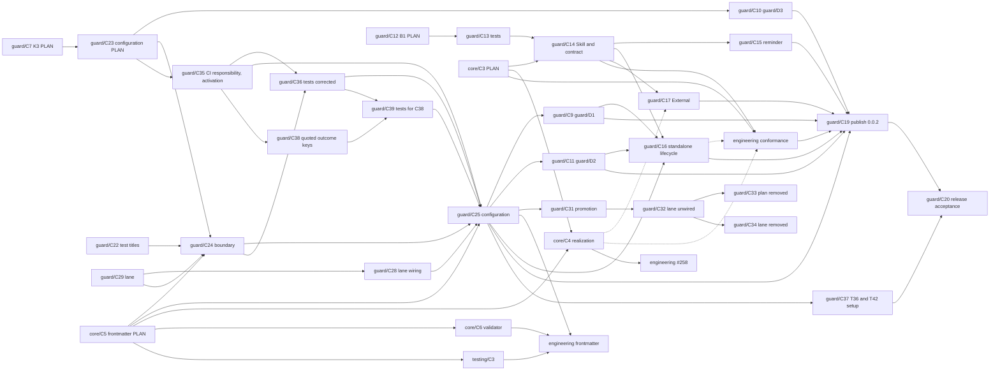

# Guard: Change

In FANATIC, C is Change: KAAL's existing bounded delivery unit, carried by a pull request. This document holds Guard's Changes, their dependencies, scope, verification and stopping conditions. Nothing is implemented before the Owner authorizes it.

Code is not the subject of this document. It remains the implementation *how*: it is written in DO, test first, to turn the planned outer tests from RED to GREEN, and its own inner Code tests, the fourth loop, evolve with it ([Testing](testing.md)). Code has no identifier series and no structural trace to Architecture: the Architecture conformance tests are what hold it to Architecture. Guard is developed in KAAL Engineering.

The Changes lift what already works in KAAL: the exit-status verdicts, the narrow-adapter rule ("supply facts, act on the exit code") and the trusted checker read from the target ref all run today in `.githooks/pre-push` and the workflows.

## Change map, in dependency order

Each Change depends on the Changes above it and lands only after them. A Change carries zero or more Intents: that is its only traceability link. Its Requirements, Architecture and Tests are reached through those Intents and are not linked again. A Change may carry none, as bounded technical or corrective work does.

| Change | Carries | Scope | Verified when |
| --- | --- | --- | --- |
| **guard/C0a** PLAN | guard/I1–guard/I6 | The Guard Capability Node, these six concerns, and both parts of the outer acceptance boundary. No Guard code. | The outer tests are RED as [Testing](testing.md#red-evidence) reports, and the Owner accepts the boundary. |
| **guard/C0b** Boundary | — | The `Guard Acceptance Boundary` job, for pull requests into `kaal/guard`. It travels alone. | It fails a test DO Change that touches the boundary. It lands before any DO Change. |
| **guard/C1** Runner | guard/I1, guard/I2 | The runner and `kaal-guard run`, with `guard.json`, named outcomes and GitHub reporting. | The outer tests that need only `run` are GREEN. |
| **guard/C1b** Check output | guard/I2 | The runner runs each check synchronously with its output inherited: the check's output goes, unchanged and as it runs, to the hook's terminal or the CI log, and Guard neither captures nor interprets it. Guard's evidence is the exit status, with a trusted checker's provenance (guard/F2, guard/F7). No Guard logging framework, no new dependency. It lands before guard/C3c, whose test lanes print thousands of lines. | Guard's inner tests show a check's output passing through on standard error, Guard's standard output holding only its verdict lines, and the verdict taken from the exit status alone; the outer tests GREEN before stay GREEN. |
| **guard/C2** KAAL Git adapter | guard/I4 | KAAL's `.githooks/pre-push` calls Guard with KAAL's `guard.json`. It travels alone. | KAAL's hook gives today's verdicts on today's scenarios, through Guard. |
| **guard/C3a** KAAL installs Guard | guard/I4 | KAAL installs `kaal-guard` from `packages/kaal-guard` as a development dependency, as an Embed consumer would, and `.githooks/pre-push` calls the installed `kaal-guard run --local`. It is not a workspace, so Guard's outer tests stay out of KAAL's Workspaces and Acceptance lanes, which run every workspace's tests and `test/acceptance/` scenarios. | guard/T5 is GREEN; the hook's verdicts are guard/C2's. |
| **guard/C3b** KAAL CI checks | guard/I4 | KAAL's `guard.json` lists its `ci` checks, and each Guard-run job's logic moves, unchanged, into a KAAL-owned check: the test lanes as their npm scripts, Change Isolation, Promotion Source, Branching and the Branching audit as scripts in `engineering/github/`. The branching checkers are `trusted`, taken from the revision KAAL supplies as `base`: the default branch's tip, as today. | guard/T33 is GREEN; each moved check gives the job's verdicts on today's scenarios, run through Guard. |
| **guard/C3b2** Checks run from the default branch | guard/I4 | Change Isolation reads its checker from the target commit through Git, as the other branching checks already read theirs, so every pull-request check can run from a checkout of the default branch. | Change Isolation gives the job's verdicts on today's scenarios when run from a default-branch checkout. |
| **guard/C3c** KAAL CI integration | guard/I4 | KAAL's existing jobs call `kaal-guard run --check`; names, matrices and triggers are unchanged; the `Guard` job is added and runs Guard's own tests. The `pull_request_target` jobs check out the default branch, where GitHub always takes their workflow from. It travels alone. | Every pre-migration check identity still reports, through Guard (guard/T34): the `push` and `pull_request` jobs and the Branching audit on `kaal/guard`; the `pull_request_target` jobs once they are on the default branch. |
| **guard/C4a** Verify | guard/I2, guard/I4 | `kaal-guard verify` in `lib/github.mjs`: per `ci` check, whether a workflow job declares it in Guard's declared form ([Run](run.md#verify)), by name or through `- { check: <name> }` matrix lines (guard/F10). Declared integration only; it infers nothing from scripts or other YAML. | Guard's inner tests show a declared, a matrix-declared and an undeclared `ci` check, every form outside the contract declaring nothing, and a pass claiming declared integration only. On KAAL's tree, `verify` names the two jobs whose invocation sits in a script, Change Isolation and the Branching audit; guard/C4c moves each to a step of its own. |
| **guard/C4b** Lifecycle | guard/I5 | `init`, `upgrade` and `remove` in `lib/lifecycle.mjs`, `managed` in `guard.json`, and the adapter templates `templates/pre-push` and `templates/guard.yml` (guard/F8). | The outer tests of `init`, `upgrade`, `remove` and `verify` are GREEN, guard/T24 among them. |
| **guard/C4c** KAAL runs verify | guard/I5 | KAAL's `Guard` job also runs `kaal-guard verify`, and the Change Isolation and Branching audit jobs invoke Guard in a step of its own, in the declared form, with their facts computed in the step before. Names, triggers and matrices are unchanged. It travels alone. | `verify` passes on KAAL's tree, and guard/T35 is GREEN. |
| **guard/C4d** Embed docs | guard/I3, guard/I5 | The consumer docs shipped in the package. | The packed package alone passes its outer tests on Linux, macOS and Windows, ready to publish as `kaal-guard@0.0.1`. |
| **guard/C5** External | guard/I6 | The External tooling and its instructions. | A delivered Change works in a fresh target and contains no KAAL element. |
| **guard/C6** Package identity | guard/I5 | The package is named `@kaihacksai/kaal-guard` (guard/N6); the command, the Capability and the repository keep their names. It lands as two Changes: the outer tests expecting the scoped name, which touch only the boundary and travel alone, then the package manifest, KAAL's development dependency and lockfile, the consumer docs and the hook line `init` prints. It is not part of guard/C5: an External delivery leaves no package dependency at all. | guard/T30 names the scoped package, and the packed package alone passes its outer tests on Linux, macOS and Windows. |
| **R1** Release | — | Publication of `@kaihacksai/kaal-guard@0.0.1`, a bounded Change of its own: the packed contents inspected, a clean install and its tests verified, and a publishing workflow with the npm bootstrap and Trusted Publishing steps proposed to the Owner. Its workflow travels alone. No release framework, and no change to Guard's runtime. | The Owner accepts the proposal. Nothing is published and no npm credential is created without the Owner's explicit authorization. |

### Consumer upgrade

KAAL is the consumer of its published package, in a disposable clone (guard/A12). KAAL's own development dependency, hook, workflows and `guard.json` do not change (guard/N8).

| Change | Carries | Scope | Verified when |
| --- | --- | --- | --- |
| **K1** PLAN | guard/I5 | guard/I5 extended to the consumer upgrade and adoption, guard/F11–guard/F18, guard/N8–guard/N9, KAAL's adoption assessment in guard/A11, guard/A12, and the planned tests guard/T36–guard/T44 with their intended evidence. No code and no test file. | The Owner accepts the plan. |
| **K2** Harness | guard/I5 | The guard/A12 harness and guard/T36–guard/T44, from `0.0.1` to a `packed` candidate. The boundary rule applies: the tests land as a PLAN Change of their own, before the harness. | Each test's evidence is recorded as found. Each suspicion is established as a Defect or refuted by its test. |
| **K3** Fix | guard/I5 | One bounded package Change for each Defect K2 establishes ([Testing](testing.md#defects)) and the Owner selects, turning its Test Case from RED to GREEN. The tests already exist, so each is a DO Change outside the acceptance boundary. The [K3 Change map](#k3-change-map) gives each one's scope, dependencies and order. | The Defect's Test Case is GREEN against a `packed` candidate, guard/T40 stays GREEN, no other outer test turns RED, and the package's outer tests stay GREEN on Linux, macOS and Windows. The Defect is then recorded as corrected. |
| **K4** Consumer job | — | A non-required job running guard/A12 on the three OSes, so a registry outage cannot block a merge. It travels alone. A separate Engineering decision, not part of K1–K3. | Proposed to the Owner; not authorized. |
| **K5** Publish | — | `0.0.2` through the Guard Release workflow, only with the Owner's authorization and only carrying a K3 Change. | The registry tarball equals the workflow's packed artifact. |
| **K6** Release acceptance | guard/I5 | The `0.0.2` gate: guard/T36, guard/T40, guard/T42, guard/T43 and guard/T64 with the `registry` `0.0.2` (restated in `guard/C30`; see [First release and later upgrades](#first-release-and-later-upgrades)). | All GREEN with `registry` evidence. Only then is the `0.0.2` Release accepted. |

### K3 Change map

This PLAN Change is `guard/C7`. In FANATIC a Change's durable identity is `guard/C<number>`; K3 and K3a–K3d remain only as aliases, and the full map of Guard's Changes is planned in `guard/C12`.

Each K3 Change corrects one Defect in `packages/kaal-guard` and lands in `kaal/guard` on its own. `guard/C23` withdrew `guard/C8`. `guard/C10` now depends on `guard/C23`, and `guard/C9` and `guard/C11` on `guard/C25`, because they record lifecycle state.

| Change | Corrects | Scope | Depends on |
| --- | --- | --- | --- |
| ~~**`guard/C8`** (K3a) Consumer bytes~~ Withdrawn by `guard/C23`, since guard/D4 is retracted | guard/D4 (guard/T44) | Guard edits only its own top-level entries in the text of an existing `guard.json`, inserting, replacing or deleting them, and keeps every other byte. It writes nothing when its entries are unchanged. A `guard.json` that Guard creates keeps today's format. `init`, `upgrade` and `remove` all write through this. | nothing |
| **`guard/C9`** (K3b) New assets | guard/D1 (guard/T38) | In `upgrade`, a managed path that is missing and unregistered is installed under `init`'s rule and registered. A file at that path that the installation record does not register is reported as left untouched. Restated by `guard/C23`. | `guard/C25` |
| **`guard/C10`** (K3c) Existing integration | guard/D3 (guard/T43) | `init` and `upgrade` apply guard/F17's rule: they read only Guard's declared integration contract, as `verify` does, and write the workflow for what remains undeclared, or none. They report each recognized declaration as executed by Guard but not managed. The command layer reads the declarations and passes them to the lifecycle, so the lifecycle still imports no adapter (guard/A7, guard/T29). | `guard/C23` |
| **`guard/C11`** (K3d) Writer version | guard/D2 (guard/T39) | `init` and `upgrade` register each asset's version and SHA-256 in the installation record (guard/F29), and `upgrade` reports the versions it moves between. Restated by `guard/C23`. | `guard/C25` |

This PLAN Change also amends guard/F14, guard/F17 and guard/F18, so K3c and K3d need no PLAN Change of their own, and no planned test changes:
- **K3c and guard/F17.** The rule is limited to Guard's declared contract. In KAAL every `ci` check and the consistency check are declared, so `init` installs no workflow there and reports nine declarations as not managed. guard/T43 asserts that unchanged. The rule's limit is that a consumer job running a check in another form, or a job named like Guard's but declaring nothing, is not recognized. Guard does not interpret GitHub workflow semantics, and KAAL's CI orchestration stays KAAL's (guard/A11).
- **K3d and guard/F14.** Writer provenance is per asset, matching the per-asset SHA-256. It is a separate entry because changing `managed` to hold objects would make `0.0.1` treat every asset as modified on rollback, which breaks guard/F16 and guard/T41.
- **K3 and Guard's installation contract (#335).** K3 imports nothing of Core or Hosting. Its guarantees are standalone ones, and they are the ones an installation contract states: K3a fixes Guard's ownership record to `managed`, `config` and `writers`; K3b installs from the lifecycle's one list of assets, which B3 later moves into the contract; K3c recognizes integration by its declared invocation, not by who wrote it; and K3d records a Guard version, not an installer's, so an asset Core writes from Guard's contract records the same writer. Node stays as it is in K3; Node 24 is B5's.
  - **Mixed versions.** A kept, consumer-modified asset keeps its earlier writer while the others move forward.
  - **Older `guard.json`.** An asset with no writer reads as `0.0.1`.
  - **Rollback.** `0.0.1` keeps the unknown `writers` entry but does not update it, and `remove` under `0.0.1` leaves it behind. The next newer `upgrade` re-records each asset. That is the stated limit.
  - **guard/T39.** guard/T39 holds as written: after `upgrade`, every unmodified asset records the installed version, and the report names `0.0.1` and that version.

The evidence stays bounded:
- Each Test Case runs against a `packed` candidate, directly and on Linux, as in K2b. Consumer evidence on macOS and Windows needs K4 or a run by hand.
- No version is bumped in K3. So `packed` still carries version `0.0.1`, and guard/T37 and guard/T41 still cannot show an asset's content moving between versions. That waits for K5 and K6.

### guard/C23 Configuration contract

The Owner stopped K3a's DO on #336. Two rulings set the frame:
- **6384007398.** Guard owns its configuration contract and its validation, not the consumer's formatting. It may retract a Requirement, a Test Case or a Defect whose contract was wrong, provided it keeps the evidence.
- **6384194537.** Guard's configuration tells Guard what to guard. Location and format are reconsidered through BASS, with the `kaal-guard` Skill in view. Lifecycle state is kept apart unless that is justified. The format follows who maintains it.

`guard/C23` is the PLAN Change that does this:
- guard/I1 states the model.
- guard/F18 keeps only obligations that hold for every option. Its byte-for-byte wording is superseded, and the old text is kept.
- guard/D4 is retracted and guard/T44 with it, and their evidence is kept ([Testing](testing.md#defects)).
- The options are compared in [Architecture](architecture.md#configuration-options-guardc23), against the Owner's criteria, and the configuration is planned there:
  - `.kaal/config/guard/<name>.md`, Git-tracked, with frontmatter under `core/C5` and a guidance body;
  - state in two scopes: a tracked installation record, `.kaal/state/guard/installation.json`, kept apart from the package's catalogue of published content; and the checkout state, in the Git metadata of the configuration scope Guard wrote;
  - an explicit `--config` path, with the fixed convention as the fallback;
  - strict refusal of undefined members, with diagnostics and a stated extensibility rule.
- guard/F1, guard/F18, guard/A1, guard/A6 and every Requirement that named `guard.json` are restated, and guard/F28 and guard/F29 are added.

It plans the configuration, and approving it accepts that plan. Implementation waits for `guard/C24` and `guard/C25`. Migration was settled by the Owner (#336, 6384215003): `0.0.2` breaks `0.0.1` deliberately, with no migration, dual format or rollback to `0.0.1`. The compatibility contracts are reassessed accordingly:
- guard/I5, guard/F15 and guard/F16 are bounded to `0.0.2` and later.
- guard/F14 no longer reads an unrecorded writer as `0.0.1`.
- guard/T37–guard/T39 and guard/T41 are superseded and re-planned between candidates ([Testing](testing.md#defects)).
- `guard/C11`'s constraint that `managed` keep its `0.0.1` shape falls away.

`run.md`, the package README and the Skill text still describe `guard.json`. They change with the code in `guard/C25`.

The K3 map is reconciled:
- `guard/C8` is withdrawn, and #336 closes unmerged as its record.
- `guard/C9` and `guard/C11` record lifecycle state, so they are rebuilt on `guard/C25`'s state file. `guard/C11`'s rule that `managed` keep its `0.0.1` shape falls away, because the state leaves the declarations.
- `guard/C10` changes no state, so it is unaffected.

| Change | Scope | Depends on |
| --- | --- | --- |
| **`guard/C23`** PLAN | The planned configuration: guard/I1, guard/F1, guard/F18, guard/A1 and guard/A6 restated; guard/F28 and guard/F29 added; guard/T61–guard/T73 planned; guard/D4 and guard/T44 retracted; and this map. No code and no test file | — |
| **`guard/C29`** Guard lane | `engineering/lanes/guard.mjs` and its tests: the required Guard jobs' outer suite is chosen from the form KAAL declares its own checks in, and the lane fails closed, never falling back, when it cannot choose; `test:guard` and `test:guard:plan` | — |
| **`guard/C28`** Lane wiring | The Guard, Guard (macOS) and Guard (Windows) jobs run the lane and its tests. `.github` only | `guard/C29` |
| **`guard/C24`** PLAN of the boundary | The new suite written as whole files in each boundary directory's `plan/`, beside the established suite, which is unchanged and stays the required gate: guard/T61–guard/T73 written, guard/T37–guard/T39, guard/T41 and guard/T44 retired there, and their RED evidence recorded with `test:guard:plan`. It travels alone | `guard/C23`, `guard/C22`, `core/C5`, `guard/C29` |
| **`guard/C25`** Configuration | `.kaal/config/guard/` in the package: the frontmatter parser and schema, the content catalogue in `contract.json`, the installation record, the scoped checkout state, `--config` and discovery, refusal with diagnostics, the two-candidate harness, and the consumer docs and Skill text. It is kept to what `guard/C24`'s tests need. KAAL's `guard.json` becomes `.kaal/config/guard/` in the same Change, which switches the required lane to the planned suite: `guard/C25` merges only with it GREEN | `guard/C24`, `guard/C28`, `core/C5`, `guard/C35`, `guard/C36` |
| **`guard/C31`** Promotion | The planned suite replaces the established files at the top of each boundary directory; `plan/` stays until `guard/C32`. It travels alone | `guard/C25` |
| **`guard/C32`** Lane unwired | The Guard jobs run the top-level suite directly again. `.github` only | `guard/C31` |
| **`guard/C33`** Plan removed | Each boundary directory's `plan/` deleted. It travels alone | `guard/C32` |
| **`guard/C34`** Lane removed | `engineering/lanes/guard.mjs`, its tests and its scripts deleted | `guard/C32` |

### CI responsibility (`guard/C35`)

The Owner reviewed `guard/C25` on #352 (6386490520): Guard provides the machinery for the consumer to register checks and integrate them into its own hooks and CI, and the consumer owns its Test Cases, commands, workflows and the assignment of execution. Guard may validate registrations, execute explicitly assigned checks and report recognized integration, but never infers missing CI responsibility and takes it over. `runs: [ci]` states scope; it triggers nothing.

The PLAN conflicted with that in two places, and `guard/C25`'s DO had followed it:
- guard/F17 had the workflow Guard installs carry a job for each `ci` check no other workflow declares, installed by a bare `init`. `guard/C25` realized it as `kaal-guard list --undeclared` feeding a dynamic matrix that `verify` read as coverage.
- guard/F13 had `upgrade` install any asset the repository lacks, the workflow included.

`guard/C35` restates guard/F8, guard/F10, guard/F13 and guard/F17 and the declared forms in [Run](run.md#verify): Guard's workflow is one fixed, catalogued content the consumer opts into with `init --ci`, never installed beside a workflow that already declares a check, and never by `upgrade`; without the opt-in, missing coverage is reported with the step to add. `guard/C36` corrects the planned tests ([Testing](testing.md#planned-outer-tests)). `guard/C25` then drops `list --undeclared` and the dynamic matrix, and keeps its GREEN configuration work.

**Initialization, registration and activation (Owner, #355, 6386981735).** Initialization prepares Guard, registration declares what it may execute, and activation decides where it executes; the consumer owns every activation. `guard/C35` adds guard/F30: `init` prepares the configuration and the installation record and activates nothing; `init --hook` and `init --ci` activate one surface each, and neither implies the other; `run --hook`, `run --ci` and `run --check <name>` execute; `remove --hook` and `remove --ci` undo one activation each, and `remove` both and the record, never touching a declaration or a Test Case. The registration word is `hook`, not `local`, because it names the surface that executes, while `run --check` and `run --ci` run on a developer's machine too; `local` is refused, naming `hook`. `upgrade` installs a new asset only for an activated surface. guard/F1, guard/F4, guard/F8, guard/F13, guard/F17 and guard/F29 follow, `guard/C36` carries the planned tests (guard/T76–guard/T78), and `guard/C25` realizes it.

**One frontmatter parsing contract (Owner, #360, 6389758902).** `core/C11` recognizes a typed artifact with Graph's Form reader, which refuses a non-string key. KAAL's declarations with `outcomes: {4: held}` have an integer key, so KAAL's own Engine rejected them. The Owner chose one common contract over a second, lenient reader. `guard/C38` restates guard/F1: outcome statuses are double-quoted, `{"4": held}`, and an unquoted status key is refused, naming the quoted form; meaning and verdicts are unchanged. It plans guard/T79 and guard/T80. `guard/C39` writes them in the boundary, and `guard/C25` realizes the refusal and quotes KAAL's three declarations.

**Published-`0.0.1` consumer evidence (Owner, #352, 6386915109).** guard/T36 and guard/T42 install the published `0.0.1` in a KAAL clone. `guard/C25` converts KAAL to `.kaal/config/guard/`, which `0.0.1`'s root `guard.json` assumption cannot read, so they fail there. That is a version-specific fixture mismatch, not evidence against their obligations. Their failures are kept as explicit transitional evidence and are never counted GREEN, and `guard/C25` does not change them. `guard/C37`, a separate PLAN Change of the acceptance boundary, revises their consumer setup for the `0.0.2` configuration without weakening an assertion. `guard/C20` then proves both against the published `0.0.2` from the registry.

The lane is a bounded transition with planned removal (`guard/C32`–`guard/C34`), agreed on #344 (6385044079, 6385265377). It is not the KAAL-wide model for controlled RED on `kaal/*`, which belongs to another workstream.

`guard/C23` is not an interim correction. It is the configuration architecture for `0.0.2`, and nothing about location, format, ownership or discovery is left for a later PLAN Change.

### Agent guidance

guard/I7 is a separately scoped `0.0.2` improvement. It is planned here and nothing in it is authorized beyond its PLAN Change, `guard/C12`.

**One contract, two levels of realization** (guard/N12). Core owns CASE installation and registration, and may embed Guard. Core owns the Installation Contract Definition, its schema and its outer conformance Test Cases. Guard supplies its installer-neutral instance (guard/F27), and two installers realize it:

| Level | Who | Guarantees | Dependency |
| --- | --- | --- | --- |
| Contract | Core owns the schema and conformance Test Cases; Guard owns its instance | What an installation of Guard is: its assets, the Skill, ownership and lifecycle rules, the Node prerequisite and the provider requirement | none at run time; conformance is verified by KAAL Engineering |
| Standalone conformance | Guard's lifecycle | Local correctness within the contract: the hook, the workflow and the Skill at `.agents/skills/kaal-guard/`, with the reminder naming it | none; Embed keeps zero KAAL dependencies |
| Core enrichment | Core, through Hosting where Core chooses | CASE registration, provider-aware deployments and pointers, dependency and conflict handling, cross-Capability verification | Core reads Guard's contract; Guard never imports Core |

The two levels are not feature-equivalent. Standalone, Claude Code reaches the Skill through the reminder or a consumer's pointer (O1). Native discovery for Claude Code needs Core enrichment.

**Modes.**
- Engineering: KAAL realizes its own Skills, Guard's among them, through Core (#258), and runs Core's conformance Test Cases against Guard's instance.
- External: Engineering's tooling writes the canonical deployment, and may use Core at delivery for further ones. The target owns plain files.
- Embedding: none toward KAAL. The earlier `Guard → kaal-core` dependency is withdrawn, because no Guard behaviour needs it.

**Node.** `0.0.2` raises Guard's floor from 20 to 24, consistent with Core, Graph and Hosting. This is a breaking consumer prerequisite: guard/N1 documents it, and guard/T59 tests that an older Node is refused with that next step.

The Changes for this, with K3's and the release's, are mapped in [Change identities](#change-identities). KAAL stays a Guard executor (guard/A11): it receives Guard's Skill through Core's realization, not through Guard's lifecycle.

guard/C3 lands as four Changes, guard/C3a, guard/C3b, guard/C3b2 and guard/C3c, because `.github` travels alone (Change Isolation): guard/C3c's jobs need the command guard/C3a installs and the checks guard/C3b lists, and its `pull_request_target` jobs run from the default branch (GitHub's rule since December 2025), so their checks must run from a default-branch checkout (guard/C3b2) and can only be observed once promoted. The Owner accepted the first split on #293. guard/T35 needs `kaal-guard verify`, so the `Guard` job gains `verify` in guard/C4c, which travels alone, and guard/T35 turns GREEN there. guard/C4 lands as four Changes for the same reasons: `verify` (guard/C4a) comes before the job that runs it (guard/C4c), the lifecycle (guard/C4b) is the largest piece and is reviewed on its own, and the docs (guard/C4d) describe what guard/C4a and guard/C4b ship.

### 0.0.2 release boundary

The Owner set this boundary in Slack (#kaal, 2026-10-24); this section is its durable record. `0.0.2` ships first, and it is the machinery `guard/C23` planned: consumers declare checks in `.kaal/config/guard/<name>.md`, Guard validates and executes them deterministically through the local hook and GitHub CI, Embed and External deliver the canonical kaal-guard Skill, and a failure or a cannot-judge result directs the agent to actionable guidance. The release is complete only when its isolated Changes, their TDD evidence over several loops, the verification on three OSes and the `registry` acceptance (`guard/C20`) are all done.

**Accepted limitation.** In `0.0.2`, Guard does not establish that a registered consumer Test Case is unchanged since its accepted PLAN baseline. A changed test can still return GREEN, and that is not a Guard integrity guarantee. `guard/C19`'s release notes and the consumer guidance (run.md, the package README and the Skill) state this plainly.

**`0.0.3` hardening candidate.** `guard/C26` (Issue #340) coordinates Test Case integrity and registration with Testing (evidence semantics), Sealing (cryptographic integrity), Change (the accepted PLAN baseline) and Change Isolation (authorization). Guard invokes and reports; it neither duplicates their ownership nor re-baselines silently. It is outside the `0.0.2` critical path, and nothing in `guard/C19` or `guard/C20` depends on it.

### First release and later upgrades

Accepting the first published `0.0.2` must not wait on a version that does not exist yet. The consumer Test Cases split by how many published versions they need (restated in `guard/C30`):

| Test Case | Needs | `0.0.2` Release acceptance (`guard/C20`) |
| --- | --- | --- |
| guard/T36, guard/T42 | the published `0.0.2` in a KAAL clone; their consumer setup is revised for the `0.0.2` configuration in `guard/C37`, a PLAN Change of the boundary before `guard/C20`. Until then their failures on the published `0.0.1` are kept as transitional evidence, never counted GREEN, and gate nothing | gates |
| guard/T40 | `0.0.1` and the published `0.0.2`: `0.0.1`'s `guard.json` is refused with the fresh setup as the next step | gates |
| guard/T43 | the published `0.0.2` on KAAL | gates |
| guard/T64 | the published `0.0.2` | gates |
| guard/T65–guard/T68 | two published versions of the `0.0.2` line | does not gate. Before `guard/C20` they have `packed` evidence between two simulated candidates (guard/N9). Their `registry` evidence gates the Release acceptance of the next published version, the first one that has a published predecessor in the line |

The package's outer tests (guard/T1–guard/T35 and guard/T61–guard/T73) stay GREEN on Linux, macOS and Windows against the packed release candidate before `guard/C19`, as for every Release. No evidence is dropped: each test keeps its trace, and its `packed` evidence is recorded as simulated.

## Change identities

A Change's durable identity is `<capability>/C<number>`, numbered by its owning Capability. Guard's Changes up to `guard/C6` keep their labels. Guard's numbers from `guard/C7` on are allocated here: no Guard Change in the repository uses them. The earlier labels R1, K1–K6 and B1–B7 remain only as aliases. Core and Engineering allocate their own numbers: Core allocated `core/C3` and `core/C4`, provisional until each merges, and Engineering's are pending. A planned Change is not a pull request: the PR column shows only pull requests that exist.

| Change | Alias | Owner | Scope | Depends on | Pull request |
| --- | --- | --- | --- | --- | --- |
| — | R1 | Guard | `0.0.1` release workflow | — | #320–#326, merged |
| — | K1, K2a, K2b | Guard | Consumer upgrade PLAN, its tests and the guard/A12 harness | — | #329, #330, #332, merged; promoted in #333 |
| `guard/C7` | K3 PLAN | Guard | The Defect map guard/D1–guard/D4 and the amendments of guard/F14, guard/F17 and guard/F18 | — | #334, merged |
| `guard/C8` | K3a | Guard | Withdrawn by `guard/C23`: guard/D4 is retracted | `guard/C7` | #336, withdrawn unmerged |
| `guard/C9` | K3b | Guard | guard/D1 (guard/T38): `upgrade` installs a missing, unrecorded asset | `guard/C25` | not created |
| `guard/C10` | K3c | Guard | guard/D3 (guard/T43): adoption by the declared integration contract | `guard/C23` | #341, merged |
| `guard/C11` | K3d | Guard | guard/D2 (guard/T39): writer version in the installation record | `guard/C25` | not created |
| `guard/C12` | B1 | Guard | This PLAN: guard/I7, guard/F19–guard/F27, guard/N1, guard/N10–guard/N12, guard/A13–guard/A17, guard/T45–guard/T59. No code and no test file | — | #335, merged |
| `guard/C13` | B2 | Guard | guard/T45–guard/T59, as a PLAN Change inside the acceptance boundary | `guard/C12` | not created |
| `guard/C14` | B3 | Guard | The Skill source and Guard's `contract.json` instance; guard/T45, guard/T46, guard/T58 | `guard/C13`, `core/C3` | not created |
| `guard/C15` | B4 | Guard | The reminder; guard/T47–guard/T49 | `guard/C14` | not created |
| `guard/C16` | B5 | Guard | The standalone lifecycle realizes the instance; Node 24; guard/T50–guard/T54, guard/T57, guard/T59 | `guard/C14`, `guard/C25`, `guard/C9`, `guard/C11` | not created |
| `guard/C17` | B6 | Guard | External: the canonical variant, and Core's further deployments at delivery; guard/T56 | `guard/C14`; `core/C4` for Core's part | not created |
| `guard/C18` | K4 | Guard | A non-required job running guard/A12 on three OSes. Proposed, not authorized | — | not created |
| `guard/C19` | K5 | Guard | Publication of `0.0.2`, only with the Owner's authorization, with release notes documenting the breaking changes, the fresh `0.0.2` setup and the accepted limitation of the [release boundary](#002-release-boundary) | `guard/C9`–`guard/C11`, `guard/C15`–`guard/C17`, the conformance evidence | not created |
| `guard/C20` | K6 | Guard | Release acceptance of `0.0.2`: guard/T36, guard/T40, guard/T42, guard/T43 and guard/T64 with `registry` evidence for the published `0.0.2`. guard/T65–guard/T68 do not gate it (restated in `guard/C30`) | `guard/C19`, `guard/C37` | not created |
| `guard/C21` | — | Guard | Every identifier in Guard's documents written Capability-qualified, as the Owner ruled on #334 and #335 | — | #337, merged |
| `guard/C22` | — | Guard | The titles of the test files inside the acceptance boundary qualified the same way. A PLAN Change of the boundary; it travels alone | `guard/C21` | #338, merged |
| `guard/C23` | — | Guard | The `0.0.2` configuration: `.kaal/config/guard/` Markdown declarations, and state in two scopes (a tracked installation record apart from the package's content catalogue, and scoped checkout state in Git's metadata); guard/D4 and guard/T44 retracted; compatibility with `0.0.1` dropped | — | #339, merged |
| `guard/C24` | — | Guard | The new suite in each boundary directory's `plan/`: guard/T61–guard/T73 written; guard/T37–guard/T39, guard/T41 and guard/T44 retired there. It travels alone | `guard/C23`, `guard/C22`, `core/C5`, `guard/C29` | #344 |
| `guard/C25` | — | Guard | `.kaal/config/guard/` in the package, and KAAL's own declarations converted, which switches the required lane to the planned suite | `guard/C24`, `guard/C28`, `core/C5`, `guard/C35`, `guard/C36`, `guard/C38`, `guard/C39` | #352 |
| `guard/C26` | — | Guard | Test Case registration: Guard invokes and reports registered consumer Test Cases, coordinated with Testing, Sealing, Change and Change Isolation. A `0.0.3` candidate, outside the `0.0.2` critical path | Testing, Sealing and Change PLANs | Issue #340; not created |
| `guard/C27` | — | Guard | The `0.0.2` release boundary recorded in this document | — | #342, merged |
| `guard/C28` | — | Guard | The required Guard jobs run the Guard lane (`guard/C29`). `.github` only | `guard/C29` | #347 |
| `guard/C29` | — | Guard | The Guard lane: the outer suite chosen from KAAL's own declarations, failing closed | — | #346 |
| `guard/C30` | — | Guard | guard/F1 names `type: Guard/Check` (core/F6); guard/C20 and K6 name the consumer tests `guard/C23` keeps; guard/T55 retired | `guard/C23`, `core/C5` | #345, merged |
| `guard/C31` | — | Guard | The planned suite promoted to the top of each boundary directory. It travels alone | `guard/C25` | not created |
| `guard/C32` | — | Guard | The Guard jobs run the top-level suite directly again. `.github` only | `guard/C31` | not created |
| `guard/C33` | — | Guard | Each boundary directory's `plan/` deleted. It travels alone | `guard/C32` | not created |
| `guard/C34` | — | Guard | The Guard lane and its scripts deleted | `guard/C32` | not created |
| `guard/C35` | — | Guard | CI responsibility and activation: guard/F8, guard/F10, guard/F13 and guard/F17 restated so that Guard's workflow is an explicit `init --ci` opt-in and missing coverage is reported, not filled; guard/F30 separates initialization from activation (`init --hook`, `init --ci`, `remove --hook`, `remove --ci`) and names the registration `hook`, not `local`; guard/T74–guard/T78 planned. No code and no test file | `guard/C23` | #355 |
| `guard/C36` | — | Guard | guard/C35's correction of the planned tests in each boundary directory's `plan/`, and guard/T74–guard/T78 written. It travels alone | `guard/C35`, `guard/C24` | #356 |
| `guard/C38` | — | Guard | One frontmatter parsing contract: guard/F1 restated so that outcome statuses are double-quoted strings, `{"4": held}`, and an unquoted status key is refused; guard/T79 and guard/T80 planned. No code and no test file | `guard/C35` | #363 |
| `guard/C39` | — | Guard | guard/C38's planned tests written in the boundary: guard/T79, guard/T80, and the package harness writing quoted status keys. It travels alone | `guard/C38`, `guard/C36` | #364 |
| `guard/C37` | — | Guard | PLAN of the boundary: guard/T36 and guard/T42's consumer setup revised for the `0.0.2` configuration (`.kaal/config/guard/`), their assertions unchanged and their transitional failures recorded. It travels alone, and `guard/C20` proves both with the published `0.0.2` | `guard/C25` | not created |
| `core/C3` (provisional) | A0 | Core | Core's PLAN: the Installation Contract Definition, schema and outer conformance Test Cases (`core/T1`…), and Agent Realization | — | not created |
| `core/C4` (provisional) | A1 | Core | Core's realization of contracts and Agent Realization, in `kaal-core`; it travels alone | `core/C3`, `core/C5` | not created |
| `engineering/C…` (pending) | B7 | Engineering | Engineering runs Core's conformance Test Cases against Guard's instance, then realizes it through Core and runs Guard's `upgrade` and `remove` on the result; the evidence is Guard's | `guard/C14`, `core/C3`; `guard/C16` and `core/C4` for the second part | not created |
| `engineering/C…` (pending) | A2 | Engineering | KAAL realizes its own Skills through Core (#258) | `core/C4` | not created |
| `core/C5` | — | Core | PLAN for Deterministic Frontmatter: the KAAL-wide NFR, the Architecture and the outer conformance Test Cases (#337 comment 6383918695) | — | not created |
| `core/C6` | — | Core | The generic frontmatter schema format and validator in `kaal-core` | `core/C5` | not created |
| `testing/C3` | — | Testing | Evidence semantics for frontmatter conformance | `core/C5` | not created |
| `engineering/C…` (pending) | — | Engineering | Applies the frontmatter conformance cases to Capability-owned artifacts, including Guard's declarations in `.kaal/config/guard/` | `core/C6`, `testing/C3`, `guard/C25` | not created |

A dotted edge is needed only for the Core-enriched part of a Change. Every Change is separately owned and lands in its owner's collector. Nothing beyond the PLAN Changes the Owner approved is authorized. `guard/C26` is a `0.0.3` candidate and is not in this graph.

## Stopping conditions

- **Checkpoint E**, after guard/C3c: guard/I1 to guard/I4 are met. A pause point, not completion.
- **Checkpoint M**, after guard/C4d: guard/I5 is also met. Still a pause point.
- **Completion**, after guard/C5 and guard/C6: guard/I1 to guard/I6 are all met, and every outer test is GREEN on all three OSes. Only this is done. Publication (R1) is a separate Owner decision.
- A published version's Release is accepted only when its consumer acceptance (K6) is GREEN with `registry` evidence. Publishing alone is not acceptance.
  - **First published `0.0.2`.** It is accepted on the tests feasible with `0.0.2` alone: guard/T36, guard/T40, guard/T42, guard/T43 and guard/T64 (restated in `guard/C30`).
  - **Cross-version upgrade acceptance.** guard/T65–guard/T68 need a second published version of the `0.0.2` line, so they are never a prerequisite for accepting the first `0.0.2`. Their `registry` evidence is part of the acceptance of the first version that has a published predecessor in the line.
- Pausing at a checkpoint is the Owner's decision. While paused, the unmet outcomes are recorded as unmet.
- A planned outer test that cannot pass without changing the boundary is a PLAN defect. It goes back to PLAN as a new PLAN Change.
- A required check name or OS matrix entry on `main` never changes without the Owner.
