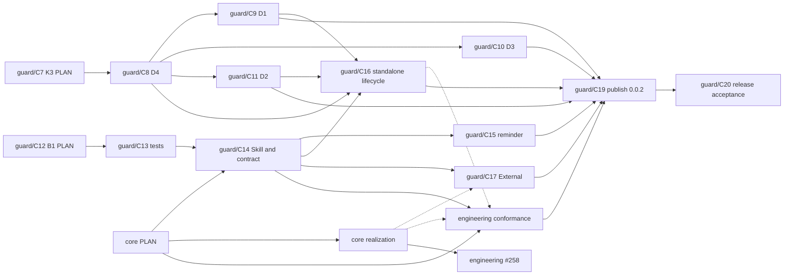

# Guard: Change

In FANATIC, C is Change: KAAL's existing bounded delivery unit, carried by a pull request. This document holds Guard's Changes, their dependencies, scope, verification and stopping conditions. Nothing is implemented before the Owner authorizes it.

Code is not the subject of this document. It remains the implementation *how*: it is written in DO, test first, to turn the planned outer tests from RED to GREEN, and its own inner Code tests, the fourth loop, evolve with it ([Testing](testing.md)). Code has no identifier series and no structural trace to Architecture: the Architecture conformance tests are what hold it to Architecture. Guard is developed in KAAL Engineering.

The Changes lift what already works in KAAL: the exit-status verdicts, the narrow-adapter rule ("supply facts, act on the exit code") and the trusted checker read from the target ref all run today in `.githooks/pre-push` and the workflows.

## Change map, in dependency order

Each Change depends on the Changes above it and lands only after them. A Change carries zero or more Intents: that is its only traceability link. Its Requirements, Architecture and Tests are reached through those Intents and are not linked again. A Change may carry none, as bounded technical or corrective work does.

| Change | Carries | Scope | Verified when |
| --- | --- | --- | --- |
| **C0a** PLAN | I1–I6 | The Guard Capability Node, these six concerns, and both parts of the outer acceptance boundary. No Guard code. | The outer tests are RED as [Testing](testing.md#red-evidence) reports, and the Owner accepts the boundary. |
| **C0b** Boundary | — | The `Guard Acceptance Boundary` job, for pull requests into `kaal/guard`. It travels alone. | It fails a test DO Change that touches the boundary. It lands before any DO Change. |
| **C1** Runner | I1, I2 | The runner and `kaal-guard run`, with `guard.json`, named outcomes and GitHub reporting. | The outer tests that need only `run` are GREEN. |
| **C1b** Check output | I2 | The runner runs each check synchronously with its output inherited: the check's output goes, unchanged and as it runs, to the hook's terminal or the CI log, and Guard neither captures nor interprets it. Guard's evidence is the exit status, with a trusted checker's provenance (F2, F7). No Guard logging framework, no new dependency. It lands before C3c, whose test lanes print thousands of lines. | Guard's inner tests show a check's output passing through on standard error, Guard's standard output holding only its verdict lines, and the verdict taken from the exit status alone; the outer tests GREEN before stay GREEN. |
| **C2** KAAL Git adapter | I4 | KAAL's `.githooks/pre-push` calls Guard with KAAL's `guard.json`. It travels alone. | KAAL's hook gives today's verdicts on today's scenarios, through Guard. |
| **C3a** KAAL installs Guard | I4 | KAAL installs `kaal-guard` from `packages/kaal-guard` as a development dependency, as an Embed consumer would, and `.githooks/pre-push` calls the installed `kaal-guard run --local`. It is not a workspace, so Guard's outer tests stay out of KAAL's Workspaces and Acceptance lanes, which run every workspace's tests and `test/acceptance/` scenarios. | T5 is GREEN; the hook's verdicts are C2's. |
| **C3b** KAAL CI checks | I4 | KAAL's `guard.json` lists its `ci` checks, and each Guard-run job's logic moves, unchanged, into a KAAL-owned check: the test lanes as their npm scripts, Change Isolation, Promotion Source, Branching and the Branching audit as scripts in `engineering/github/`. The branching checkers are `trusted`, taken from the revision KAAL supplies as `base`: the default branch's tip, as today. | T33 is GREEN; each moved check gives the job's verdicts on today's scenarios, run through Guard. |
| **C3b2** Checks run from the default branch | I4 | Change Isolation reads its checker from the target commit through Git, as the other branching checks already read theirs, so every pull-request check can run from a checkout of the default branch. | Change Isolation gives the job's verdicts on today's scenarios when run from a default-branch checkout. |
| **C3c** KAAL CI integration | I4 | KAAL's existing jobs call `kaal-guard run --check`; names, matrices and triggers are unchanged; the `Guard` job is added and runs Guard's own tests. The `pull_request_target` jobs check out the default branch, where GitHub always takes their workflow from. It travels alone. | Every pre-migration check identity still reports, through Guard (T34): the `push` and `pull_request` jobs and the Branching audit on `kaal/guard`; the `pull_request_target` jobs once they are on the default branch. |
| **C4a** Verify | I2, I4 | `kaal-guard verify` in `lib/github.mjs`: per `ci` check, whether a workflow job declares it in Guard's declared form ([Run](run.md#verify)), by name or through `- { check: <name> }` matrix lines (F10). Declared integration only; it infers nothing from scripts or other YAML. | Guard's inner tests show a declared, a matrix-declared and an undeclared `ci` check, every form outside the contract declaring nothing, and a pass claiming declared integration only. On KAAL's tree, `verify` names the two jobs whose invocation sits in a script, Change Isolation and the Branching audit; C4c moves each to a step of its own. |
| **C4b** Lifecycle | I5 | `init`, `upgrade` and `remove` in `lib/lifecycle.mjs`, `managed` in `guard.json`, and the adapter templates `templates/pre-push` and `templates/guard.yml` (F8). | The outer tests of `init`, `upgrade`, `remove` and `verify` are GREEN, T24 among them. |
| **C4c** KAAL runs verify | I5 | KAAL's `Guard` job also runs `kaal-guard verify`, and the Change Isolation and Branching audit jobs invoke Guard in a step of its own, in the declared form, with their facts computed in the step before. Names, triggers and matrices are unchanged. It travels alone. | `verify` passes on KAAL's tree, and T35 is GREEN. |
| **C4d** Embed docs | I3, I5 | The consumer docs shipped in the package. | The packed package alone passes its outer tests on Linux, macOS and Windows, ready to publish as `kaal-guard@0.0.1`. |
| **C5** External | I6 | The External tooling and its instructions. | A delivered Change works in a fresh target and contains no KAAL element. |
| **C6** Package identity | I5 | The package is named `@kaihacksai/kaal-guard` (N6); the command, the Capability and the repository keep their names. It lands as two Changes: the outer tests expecting the scoped name, which touch only the boundary and travel alone, then the package manifest, KAAL's development dependency and lockfile, the consumer docs and the hook line `init` prints. It is not part of C5: an External delivery leaves no package dependency at all. | T30 names the scoped package, and the packed package alone passes its outer tests on Linux, macOS and Windows. |
| **R1** Release | — | Publication of `@kaihacksai/kaal-guard@0.0.1`, a bounded Change of its own: the packed contents inspected, a clean install and its tests verified, and a publishing workflow with the npm bootstrap and Trusted Publishing steps proposed to the Owner. Its workflow travels alone. No release framework, and no change to Guard's runtime. | The Owner accepts the proposal. Nothing is published and no npm credential is created without the Owner's explicit authorization. |

### Consumer upgrade

KAAL is the consumer of its published package, in a disposable clone (A12). KAAL's own development dependency, hook, workflows and `guard.json` do not change (N8).

| Change | Carries | Scope | Verified when |
| --- | --- | --- | --- |
| **K1** PLAN | I5 | I5 extended to the consumer upgrade and adoption, F11–F18, N8–N9, KAAL's adoption assessment in A11, A12, and the planned tests T36–T44 with their intended evidence. No code and no test file. | The Owner accepts the plan. |
| **K2** Harness | I5 | The A12 harness and T36–T44, from `0.0.1` to a `packed` candidate. The boundary rule applies: the tests land as a PLAN Change of their own, before the harness. | Each test's evidence is recorded as found. H1–H5 are each demonstrated or refuted. |
| **K3** Fix | I5 | One bounded package Change for each hypothesis K2 demonstrates, RED to GREEN on Linux, macOS and Windows. | Its planned test is GREEN against a `packed` candidate, and no other outer test turns RED. |
| **K4** Consumer job | — | A non-required job running A12 on the three OSes, so a registry outage cannot block a merge. It travels alone. A separate Engineering decision, not part of K1–K3. | Proposed to the Owner; not authorized. |
| **K5** Publish | — | `0.0.2` through the Guard Release workflow, only with the Owner's authorization and only carrying a K3 Change. | The registry tarball equals the workflow's packed artifact. |
| **K6** Release acceptance | I5 | T36–T44 from `0.0.1` to the `registry` `0.0.2`. | All GREEN with `registry` evidence. Only then is the `0.0.2` Release accepted. |

### Agent guidance

I7 is a separately scoped `0.0.2` improvement. It is planned here and nothing in it is authorized beyond its PLAN Change, `guard/C12`.

**One contract, two levels of realization** (N12). Core owns CASE installation and registration, and may embed Guard. Core owns the Installation Contract Definition, its schema and its outer conformance Test Cases. Guard supplies its installer-neutral instance (F27), and two installers realize it:

| Level | Who | Guarantees | Dependency |
| --- | --- | --- | --- |
| Contract | Core owns the schema and conformance Test Cases; Guard owns its instance | What an installation of Guard is: its assets, the Skill, ownership and lifecycle rules, the Node prerequisite and the provider requirement | none at run time; conformance is verified by KAAL Engineering |
| Standalone conformance | Guard's lifecycle | Local correctness within the contract: the hook, the workflow and the Skill at `.agents/skills/kaal-guard/`, with the reminder naming it | none; Embed keeps zero KAAL dependencies |
| Core enrichment | Core, through Hosting where Core chooses | CASE registration, provider-aware deployments and pointers, dependency and conflict handling, cross-Capability verification | Core reads Guard's contract; Guard never imports Core |

The two levels are not feature-equivalent. Standalone, Claude Code reaches the Skill through the reminder or a consumer's pointer (O1). Native discovery for Claude Code needs Core enrichment.

**Modes.**
- Engineering: KAAL realizes its own Skills, Guard's among them, through Core (#258), and runs Core's conformance Test Cases against Guard's instance.
- External: Engineering's tooling writes the canonical deployment, and may use Core at delivery for further ones. The target owns plain files.
- Embedding: none toward KAAL. The earlier `Guard → kaal-core` dependency is withdrawn, because no Guard behaviour needs it.

**Node.** `0.0.2` raises Guard's floor from 20 to 24, consistent with Core, Graph and Hosting. This is a breaking consumer prerequisite: N1 documents it, and T59 tests that an older Node is refused with that next step.

The Changes for this, with K3's and the release's, are mapped in [Change identities](#change-identities). KAAL stays a Guard executor (A11): it receives Guard's Skill through Core's realization, not through Guard's lifecycle.

C3 lands as four Changes, C3a, C3b, C3b2 and C3c, because `.github` travels alone (Change Isolation): C3c's jobs need the command C3a installs and the checks C3b lists, and its `pull_request_target` jobs run from the default branch (GitHub's rule since December 2025), so their checks must run from a default-branch checkout (C3b2) and can only be observed once promoted. The Owner accepted the first split on #293. T35 needs `kaal-guard verify`, so the `Guard` job gains `verify` in C4c, which travels alone, and T35 turns GREEN there. C4 lands as four Changes for the same reasons: `verify` (C4a) comes before the job that runs it (C4c), the lifecycle (C4b) is the largest piece and is reviewed on its own, and the docs (C4d) describe what C4a and C4b ship.

## Change identities

A Change's durable identity is `<capability>/C<number>`, numbered by its owning Capability. Guard's Changes up to `guard/C6` keep their labels. Guard's numbers from `guard/C7` on are allocated here: no Guard Change in the repository uses them. The earlier labels R1, K1–K6 and B1–B7 remain only as aliases. Core and Engineering allocate their own numbers, so theirs are shown as pending until they do. A planned Change is not a pull request: the PR column shows only pull requests that exist.

| Change | Alias | Owner | Scope | Depends on | Pull request |
| --- | --- | --- | --- | --- | --- |
| — | R1 | Guard | `0.0.1` release workflow | — | #320–#326, merged |
| — | K1, K2a, K2b | Guard | Consumer upgrade PLAN, its tests and the A12 harness | — | #329, #330, #332, merged; promoted in #333 |
| `guard/C7` | K3 PLAN | Guard | The Defect map D1–D4 and the amendments of F14, F17 and F18 | — | #334, open |
| `guard/C8` | K3a | Guard | D4 (T44): Guard writes only its own entries of `guard.json` | `guard/C7` | not created |
| `guard/C9` | K3b | Guard | D1 (T38): `upgrade` installs a missing, unrecorded asset | `guard/C8` | not created |
| `guard/C10` | K3c | Guard | D3 (T43): adoption by the declared integration contract | `guard/C8` | not created |
| `guard/C11` | K3d | Guard | D2 (T39): per-asset writer provenance | `guard/C8` | not created |
| `guard/C12` | B1 | Guard | This PLAN: I7, F19–F27, N1, N10–N12, A13–A17, T45–T59. No code and no test file | — | #335, open |
| `guard/C13` | B2 | Guard | T45–T59, as a PLAN Change inside the acceptance boundary | `guard/C12` | not created |
| `guard/C14` | B3 | Guard | The Skill source and Guard's `contract.json` instance; T45, T46, T58 | `guard/C13`, Core's contract PLAN | not created |
| `guard/C15` | B4 | Guard | The reminder; T47–T49 | `guard/C14` | not created |
| `guard/C16` | B5 | Guard | The standalone lifecycle realizes the instance; Node 24; T50–T55, T57, T59 | `guard/C14`, `guard/C8`, `guard/C9`, `guard/C11` | not created |
| `guard/C17` | B6 | Guard | External: the canonical variant, and Core's further deployments at delivery; T56 | `guard/C14`; Core's realization for Core's part | not created |
| `guard/C18` | K4 | Guard | A non-required job running A12 on three OSes. Proposed, not authorized | — | not created |
| `guard/C19` | K5 | Guard | Publication of `0.0.2`, only with the Owner's authorization | `guard/C9`–`guard/C11`, `guard/C15`–`guard/C17`, the conformance evidence | not created |
| `guard/C20` | K6 | Guard | Release acceptance: T36–T44 and T55 with `registry` evidence | `guard/C19` | not created |
| `core/C…` (pending) | A0 | Core | Core's PLAN: the Installation Contract Definition, schema and outer conformance Test Cases (`core/T…`), and Agent Realization | — | not created |
| `core/C…` (pending) | A1 | Core | Core's realization of contracts and Agent Realization, in `kaal-core`; it travels alone | Core's PLAN | not created |
| `engineering/C…` (pending) | B7 | Engineering | Engineering runs Core's conformance Test Cases against Guard's instance, then realizes it through Core and runs Guard's `upgrade` and `remove` on the result; the evidence is Guard's | `guard/C14`, Core's PLAN; `guard/C16` and Core's realization for the second part | not created |
| `engineering/C…` (pending) | A2 | Engineering | KAAL realizes its own Skills through Core (#258) | Core's realization | not created |

A dotted edge is needed only for the Core-enriched part of a Change. Every Change is separately owned and lands in its owner's collector. Nothing beyond `guard/C7` and `guard/C12` is authorized.

## Stopping conditions

- **Checkpoint E**, after C3c: I1 to I4 are met. A pause point, not completion.
- **Checkpoint M**, after C4d: I5 is also met. Still a pause point.
- **Completion**, after C5 and C6: I1 to I6 are all met, and every outer test is GREEN on all three OSes. Only this is done. Publication (R1) is a separate Owner decision.
- A published version's Release is accepted only when its consumer acceptance (K6) is GREEN with `registry` evidence. Publishing alone is not acceptance.
- Pausing at a checkpoint is the Owner's decision. While paused, the unmet outcomes are recorded as unmet.
- A planned outer test that cannot pass without changing the boundary is a PLAN defect. It goes back to PLAN as a new PLAN Change.
- A required check name or OS matrix entry on `main` never changes without the Owner.
