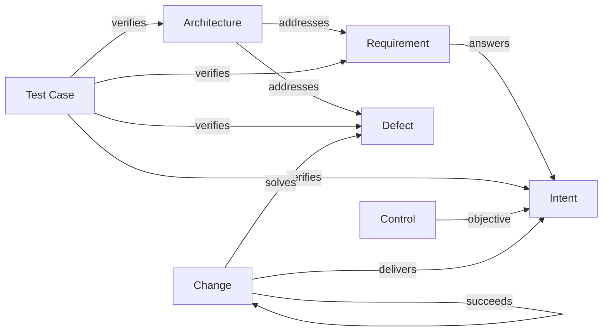

# KAAL object metamodel

The one authoritative reference for the semantic objects of KAAL and the relationships between them. It describes meaning only: what is wanted (Intent), what is wrong (Defect), what is required (Requirement), how it is built (Architecture), how it is shown (Test Case), what keeps it so (Control) and what moves it (Change). It holds no process (Stage, Evidence), no record (Change Record) and no term of git or any hosting platform; those belong to a binding outside this model. Each object and each relationship is defined once, here; the views in [views/](views/) only select from this model and never define anything.

Every row says how far it can be trusted: **normative** (stated by an owner's Definition or decided by the Owner) or **observed** (a convention found in the repository, with the path that shows it). Existing identifiers and keys are kept as they are; where the Owner's word and the repository's key differ, both are shown and the difference is listed under Mismatches.

## Purpose

The tracing chain, named INFORMED ([INFORMED.md](INFORMED.md): Implementation Navigates Forward: Observed Results Mirror Earlier Decisions), gives an anchor for semantic reasoning, both when a Change is created and when it is understood afterwards. Reasoning starts from one fixed point and moves along the chain: **Intent**, **Requirement**, **Architecture**, **Test Case**. A **Control** enters the argument at its Intents and has no chain of its own: its realization is the normal chain below those Intents. A Test Case that turns from RED to GREEN is evidence about the Intent at the start of the chain. The code that makes a Test Case GREEN is not an object of this model: it is the step from PLAN to DO (code if RED, none if GREEN), which is TDD-motivated and belongs to the process. Where the repository does not yet carry a link of the chain, the model says so under Mismatches.

**Snapshot plus moves.** Current and Target are not objects. The Target is the set of elements outside the Change folders: the Intents, Requirements, Architecture and Test Cases as they stand, the current desired state (D). What holds today is shown by the target Test Cases. Each Change folder explains one move on the way (A to B to C to D); past states are not persisted. The target Test Cases are the only ones that say what holds, so a Change does not repeat them.

## Trace chain

| Step | Object | Relates to the previous step by | Status in the repository |
| --- | --- | --- | --- |
| 1 | Intent | the start of the chain; the Why, traces to nothing (an external reference is parked for later) | exists |
| 2 | Requirement | answers Intent (key `serves`); Functional or Non-Functional | exists |
| 3 | Architecture | addresses Requirement (key `addresses`) | exists |
| 4 | Test Case | verifies Intent, Requirement, Architecture, or Defect, by the ids it exports (key `tests`) | exists |
| Control | Control | objective is 1..n Intents (key `has`); no chain of its own | exists, linked to Intent only |
| Defect | Defect | a root beside Intent: it comes out of the blue, a negative What; Architecture addresses it, a Change solves it | exists |

Every view below shows the part of this model its template carries.

## Diagram

Solid arrows are normative, dashed arrows observed.

## Objects

| Object | Repository identity | Status | Defined by |
| --- | --- | --- | --- |
| Intent | `<capability>/I<n>`; the Why, a root | normative | kaal-intent (not on `main`); GLUE names the discipline |
| Defect | `<capability>/D<n>`, a record with `expected`, `observed`, `where`, `status`, `tests`; a root, a negative What | normative | the hotfix route requires the identity; example `packages/kaal-hosting/06-defects/D10-multiline-conditional-selector.md` |
| Requirement | `<capability>/F<n>` functional, `<capability>/N<n>` nonfunctional; the What | normative | kaal-requirements (not on `main`); GLUE |
| Architecture | `<capability>/A<n>`, may have a `parent` | normative | kaal-architecture (not on `main`); GLUE |
| Test Case | `<capability>/T<n>`, a file exporting `id`, `tests`, `title`, `run`; a Case that lives in a Change folder is still a Test Case, not a separate object | normative | kaal-testing |
| Control | `<capability>/CTL<n>`, with `type` and `has` | normative | `packages/kaal-controls/02-requirements/F13-control-shape/F13.md`; six in `engineering/release-management/04-controls/` |
| Change | `<capability>/C<n>`, a Change Node in its record folder | normative | kaal-change, Change Definition |

## Relationships

| Relationship | From → to | Repository key | Status | Source |
| --- | --- | --- | --- | --- |
| answers | Requirement → Intent | `serves` | normative | Owner, 18 Nov 2026 |
| addresses | Architecture → Requirement, Defect | `addresses` for Requirement; none found for Defect | normative | Owner, 18 Nov 2026 |
| verifies | Test Case → Intent, Requirement, Architecture, Defect | `export const tests` | normative | Owner, 18 Nov 2026; a Test Case may verify a Requirement directly and need not pass through Architecture |
| objective | Control → Intent | `has` | normative | Owner, 18 Nov 2026 (1..n Intents); `packages/kaal-controls/02-requirements/F13-control-shape/F13.md` |
| delivers | Change → Intent | `implements` | normative | Owner, 18 Nov 2026; Delivers Definition (`packages/kaal-change/capability/Delivers.md`) |
| solves | Change → Defect | none found | normative | Owner, 18 Nov 2026 (two distinct verbs, deliberately: delivers for Intent, solves for Defect) |
| succeeds | Change → Change | none found | normative | Succeeds Definition (`packages/kaal-change/capability/Succeeds.md`) |

## Vocabularies

- **Lifecycle of a Change**, read from facts and never stored: Proposed, Accepted, Withdrawn, Promoted (`packages/kaal-change/capability/Change-Lifecycle.md`). Approval, verification and validation are not states.
- **INFORMED**, the mnemonic of the trace chain: [INFORMED.md](INFORMED.md). It owns no instruction, capability or control.
- **Change class**: Normal, Standard, Emergency (`Change-Classification.md`).

## Views

A view selects the part of the model one template carries. The template named in each row is its binding.

| TYPE | View | Template |
| --- | --- | --- |
| DEFAULT | [views/default.md](views/default.md) | `.github/pull_request_template.md` |
| PLAN | [views/plan.md](views/plan.md) | `.github/PULL_REQUEST_TEMPLATE/plan.md` |
| DO | [views/do.md](views/do.md) | `.github/PULL_REQUEST_TEMPLATE/do.md` |
| ACT | [views/act.md](views/act.md) | `.github/PULL_REQUEST_TEMPLATE/act.md` |
| PROMOTION | [views/promotion.md](views/promotion.md) | `.github/PULL_REQUEST_TEMPLATE/promotion.md` |
| HOTFIX | [views/hotfix.md](views/hotfix.md) | `.github/PULL_REQUEST_TEMPLATE/hotfix.md` |
| WIRE | [views/wire.md](views/wire.md) | none on `main` (mismatch M10) |
| SYNC | [views/sync.md](views/sync.md) | `.github/PULL_REQUEST_TEMPLATE/sync.md` |

## Reviewer questions

Each question is answered by following these relationships from the Change.

| # | Question | Path |
| --- | --- | --- |
| Q1 | Which Intent does the Change deliver, or which Defect does it solve? | Change delivers Intent; Change solves Defect |
| Q2 | Which Requirements and Architecture support that Intent? | Requirement answers Intent; Architecture addresses Requirement; where none exist, Control objective Intent |
| Q3 | Which Controls pursue that Intent? | Control objective Intent |
| Q4 | What does each Test Case explicitly verify? | Test Case verifies (the exported list, key `tests`) |
| Q5 | Which Defects are addressed? | Architecture addresses Defect; Change solves Defect |

## Mismatches

Recorded, not corrected. Each names the Owner's word or the model's claim, what the repository shows, and where.

| # | The model says | The repository shows | Evidence |
| --- | --- | --- | --- |
| M1 | Change delivers Intent | the key is `implements` | `engineering/release-management/00-changes/C65-sync-split/C65.md` |
| M2 | Requirement answers Intent | the key is `serves` | `engineering/release-management/02-requirements/F22-wire-operation/F22.md` |
| M3 | Architecture addresses Defect | no Architecture file addresses a Defect | `engineering/release-management/03-architecture/A47-wire-install/A47.md` |
| M4 | every Intent has Requirements and Architecture | release/I35 has none; Controls have it as their objective | `engineering/release-management/04-controls/CTL7-verify-sync/CTL7.md` |
| M5 | a Change has a Change Node | release/C37 has no `C37.md` | `engineering/release-management/00-changes/C37-developing/change.md` |
| M6 | a Change solves a Defect | no file records a Change solving a Defect; the repository's Change records closes a row of its `gap.md`, outside this model | `engineering/release-management/00-changes/C65-sync-split/gap.md` |
| M7 | a Control's realization is the normal chain below its Intents | a Control has an Intent only; no file links an Architecture to a Control | `engineering/release-management/04-controls/CTL1-verify-stages/CTL1.md` |
| M8 | a Test Case verifies an Intent, Requirement, Architecture or Defect | the one key `export const tests` serializes verifies, and today it names a Change (release/C65) | `engineering/release-management/00-changes/C65-sync-split/T851.test.mjs` |
| M9 | every kind of work has a template and a view | WIRE has a view and no template on `main` | `engineering/release-management/03-architecture/A47-wire-install/A47.md` |
