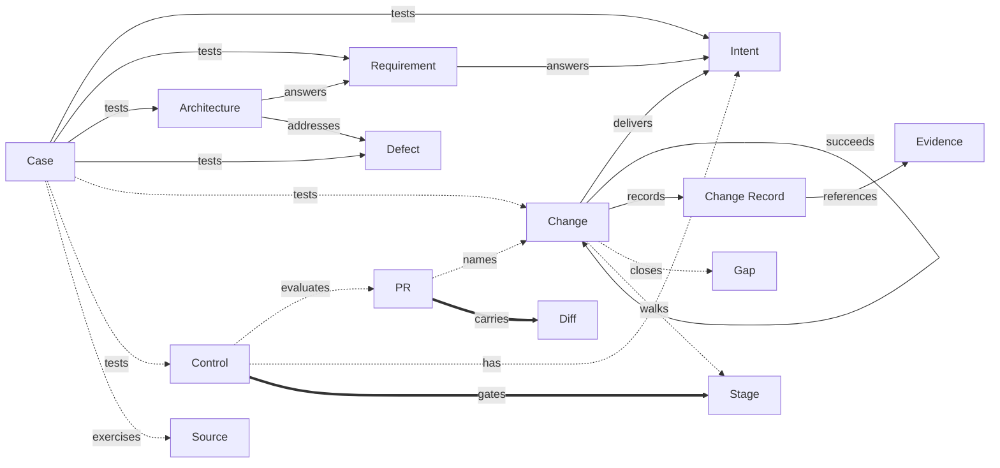

# KAAL object metamodel

The one authoritative reference for the objects of a Change and the relationships between them. It describes objects and relationships, not the order of workflow steps. A pull request is a carrier: it joins a source branch to a target branch, the diff between them, and the Controls evaluated on it. It is not a Change and never the authority for a Change's lifecycle state; the Change is the KAAL record, the diff is the repository's alteration. Each object and each relationship is defined once, here; the views in [views/](views/) only select from this model and never define anything.

Every row says how far it can be trusted: **normative** (stated by an owner's Definition or confirmed by the Owner), **observed** (a convention found in the repository, with the path that shows it), or **proposed** (an extension for the Owner to decide). Existing identifiers and keys are kept as they are; where the Owner's word and the repository's key differ, both are shown and the difference is listed under Mismatches.

## Purpose

The tracing chain, named INFORMED ([INFORMED.md](INFORMED.md): Implementation Navigates Forward: Observed Results Mirror Earlier Decisions), gives an anchor for semantic reasoning, both when a Change is created and when it is understood afterwards. Reasoning starts from one fixed point and moves along the chain: **Intent**, **Requirement**, **Architecture**, **Control**, **Case**, and then the **code or ruleset** the Case runs. Each step answers the one before it, so a reader or an agent can ask at any object what it answers and what answers it, and a Case that turns from RED to GREEN is evidence about the Intent at the start of the chain. The model exists so that this reasoning needs no reconstruction of KAAL's architecture from scattered documents. Where the repository does not yet carry a link of the chain, the model says so under Mismatches.

## Trace chain

| Step | Object | Answers the previous step by | Status in the repository |
| --- | --- | --- | --- |
| 1 | Intent | the start of the chain | exists |
| 2 | Requirement | answers Intent (`serves`) | exists |
| 3 | Architecture | answers Requirement (`addresses`) | exists |
| 4 | Control | has Intent (`has`); no link from Architecture to a Control is found | exists, linked to Intent only |
| 5 | Case | tests any of the above by the ids it exports | exists |
| 6 | Source | a Case exercises it, RED to GREEN; no key declares the relation | exists, undeclared |

Every view below shows the part of this chain its template carries.

## Diagram

Solid arrows are normative, dashed arrows observed, thick arrows proposed.

## Objects

| Object | Repository identity | Status | Defined by |
| --- | --- | --- | --- |
| Intent | `<capability>/I<n>` | normative | kaal-intent (not on `main`); GLUE names the discipline |
| Requirement | `<capability>/F<n>` functional, `<capability>/N<n>` nonfunctional | normative | kaal-requirements (not on `main`); GLUE |
| Architecture | `<capability>/A<n>`, may have a `parent` | normative | kaal-architecture (not on `main`); GLUE |
| Defect | `<capability>/D<n>`, a record with `expected`, `observed`, `where`, `status`, `tests` | normative | the hotfix route requires the identity; example `packages/kaal-hosting/06-defects/D10-multiline-conditional-selector.md` |
| Case | `<capability>/T<n>`, a file exporting `id`, `tests`, `title`, `run` | normative | kaal-testing |
| Change | `<capability>/C<n>`, a Change Node in its record folder | normative | kaal-change, Change Definition |
| Change Record | the folder of a Change (`00-changes/C<n>-<slug>/` in release management) | normative | kaal-change, Change Record Definition |
| Evidence | what a record references: Case results, checks, `evidence.md`, the 4L retrospective, a Review judgment | normative | kaal-change (tracks, never owns); Testing (verification); Review (validation) |
| PR | a GitHub pull request from a source branch to a target branch, with a title TYPE and a body in the envelope of its template; a carrier and the context in which Controls are evaluated, never a Change | observed | `engineering/github/branching.md` (routes by TYPE); Owner direction, 18 Nov 2026 |
| Diff | the difference between the target and the source branch at the head of a PR: the changed files, the proposed alteration of repository state; not a Change Record | proposed | Owner direction, 18 Nov 2026 (CPO review of the views); no Definition names it |
| Control | `<capability>/CTL<n>`, with `type` and `has` | observed | `packages/kaal-controls/02-requirements/F13-control-shape/F13.md`; six in `engineering/release-management/04-controls/` |
| Source | the code, workflow or ruleset a Case exercises, under `05-src/` | observed | `engineering/release-management/00-changes/C37-developing/T511.test.mjs` imports the judge it runs |
| Gap | `<capability>/G<n>`, a row of a Change's `gap.md` | observed | `engineering/release-management/00-changes/C65-sync-split/gap.md` |
| Stage | a stage of `05-src/stages/stages.json` (Developing, Integrating, Promoting, Publishing) | observed | `engineering/release-management/strategy.md` |

## Relationships

| Relationship | From → to | Repository key | Status | Source |
| --- | --- | --- | --- | --- |
| delivers | Change → Intent | `implements` | normative | Owner, 18 Nov 2026; Delivers Definition (`packages/kaal-change/capability/Delivers.md`) |
| answers | Requirement → Intent | `serves` | normative | Owner, 18 Nov 2026 |
| answers | Architecture → Requirement | `addresses` | normative | Owner, 18 Nov 2026 |
| addresses | Architecture → Defect | none found | normative | Owner, 18 Nov 2026 |
| tests | Case → Intent, Requirement, Architecture, Defect | `export const tests` | normative | Owner, 18 Nov 2026 |
| succeeds | Change → Change | none found | normative | Succeeds Definition (`packages/kaal-change/capability/Succeeds.md`) |
| records | Change → Change Record | the folder | normative | Change Record Definition |
| references | Change Record → Evidence | none | normative | Change Record Definition |
| names | PR → Change | the Change line of the body | observed | `.github/PULL_REQUEST_TEMPLATE/plan.md` |
| carries | PR → Diff | the head and the base of the PR | proposed | Owner direction, 18 Nov 2026 |
| evaluates | Control → PR | a check on the head commit of the PR | observed | `engineering/release-management/04-controls/CTL7-verify-sync/CTL7.md` |
| has | Control → Intent | `has` | observed | `packages/kaal-controls/02-requirements/F13-control-shape/F13.md` |
| tests | Case → Change, Control | `export const tests` | observed | `engineering/release-management/00-changes/C65-sync-split/T851.test.mjs`, `engineering/release-management/04-controls/CTL7-verify-sync/T750.test.mjs` |
| exercises | Case → Source | none | observed | `engineering/release-management/00-changes/C37-developing/T511.test.mjs` |
| closes | Change → Gap | `closes` | observed | `engineering/release-management/00-changes/C65-sync-split/C65.md` |
| walks | Change → Stage | none | observed | `engineering/release-management/strategy.md` |
| gates | Control → Stage | none | proposed | `strategy.md` says each stage has one gate; no file names the control |

## Vocabularies

- **Lifecycle of a Change**, read from facts and never stored: Proposed, Accepted, Withdrawn, Promoted (`packages/kaal-change/capability/Change-Lifecycle.md`). Approval, verification and validation are not states.
- **PR title TYPE**: PLAN, DO, ACT, PROMOTION, SYNC, HOTFIX, DEFAULT, and WIRE in use. The PDCA phase a PR carries is its TYPE; it is not the state of the Change. The TYPE also says the route: its source and target branch.
- **INFORMED**, the mnemonic of the trace chain: [INFORMED.md](INFORMED.md). It owns no instruction, capability or control.
- **Change class**: Normal, Standard, Emergency (`Change-Classification.md`).

## Views

| TYPE | View | Template |
| --- | --- | --- |
| DEFAULT | [views/default.md](views/default.md) | `.github/pull_request_template.md` |
| PLAN | [views/plan.md](views/plan.md) | `.github/PULL_REQUEST_TEMPLATE/plan.md` |
| DO | [views/do.md](views/do.md) | `.github/PULL_REQUEST_TEMPLATE/do.md` |
| ACT | [views/act.md](views/act.md) | `.github/PULL_REQUEST_TEMPLATE/act.md` |
| PROMOTION | [views/promotion.md](views/promotion.md) | `.github/PULL_REQUEST_TEMPLATE/promotion.md` |
| HOTFIX | [views/hotfix.md](views/hotfix.md) | `.github/PULL_REQUEST_TEMPLATE/hotfix.md` |
| SYNC | [views/sync.md](views/sync.md) | `.github/PULL_REQUEST_TEMPLATE/sync.md` |

## Reviewer questions

Each question is answered by following these relationships from the PR.

| # | Question | Path |
| --- | --- | --- |
| Q1 | What objects does this Change affect? | PR names Change; Change records Change Record; PR carries Diff, the changed files by folder |
| Q2 | Which Intent does it deliver? | PR names Change; Change delivers Intent |
| Q3 | Which Requirements and Architecture support that Intent? | Requirement answers Intent; Architecture answers Requirement; where none exist, Control has Intent |
| Q4 | What does each Case explicitly test? | Case tests (the exported list) |
| Q5 | Which Defects are addressed? | Architecture addresses Defect; Case tests Defect; Change closes Gap |
| Q6 | What evidence supports the requested decision? | Change records Change Record; Change Record references Evidence |

## Mismatches

Recorded, not corrected. Each names the Owner's word or the model's claim, what the repository shows, and where.

| # | The model says | The repository shows | Evidence |
| --- | --- | --- | --- |
| M1 | Change delivers Intent | the key is `implements` | `engineering/release-management/00-changes/C65-sync-split/C65.md` |
| M2 | Requirement answers Intent; Architecture answers Requirement | the keys are `serves` and `addresses` | `engineering/release-management/02-requirements/F22-wire-operation/F22.md` |
| M3 | Architecture addresses Defect | no Architecture file addresses a Defect | `engineering/release-management/03-architecture/A47-wire-install/A47.md` |
| M4 | every Intent has Requirements and Architecture | release/I35 has none; Controls answer it | `engineering/release-management/04-controls/CTL7-verify-sync/CTL7.md` |
| M5 | a Change has a Change Node | release/C37 has no `C37.md` | `engineering/release-management/00-changes/C37-developing/change.md` |
| M6 | the PR names the Intent | the Change chapter names the Change only; the Intent appears, when it does, in prose (the PLAN #1889 mentions release/I35 in To, the ACT #1891 and PROMOTION #1892 do not) | `engineering/release-management/00-changes/C65-sync-split/C65.md` |
| M7 | every PR TYPE has a template | WIRE has none on `main` | `engineering/release-management/03-architecture/A47-wire-install/A47.md` |
| M8 | a Change closes a Defect | the Change closes a Gap, a different object | `engineering/release-management/00-changes/C65-sync-split/gap.md` |
| M9 | the chain runs Intent, Requirement, Architecture, Control, Case | a Control has an Intent only; no file links an Architecture to a Control or a Control to its Source | `engineering/release-management/04-controls/CTL1-verify-stages/CTL1.md` |
| M10 | a PR does not realize a Change: it carries a Diff and names a Change | the Change Definition says "a pull request is one realization of a Change", and Branching speaks of a Change proposed through a pull request | `packages/kaal-change/capability/Change-Definition.md` |
