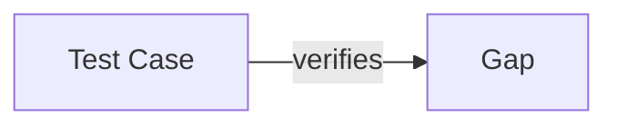

# ACT view of the KAAL object metamodel

Template: `.github/PULL_REQUEST_TEMPLATE/act.md`. Global model: [metamodel.md](../metamodel.md). This view selects from the model and defines nothing.

An ACT adds the records that close the Change in its collector, today the 4L retrospective.

Effect on the model: none on delivery or solving, which the Change did in DO. The ACT is after the act: it records the 4L retrospective and unwires the Change's Test Cases. The Test Cases that lived in the Change folder retire and their guard registration goes; the target Test Cases beside each element stay.

**Purpose.** This view anchors semantic reasoning about ACT work, both when it is written and when it is understood afterwards, along the INFORMED chain: Intent, Requirement, Architecture, Test Case; a Control enters at its Intents. **In the chain:** Test Case and Gap: the Test Cases that verified the Gap in the Change folder retire, and the target Test Cases remain as what verifies the delivered Intent or solved Defect.

## Objects
Gap, Test Case.

## Relationships
verifies.

## Information the template expects
The Change line; the records the ACT adds, named and not repeated.

## What the reviewer should be able to verify
That the 4L retrospective is present; that the Test Cases in the Change folder are unwired and the target Test Cases beside each element remain; that nothing else changed.

## The INFORMED chapter
The template carries a chapter named INFORMED. It links this view, which links [metamodel.md](../metamodel.md), and names the Change. It holds one box for each concern below. Each box is ticked, or marked n/a with a reason. A tick is the author's claim, not evidence.

- [ ] The 4L retrospective is present
- [ ] The Test Cases in the Change folder are unwired and the target Test Cases beside each element remain
- [ ] Nothing else changed

**Process control** (verify Envelope, on the filled template): the chapter exists, the view link is right, the Change exists, and every box above is present and either ticked or n/a with a reason. It never judges the work and does not repeat the trace.
**Content control** (on the Change's files): the chain links exist, Test Cases name what they test and ran RED then GREEN, Controls are declared, and each claim is compared with the evidence in both directions: ticked without evidence is "claimed but not found"; evidence present but the box not ticked, or marked n/a, is "done but not claimed". Both are findings.

## Outside this template
What the retrospective concludes (Review judges it); the Intent, Requirements and Test Cases (unchanged by an ACT); delivery to `main`.
