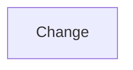

# ACT view of the KAAL object metamodel

Template: `.github/PULL_REQUEST_TEMPLATE/act.md`. Global model: [metamodel.md](../metamodel.md). This view selects from the model and defines nothing.

An ACT is after the act: the retrospective.

**Purpose.** This view anchors semantic reasoning about ACT work along the INFORMED chain. **In the chain:** No new nodes. All Test Cases are GREEN.

## Objects
Change.

## Relationships

## Information the template expects
The Change line; the retrospective (4L).

## What the reviewer should be able to verify
That the retrospective is present, that no node was added, and that all Test Cases are GREEN.

## The INFORMED chapter
The template carries a chapter named INFORMED. It links this view, which links [metamodel.md](../metamodel.md), and names the Change. Each box below is ticked, or marked n/a with a reason; a tick is the author's claim, not evidence.

- [ ] The retrospective is present
- [ ] No node was added
- [ ] All Test Cases are GREEN (RED 0, UNKNOWN 0)

**Process control** (verify Envelope, on the filled template): the chapter exists, the view link is right, the Change exists, and every box is present and either ticked or n/a with a reason. It never judges the work.
**Content control** (on the Change's files): each claim is compared with the evidence in both directions: ticked without evidence is "claimed but not found"; evidence present but not ticked, or n/a, is "done but not claimed". Both are findings.

## Outside this template
Implementation (DO); delivery to `main`.
