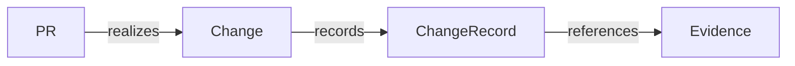

# ACT view of the KAAL object metamodel

Template: `.github/PULL_REQUEST_TEMPLATE/act.md`. Global model: [metamodel.md](../metamodel.md). This view selects from the model and defines nothing.

An ACT adds the records that close the Change in its collector, today the 4L retrospective.

**Purpose.** This view anchors semantic reasoning about a ACT pull request, both when it is written and when it is understood afterwards, along the INFORMED chain, Intent, Requirement, Architecture, Control, Case, then code or ruleset. **In the chain:** the whole chain, afterwards: the ACT records what the Change taught about it, for the next reader.

## Objects
Change, Change Record, Evidence, PR.

## Relationships
records, references, realizes.

## Information the template expects
The Change line; the records the ACT adds, named and not repeated.

## What the reviewer should be able to verify
That the record the ACT names exists in the Change Record and belongs to the Change (Q6); that nothing else changed (Q1).

## The INFORMED chapter
The template carries a chapter named INFORMED. It links this view, which links [metamodel.md](../metamodel.md), and names the Change. It holds one box for each concern below. Each box is ticked, or marked n/a with a reason. A tick is the author's claim, not evidence.

- [ ] The record the ACT names exists in the Change Record and belongs to the Change
- [ ] Nothing else changed

**Process control** (verify Envelope, on the pull request): the chapter exists, the view link is right, the Change exists, and every box above is present and either ticked or n/a with a reason. It never judges the work and does not repeat the trace.
**Content control** (on the Change's files): the chain links exist, Cases name what they test and ran RED then GREEN, Controls are declared, and each claim is compared with the evidence in both directions: ticked without evidence is "claimed but not found"; evidence present but the box not ticked, or marked n/a, is "done but not claimed". Both are findings.

## Outside this template
What the retrospective concludes (Review judges it); the Intent, Requirements and Cases (unchanged by an ACT); delivery to `main`.
