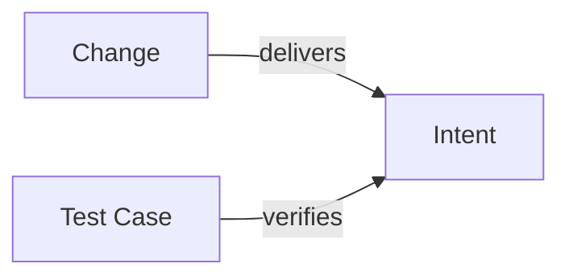

# DEFAULT view of the KAAL object metamodel

Template: `.github/pull_request_template.md`. Global model: [metamodel.md](../metamodel.md). This view selects from the model and defines nothing.

The fallback form: states the Intent and how it is to be shown met.

**Purpose.** This view anchors semantic reasoning about DEFAULT work along the INFORMED chain. **In the chain:** Change delivers Intent; Test Cases verify it.

## Objects
Change, Intent, Test Case.

## Relationships
delivers, verifies.

## Information the template expects
The Intent; what shows it met (Verified by); the judgment required (Validated by).

## What the reviewer should be able to verify
That the Change delivers the stated Intent and the Test Cases verify it.

## The INFORMED chapter
The template carries a chapter named INFORMED. It links this view, which links [metamodel.md](../metamodel.md), and names the Change. Each box below is ticked, or marked n/a with a reason; a tick is the author's claim, not evidence.

- [ ] The Change delivers the stated Intent
- [ ] The Test Cases verify that Intent

**Process control** (verify Envelope, on the filled template): the chapter exists, the view link is right, the Change exists, and every box is present and either ticked or n/a with a reason. It never judges the work.
**Content control** (on the Change's files): each claim is compared with the evidence in both directions: ticked without evidence is "claimed but not found"; evidence present but not ticked, or n/a, is "done but not claimed". Both are findings.

## Outside this template
Design detail; the lifecycle state of the Change.
