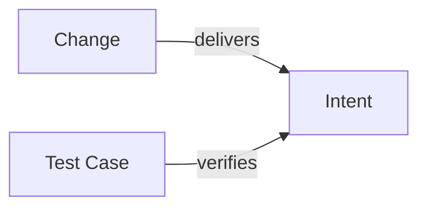

# DEFAULT view of the KAAL object metamodel

Template: `.github/pull_request_template.md`. Global model: [metamodel.md](../metamodel.md). This view selects from the model and defines nothing.

The fallback envelope, used only when no specialized TYPE fits. Its chapters are Intent, Design, Verified by and Validated by.

Effect on the model: none specific. The fallback form states an Intent and how it is to be shown met.

**Purpose.** This view anchors semantic reasoning about DEFAULT work, both when it is written and when it is understood afterwards, along the INFORMED chain: Intent, Requirement, Architecture, Test Case; a Control enters at its Intents. **In the chain:** Intent to Test Case: the Verified by and Validated by chapters say how the Intent is to be shown met.

## Objects
Change, Intent, Test Case.

## Relationships
delivers, verifies.

## Information the template expects
The Intent the Change must achieve; optionally a Design that belongs to the Change contract; the deterministic evidence required (Verified by); the judgment required (Validated by).

## What the reviewer should be able to verify
That the Change named by the body delivers the stated Intent, that the Verified by evidence is a Test Case result or a check that verifies that Intent, and that the judgment asked for is one an independent reviewer or the Owner can give.

## The INFORMED chapter
The template carries a chapter named INFORMED. It links this view, which links [metamodel.md](../metamodel.md), and names the Change. It holds one box for each concern below. Each box is ticked, or marked n/a with a reason. A tick is the author's claim, not evidence.

- [ ] The Change line names a Change that delivers an Intent or solves a Defect
- [ ] Verified by names a Test Case result or a check that verifies that Intent
- [ ] The judgment asked for is one an independent reviewer or the Owner can give

**Process control** (verify Envelope, on the filled template): the chapter exists, the view link is right, the Change exists, and every box above is present and either ticked or n/a with a reason. It never judges the work and does not repeat the trace.
**Content control** (on the Change's files): the chain links exist, Test Cases name what they test and ran RED then GREEN, Controls are declared, and each claim is compared with the evidence in both directions: ticked without evidence is "claimed but not found"; evidence present but the box not ticked, or marked n/a, is "done but not claimed". Both are findings.

## Outside this template
Which Requirements and Architecture support the Intent (the Change holds them); the lifecycle state of the Change; any Control.
