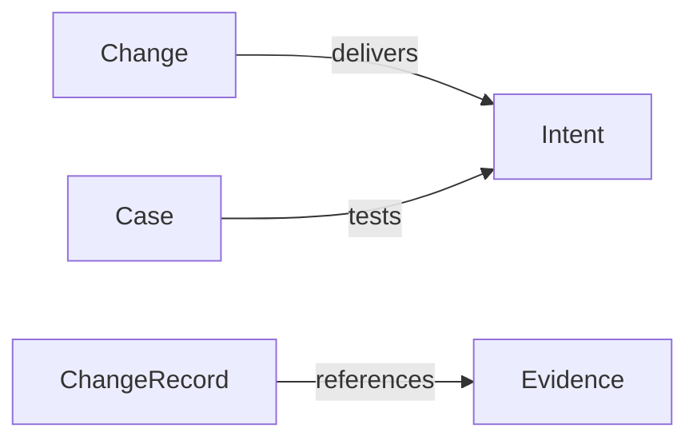

# DEFAULT view of the KAAL object metamodel

Template: `.github/pull_request_template.md`. Global model: [metamodel.md](../metamodel.md). This view selects from the model and defines nothing.

The fallback envelope, used only when no specialized TYPE fits. Its chapters are Intent, Design, Verified by and Validated by.

**Purpose.** This view anchors semantic reasoning about a DEFAULT pull request, both when it is written and when it is understood afterwards, along the INFORMED chain, Intent, Requirement, Architecture, Control, Case, then code or ruleset. **In the chain:** Intent to Case: the Verified by and Validated by chapters say how the Intent is to be shown met.

## Objects
Change, Intent, Case, Change Record, Evidence.

## Relationships
delivers, tests, references.

## Information the template expects
The Intent the Change must achieve; optionally a Design that belongs to the Change contract; the deterministic evidence required (Verified by); the judgment required (Validated by).

## What the reviewer should be able to verify
That the Change named by the body delivers the stated Intent (Q2), that the Verified by evidence is a Case result or a check that tests that Intent (Q4), and that the judgment asked for is one an independent reviewer or the Owner can give (Q6).

## The INFORMED chapter
The template carries a chapter named INFORMED. It links this view, which links [metamodel.md](../metamodel.md), and names the Change. It holds one box for each concern below. Each box is ticked, or marked n/a with a reason. A tick is the author's claim, not evidence.

- [ ] The Change line names a Change Record that delivers an Intent
- [ ] Verified by names a Case result or a check that tests that Intent
- [ ] The judgment asked for is one an independent reviewer or the Owner can give

**Process control** (verify Envelope, on the pull request): the chapter exists, the view link is right, the Change exists, and every box above is present and either ticked or n/a with a reason. It never judges the work and does not repeat the trace.
**Content control** (on the Change's files): the chain links exist, Cases name what they test and ran RED then GREEN, Controls are declared, and each claim is compared with the evidence in both directions: ticked without evidence is "claimed but not found"; evidence present but the box not ticked, or marked n/a, is "done but not claimed". Both are findings.

## Outside this template
Which Requirements and Architecture support the Intent (the Change Record holds them); the lifecycle state of the Change; any control or stage.
