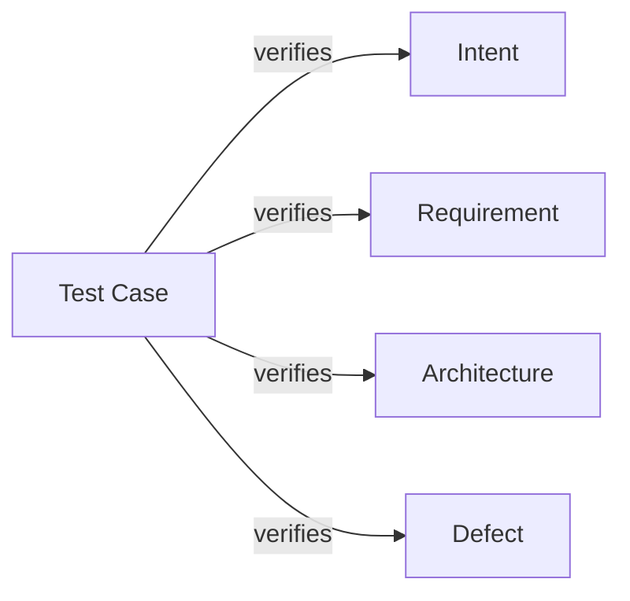

# DO view of the KAAL object metamodel

Template: `.github/PULL_REQUEST_TEMPLATE/do.md`. Global model: [metamodel.md](../metamodel.md). This view selects from the model and defines nothing.

A DO implements a planned Change.

**Purpose.** This view anchors semantic reasoning about DO work along the INFORMED chain. **In the chain:** Makes the planned Test Cases GREEN. RED stays the same or goes down; nothing else is added.

## Objects
Intent, Requirement, Architecture, Defect, Test Case.

## Relationships
verifies.

## Information the template expects
The Change line; what the DO implements.

## What the reviewer should be able to verify
That the Test Cases the PLAN left RED are now GREEN, that RED did not go up, and that no node was added.

## The INFORMED chapter
The template carries a chapter named INFORMED. It links this view, which links [metamodel.md](../metamodel.md), and names the Change. Each box below is ticked, or marked n/a with a reason; a tick is the author's claim, not evidence.

- [ ] The planned Test Cases are GREEN
- [ ] RED did not go up
- [ ] No object was added

**Process control** (verify Envelope, on the filled template): the chapter exists, the view link is right, the Change exists, and every box is present and either ticked or n/a with a reason. It never judges the work.
**Content control** (on the Change's files): each claim is compared with the evidence in both directions: ticked without evidence is "claimed but not found"; evidence present but not ticked, or n/a, is "done but not claimed". Both are findings.

## Outside this template
Planning (PLAN); the retrospective (ACT).
