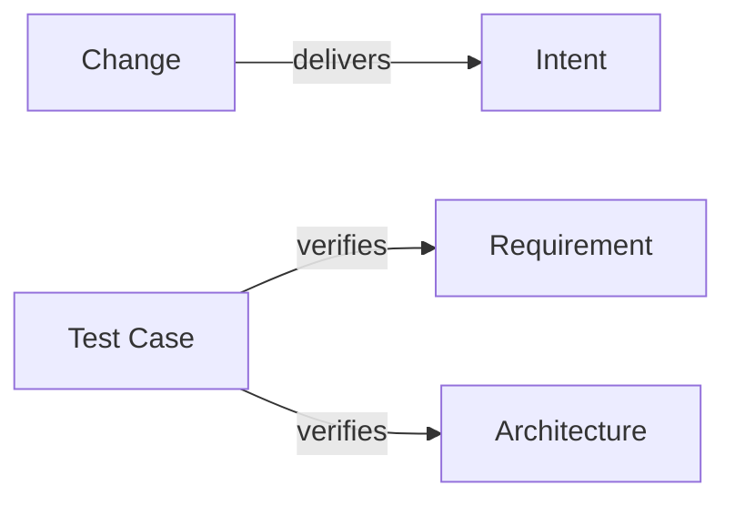

# DO view of the KAAL object metamodel

Template: `.github/PULL_REQUEST_TEMPLATE/do.md`. Global model: [metamodel.md](../metamodel.md). This view selects from the model and defines nothing.

A DO implements a planned Change: the RED Test Cases turn GREEN and nothing else changes.

Effect on the model: turns the planned Test Cases GREEN. The code that does it is outside the model (code if RED, none if GREEN).

**Purpose.** This view anchors semantic reasoning about DO work, both when it is written and when it is understood afterwards, along the INFORMED chain: Intent, Requirement, Architecture, Test Case; a Control enters at its Intents. **In the chain:** Test Case: the Test Cases that ran RED turn GREEN, which is the evidence about the Intent at the start of the chain.

## Objects
Change, Intent, Requirement, Architecture, Test Case.

## Relationships
delivers, verifies.

## Information the template expects
The Change line; what the DO implements; the refactoring intended while behaviour stays, or that there is none.

## What the reviewer should be able to verify
That the Change is the one the merged PLAN planned; which Test Cases turned GREEN and what each explicitly verifies; that the files changed are the objects the PLAN named; the Test Cases that turned GREEN.

## The INFORMED chapter
The template carries a chapter named INFORMED. It links this view, which links [metamodel.md](../metamodel.md), and names the Change. It holds one box for each concern below. Each box is ticked, or marked n/a with a reason. A tick is the author's claim, not evidence.

- [ ] The Change is the one the merged PLAN planned
- [ ] Each Test Case that turned GREEN names what it verifies
- [ ] The files changed are the objects the PLAN named
- [ ] The Test Cases that turned GREEN are named

**Process control** (verify Envelope, on the filled template): the chapter exists, the view link is right, the Change exists, and every box above is present and either ticked or n/a with a reason. It never judges the work and does not repeat the trace.
**Content control** (on the Change's files): the chain links exist, Test Cases name what they test and ran RED then GREEN, Controls are declared, and each claim is compared with the evidence in both directions: ticked without evidence is "claimed but not found"; evidence present but the box not ticked, or marked n/a, is "done but not claimed". Both are findings.

## Outside this template
New Requirements or Intent (a change to those is a new PLAN); the retrospective; delivery to `main`.
