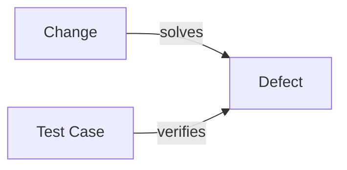

# HOTFIX view of the KAAL object metamodel

Template: `.github/PULL_REQUEST_TEMPLATE/hotfix.md`. Global model: [metamodel.md](../metamodel.md). This view selects from the model and defines nothing.

A HOTFIX is the fast, focused route for a proven Defect. It is not PLAN, DO and ACT.

**Purpose.** This view anchors semantic reasoning about HOTFIX work along the INFORMED chain. **In the chain:** The Change solves a Defect. The Defect is proven (it may come from `main`, another branch, or just be found) and the Test Cases that verify it go from RED against the base to GREEN. Only GREEN merges: `main` never carries RED.

## Objects
Change, Defect, Test Case.

## Relationships
solves, verifies.

## Information the template expects
The Change (id and name); the Defect (`<capability>/D<n>`); the urgency; the approach.

## What the reviewer should be able to verify
That the Defect is proven, that its Test Cases are RED against the base and GREEN on the head, and that nothing else changed.

## The INFORMED chapter
The template carries a chapter named INFORMED. It links this view, which links [metamodel.md](../metamodel.md), and names the Change. Each box below is ticked, or marked n/a with a reason; a tick is the author's claim, not evidence.

- [ ] The Defect is proven
- [ ] Its Test Cases are RED against the base and GREEN on the head
- [ ] Nothing else changed

**Process control** (verify Envelope, on the filled template): the chapter exists, the view link is right, the Change exists, and every box is present and either ticked or n/a with a reason. It never judges the work.
**Content control** (on the Change's files): each claim is compared with the evidence in both directions: ticked without evidence is "claimed but not found"; evidence present but not ticked, or n/a, is "done but not claimed". Both are findings.

## Outside this template
Planning and the retrospective; not every Defect is a HOTFIX.
