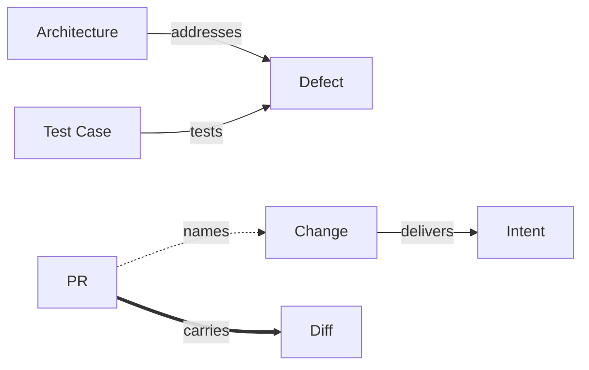

# HOTFIX view of the KAAL object metamodel

Template: `.github/PULL_REQUEST_TEMPLATE/hotfix.md`. Global model: [metamodel.md](../metamodel.md). This view selects from the model and defines nothing.

A HOTFIX is an Emergency Change that corrects a Defect by the fastest safe path.

**Purpose.** This view anchors semantic reasoning about a HOTFIX pull request, both when it is written and when it is understood afterwards, along the INFORMED chain, Intent, Requirement, Architecture, Control, Test Case, then code or ruleset. **In the chain:** Defect to Architecture to Test Case to Source: the Defect is addressed by Architecture, a Test Case fails RED on it and turns GREEN with the correction.

## Objects
Change, Intent, Architecture, Defect, Test Case, PR, Diff.

## Relationships
addresses, tests, delivers, names, carries.

## Information the template expects
The Change (id and name only); the Defect by its `<capability>/D<n>` identity and the state that is defective; the urgency; the approach.

## What the reviewer should be able to verify
That the Defect identity resolves (Q5); that a Test Case tests that Defect and ran RED before GREEN (Q4); that the Architecture the correction addresses is named (Q3); that the state claimed defective (production, `main` or a collector) is the one meant.

## The INFORMED chapter
The template carries a chapter named INFORMED. It links this view, which links [metamodel.md](../metamodel.md), and names the Change. It holds one box for each concern below. Each box is ticked, or marked n/a with a reason. A tick is the author's claim, not evidence.

- [ ] The Defect identity resolves
- [ ] A Test Case tests that Defect and ran RED before GREEN
- [ ] The Architecture the correction addresses is named
- [ ] The state claimed defective (production, main or a collector) is the one meant

**Process control** (verify Envelope, on the pull request): the chapter exists, the view link is right, the Change exists, and every box above is present and either ticked or n/a with a reason. It never judges the work and does not repeat the trace.
**Content control** (on the Change's files): the chain links exist, Test Cases name what they test and ran RED then GREEN, Controls are declared, and each claim is compared with the evidence in both directions: ticked without evidence is "claimed but not found"; evidence present but the box not ticked, or marked n/a, is "done but not claimed". Both are findings.

## Outside this template
A broader improvement or refactoring; the ordinary path for the Change; whether production is affected beyond what the Defect states.
