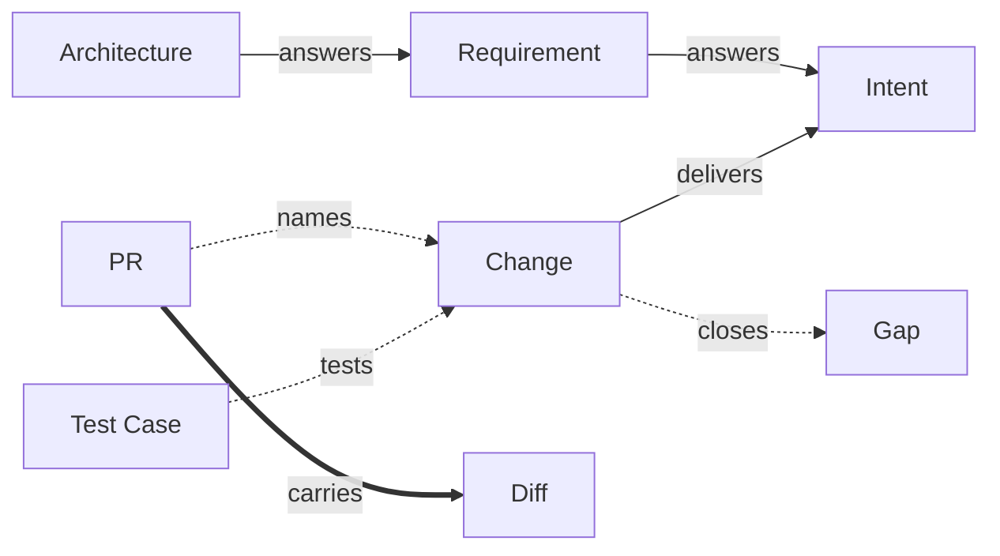

# PLAN view of the KAAL object metamodel

Template: `.github/PULL_REQUEST_TEMPLATE/plan.md`. Global model: [metamodel.md](../metamodel.md). This view selects from the model and defines nothing.

A PLAN proposes a Change: it adds drafts and Test Cases that run RED, and no behaviour.

**Purpose.** This view anchors semantic reasoning about a PLAN pull request, both when it is written and when it is understood afterwards, along the INFORMED chain, Intent, Requirement, Architecture, Control, Test Case, then code or ruleset. **In the chain:** Intent, Requirement, Architecture, Control and Test Case: a PLAN sets the chain down to Test Cases that run RED, with no Source yet.

## Objects
Change, Intent, Requirement, Architecture, Test Case, Gap, PR, Diff.

## Relationships
delivers, answers, tests, closes, names, carries.

## Information the template expects
The Change line (id, name, what it is about); From (the current state); To (the target state); Because (the value delivered).

## What the reviewer should be able to verify
That the Change line resolves to a Change Record that delivers an Intent (Q2); that the Requirements and Architecture drafted answer that Intent, or that Controls do (Q3); that every Test Case runs RED for the reason the record gives and names what it tests (Q4); the Gap it closes, if the Change uses Gaps (Q5).

## The INFORMED chapter
The template carries a chapter named INFORMED. It links this view, which links [metamodel.md](../metamodel.md), and names the Change. It holds one box for each concern below. Each box is ticked, or marked n/a with a reason. A tick is the author's claim, not evidence.

- [ ] The Change line resolves to a Change Record that delivers an Intent
- [ ] Requirements and Architecture answer that Intent, or a Control has it
- [ ] Every Test Case runs RED for the reason the record gives and names what it tests
- [ ] The Gap closed is named, if the Change uses Gaps
- [ ] From, To and Because are stated

**Process control** (verify Envelope, on the pull request): the chapter exists, the view link is right, the Change exists, and every box above is present and either ticked or n/a with a reason. It never judges the work and does not repeat the trace.
**Content control** (on the Change's files): the chain links exist, Test Cases name what they test and ran RED then GREEN, Controls are declared, and each claim is compared with the evidence in both directions: ticked without evidence is "claimed but not found"; evidence present but the box not ticked, or marked n/a, is "done but not claimed". Both are findings.

## Outside this template
Implementation (DO), the retrospective (ACT), the lifecycle state, delivery to `main`.
