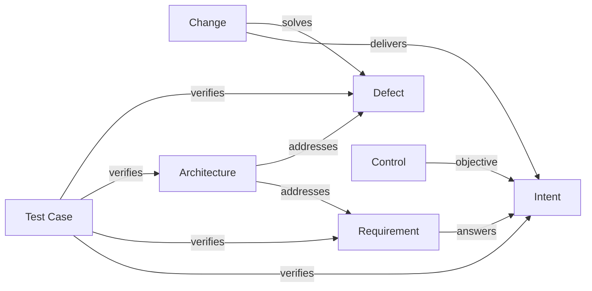

# PLAN view of the KAAL object metamodel

Template: `.github/PULL_REQUEST_TEMPLATE/plan.md`. Global model: [metamodel.md](../metamodel.md). This view selects from the model and defines nothing.

A PLAN proposes a Change.

**Purpose.** This view anchors semantic reasoning about PLAN work along the INFORMED chain. **In the chain:** The Change delivers an Intent and/or solves a Defect. It may add Intent, Defect, Requirement, Architecture, Control and Test Case. RED stays the same or goes up.

## Objects
Change, Intent, Defect, Requirement, Architecture, Test Case, Control.

## Relationships
delivers, solves, answers, addresses, verifies, objective.

## Information the template expects
The Change line; From (current); To (target); Because (value).

## What the reviewer should be able to verify
That the Change delivers an Intent and/or solves a Defect, that what it adds is linked as the model says, and that the new Test Cases run RED.

## The INFORMED chapter
The template carries a chapter named INFORMED. It links this view, which links [metamodel.md](../metamodel.md), and names the Change. Each box below is ticked, or marked n/a with a reason; a tick is the author's claim, not evidence.

- [ ] The Change delivers an Intent and/or solves a Defect
- [ ] Everything added is linked as the model says
- [ ] New Test Cases run RED; RED did not go down

**Process control** (verify Envelope, on the filled template): the chapter exists, the view link is right, the Change exists, and every box is present and either ticked or n/a with a reason. It never judges the work.
**Content control** (on the Change's files): each claim is compared with the evidence in both directions: ticked without evidence is "claimed but not found"; evidence present but not ticked, or n/a, is "done but not claimed". Both are findings.

## Outside this template
Implementation (DO); the retrospective (ACT).
