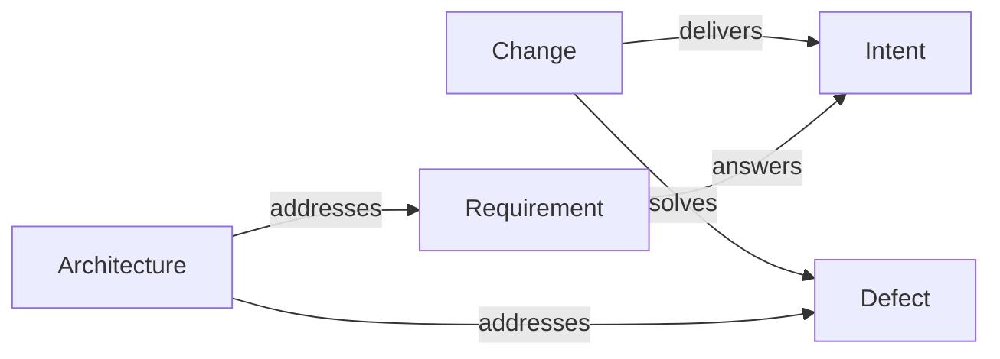

# PLAN view of the KAAL object metamodel

Template: `.github/PULL_REQUEST_TEMPLATE/plan.md`. Global model: [metamodel.md](../metamodel.md). This view selects from the model and defines nothing.

A PLAN proposes a Change: it adds drafts and Test Cases that run RED, and no behaviour.

Effect on the model: names the Intent or Defect, its Requirements and Architecture; adds Test Cases that run RED.

**Purpose.** This view anchors semantic reasoning about PLAN work, both when it is written and when it is understood afterwards, along the INFORMED chain: Intent, Requirement, Architecture, Test Case; a Control enters at its Intents. **In the chain:** Intent or Defect, Requirement, Architecture and Test Case: the work sets the chain down to Test Cases that run RED; nothing is made GREEN.

## Objects
Change, Intent, Defect, Requirement, Architecture, Test Case.

## Relationships
delivers, solves, answers, addresses, verifies.

## Information the template expects
The Change line (id, name, what it is about); From (the current state); To (the target state); Because (the value delivered).

## What the reviewer should be able to verify
That the Change line names a Change that delivers an Intent or solves a Defect; that the Requirements drafted answer that Intent and the Architecture addresses them, or that Controls have it as their objective; that every Test Case runs RED for the reason the record gives and names what it verifies.

## The INFORMED chapter
The template carries a chapter named INFORMED. It links this view, which links [metamodel.md](../metamodel.md), and names the Change. It holds one box for each concern below. Each box is ticked, or marked n/a with a reason. A tick is the author's claim, not evidence.

- [ ] The Change line names a Change that delivers an Intent or solves a Defect
- [ ] Requirements answer that Intent and Architecture addresses them, or a Control has it as its objective
- [ ] Every Test Case runs RED for the reason the record gives and names what it verifies
- [ ] From, To and Because are stated

**Process control** (verify Envelope, on the filled template): the chapter exists, the view link is right, the Change exists, and every box above is present and either ticked or n/a with a reason. It never judges the work and does not repeat the trace.
**Content control** (on the Change's files): the chain links exist, Test Cases name what they test and ran RED then GREEN, Controls are declared, and each claim is compared with the evidence in both directions: ticked without evidence is "claimed but not found"; evidence present but the box not ticked, or marked n/a, is "done but not claimed". Both are findings.

## Outside this template
Implementation (DO), the retrospective (ACT), the lifecycle state, delivery to `main`.
