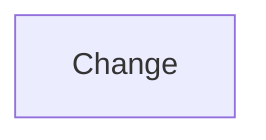

# PROMOTION view of the KAAL object metamodel

Template: `.github/PULL_REQUEST_TEMPLATE/promotion.md`. Global model: [metamodel.md](../metamodel.md). This view selects from the model and defines nothing.

A PROMOTION delivers what a collector holds to `main`.

**Purpose.** This view anchors semantic reasoning about PROMOTION work along the INFORMED chain. **In the chain:** No semantic effect: the Change node only, no edges (transport).

## Objects
Change.

## Relationships

## Information the template expects
One line per Change delivered; why now.

## What the reviewer should be able to verify
That nothing travels but the Changes named.

## The INFORMED chapter
The template carries a chapter named INFORMED. It links this view, which links [metamodel.md](../metamodel.md), and names the Change. Each box below is ticked, or marked n/a with a reason; a tick is the author's claim, not evidence.

- [ ] Each Change named is Accepted in the collector
- [ ] Only the Changes named travel

**Process control** (verify Envelope, on the filled template): the chapter exists, the view link is right, the Change exists, and every box is present and either ticked or n/a with a reason. It never judges the work.
**Content control** (on the Change's files): each claim is compared with the evidence in both directions: ticked without evidence is "claimed but not found"; evidence present but not ticked, or n/a, is "done but not claimed". Both are findings.

## Outside this template
Everything semantic.
