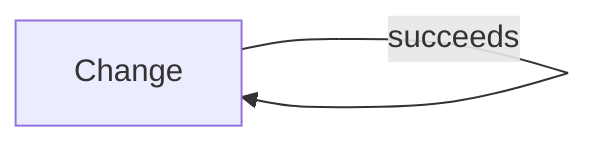

# PROMOTION view of the KAAL object metamodel

Template: `.github/PULL_REQUEST_TEMPLATE/promotion.md`. Global model: [metamodel.md](../metamodel.md). This view selects from the model and defines nothing.

A PROMOTION delivers the Changes a collector holds to `main`.

Effect on the model: none. A PROMOTION carries what the collector holds onward and adds no object and no relationship; the objectives of the Controls are unchanged by it.

**Purpose.** This view anchors semantic reasoning about PROMOTION work, both when it is written and when it is understood afterwards, along the INFORMED chain: Intent, Requirement, Architecture, Test Case; a Control enters at its Intents. **In the chain:** none: a PROMOTION carries chains already verified and adds no link to any chain.

## Objects
Change.

## Relationships
succeeds.

## Information the template expects
One line per Change delivered, `<id> <name>: <phases carried>`; why now.

## What the reviewer should be able to verify
That each Change named is Accepted in the collector and no Change it succeeds is missing; that nothing else travels with it.

## The INFORMED chapter
The template carries a chapter named INFORMED. It links this view, which links [metamodel.md](../metamodel.md), and names the Change. It holds one box for each concern below. Each box is ticked, or marked n/a with a reason. A tick is the author's claim, not evidence.

- [ ] Each Change named is Accepted in the collector and carries the phases it names
- [ ] No Change it succeeds is missing
- [ ] Nothing else travels with it

**Process control** (verify Envelope, on the filled template): the chapter exists, the view link is right, the Change exists, and every box above is present and either ticked or n/a with a reason. It never judges the work and does not repeat the trace.
**Content control** (on the Change's files): the chain links exist, Test Cases name what they test and ran RED then GREEN, Controls are declared, and each claim is compared with the evidence in both directions: ticked without evidence is "claimed but not found"; evidence present but the box not ticked, or marked n/a, is "done but not claimed". Both are findings.

## Outside this template
The content of each Change; the Requirements and Test Cases (judged where each Change landed); whether the Intent achieved its Outcome.
