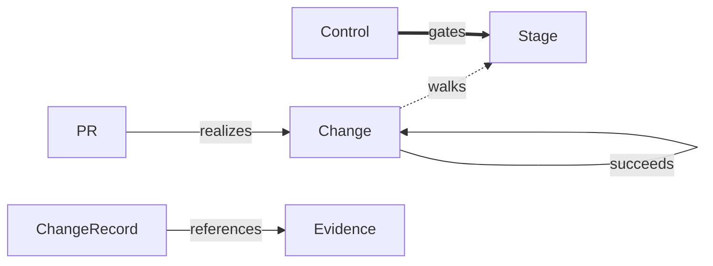

# PROMOTION view of the KAAL object metamodel

Template: `.github/PULL_REQUEST_TEMPLATE/promotion.md`. Global model: [metamodel.md](../metamodel.md). This view selects from the model and defines nothing.

A PROMOTION delivers the Changes a collector holds to `main`.

**Purpose.** This view anchors semantic reasoning about a PROMOTION pull request, both when it is written and when it is understood afterwards, along the INFORMED chain, Intent, Requirement, Architecture, Control, Case, then code or ruleset. **In the chain:** the whole chain, for each Change: every Change named arrives with its Intent, its answers and its GREEN Cases already in its record.

## Objects
Change, Change Record, Evidence, Stage, Control, PR.

## Relationships
succeeds, walks, gates, references, realizes.

## Information the template expects
One line per Change delivered, `<id> <name>: <phases carried>`; why now.

## What the reviewer should be able to verify
That each Change named is Accepted in the collector and carries the phases it names (Q1, Q6); that no Change it succeeds is missing (Q1); that the Intents delivered are those of the Changes (Q2); that the stage it enters, Promoting, has its gate green at the exact head (Q6).

## The INFORMED chapter
The template carries a chapter named INFORMED. It links this view, which links [metamodel.md](../metamodel.md), and names the Change. It holds one box for each concern below. Each box is ticked, or marked n/a with a reason. A tick is the author's claim, not evidence.

- [ ] Each Change named is Accepted in the collector and carries the phases it names
- [ ] No Change it succeeds is missing
- [ ] The Intents delivered are those of the Changes
- [ ] The gate of Promoting is green at the exact head

**Process control** (verify Envelope, on the pull request): the chapter exists, the view link is right, the Change exists, and every box above is present and either ticked or n/a with a reason. It never judges the work and does not repeat the trace.
**Content control** (on the Change's files): the chain links exist, Cases name what they test and ran RED then GREEN, Controls are declared, and each claim is compared with the evidence in both directions: ticked without evidence is "claimed but not found"; evidence present but the box not ticked, or marked n/a, is "done but not claimed". Both are findings.

## Outside this template
The content of each Change; the Requirements and Cases (judged where each Change landed); whether the Intent achieved its Outcome.
