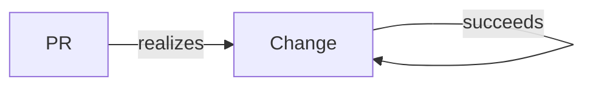

# SYNC view of the KAAL object metamodel

Template: `.github/PULL_REQUEST_TEMPLATE/sync.md`. Global model: [metamodel.md](../metamodel.md). This view selects from the model and defines nothing.

A SYNC brings a newer `main` into a collector and claims no Change Record of its own.

**Purpose.** This view anchors semantic reasoning about a SYNC pull request, both when it is written and when it is understood afterwards, along the INFORMED chain, Intent, Requirement, Architecture, Control, Case, then code or ruleset. **In the chain:** none: a SYNC carries chains already accepted elsewhere and adds no link to any chain.

## Objects
Change, PR.

## Relationships
succeeds, realizes.

## Information the template expects
The primary incoming Change that drives the synchronization; the reason it is needed now.

## What the reviewer should be able to verify
That the primary Change named is already accepted elsewhere and is the driver (Q2, Q6); that the pull request adds no new work of its own (Q1).

## The INFORMED chapter
The template carries a chapter named INFORMED. It links this view, which links [metamodel.md](../metamodel.md), and names the Change. It holds one box for each concern below. Each box is ticked, or marked n/a with a reason. A tick is the author's claim, not evidence.

- [ ] The primary Change named is already accepted elsewhere and is the driver
- [ ] The pull request adds no new work of its own

**Process control** (verify Envelope, on the pull request): the chapter exists, the view link is right, the Change exists, and every box above is present and either ticked or n/a with a reason. It never judges the work and does not repeat the trace.
**Content control** (on the Change's files): the chain links exist, Cases name what they test and ran RED then GREEN, Controls are declared, and each claim is compared with the evidence in both directions: ticked without evidence is "claimed but not found"; evidence present but the box not ticked, or marked n/a, is "done but not claimed". Both are findings.

## Outside this template
Any new Intent, Requirement or Case; the content of the incoming Changes, judged where they were accepted.
