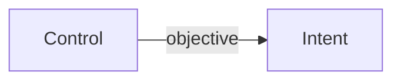

# WIRE view of the KAAL object metamodel

Template: none on `main` yet (mismatch M9). Global model: [metamodel.md](../metamodel.md). This view selects from the model and defines nothing.

A WIRE activates what `main` already approved.

**Purpose.** This view anchors semantic reasoning about WIRE work along the INFORMED chain. **In the chain:** Activates a Control: its objective on an Intent now holds in force.

## Objects
Control, Intent.

## Relationships
objective.

## Information the template expects
The Control activated and its Intent; what is copied.

## What the reviewer should be able to verify
That the Control names its Intent and that what is copied is what `main` approved.

## The INFORMED chapter
The template carries a chapter named INFORMED. It links this view, which links [metamodel.md](../metamodel.md), and names the Change. Each box below is ticked, or marked n/a with a reason; a tick is the author's claim, not evidence.

- [ ] The Control names its Intent
- [ ] What is copied is what main approved

**Process control** (verify Envelope, on the filled template): the chapter exists, the view link is right, the Change exists, and every box is present and either ticked or n/a with a reason. It never judges the work.
**Content control** (on the Change's files): each claim is compared with the evidence in both directions: ticked without evidence is "claimed but not found"; evidence present but not ticked, or n/a, is "done but not claimed". Both are findings.

## Outside this template
Whether the Control holds in practice.
