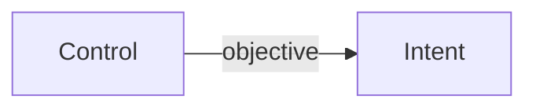

# WIRE view of the KAAL object metamodel

Template: none on `main` yet (mismatch M10). Global model: [metamodel.md](../metamodel.md). This view selects from the model and defines nothing.

A WIRE copies approved content from `main` into the live configuration and travels alone.

Effect on the model: activates Controls. The objective of each Control on its Intent now holds in force; no object or relationship is added.

**Purpose.** This view anchors semantic reasoning about WIRE work, both when it is written and when it is understood afterwards, along the INFORMED chain: Intent, Requirement, Architecture, Test Case; a Control enters at its Intents. **In the chain:** Control to Intent: the Control activated pursues its Intents, and nothing else on the chain changes.

## Objects
Control, Intent.

## Relationships
objective.

## Information the template expects
The Control activated and its Intents; what is copied, and from where.

## What the reviewer should be able to verify
That each Control activated names its Intents; that what is copied is what was approved on `main`; that nothing else travels with it.

## The INFORMED chapter
The template carries a chapter named INFORMED. It links this view, which links [metamodel.md](../metamodel.md), and names the Change. It holds one box for each concern below. Each box is ticked, or marked n/a with a reason. A tick is the author's claim, not evidence.

- [ ] Each Control activated names its Intents
- [ ] What is copied is what was approved on main
- [ ] Nothing else travels with it

**Process control** (verify Envelope, on the filled template): the chapter exists, the view link is right, the Change exists, and every box above is present and either ticked or n/a with a reason. It never judges the work and does not repeat the trace.
**Content control** (on the Change's files): the chain links exist, Test Cases name what they test and ran RED then GREEN, Controls are declared, and each claim is compared with the evidence in both directions: ticked without evidence is "claimed but not found"; evidence present but the box not ticked, or marked n/a, is "done but not claimed". Both are findings.

## Outside this template
The content of the Controls; whether they hold in practice.
