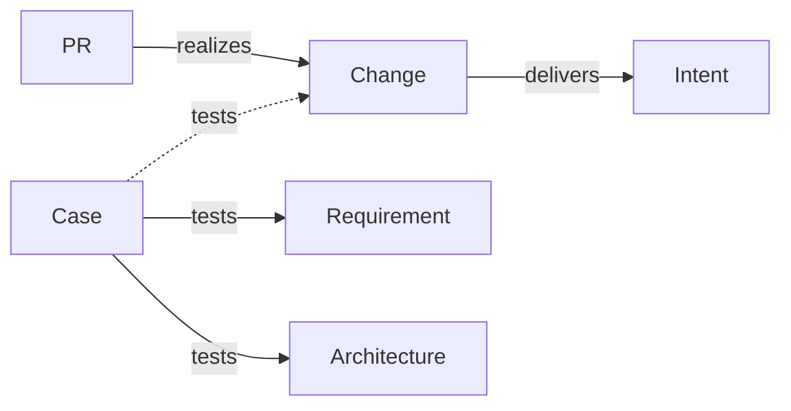

# DO view of the KAAL object metamodel

Template: `.github/PULL_REQUEST_TEMPLATE/do.md`. Global model: [metamodel.md](../metamodel.md). This view selects from the model and defines nothing.

A DO implements a planned Change: the RED Cases turn GREEN and nothing else changes.

## Objects
Change, Intent, Requirement, Architecture, Case, PR.

## Relationships
delivers, tests, realizes.

## Information the template expects
The Change line; what the DO implements; the refactoring intended while behaviour stays, or that there is none.

## What the reviewer should be able to verify
That the Change is the one the merged PLAN planned (Q2); which Cases turned GREEN and what each explicitly tests (Q4); that the files changed are the objects the PLAN named (Q1); the evidence in the record (Q6).

## Outside this template
New Requirements or Intent (a change to those is a new PLAN); the retrospective; delivery to `main`.
