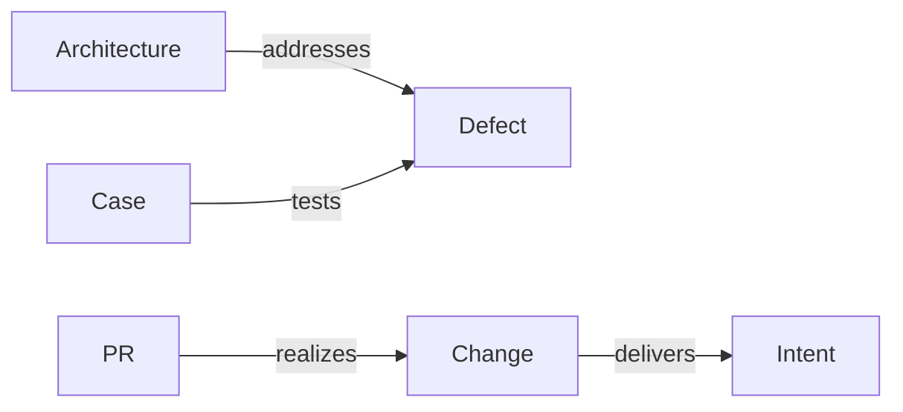

# HOTFIX view of the KAAL object metamodel

Template: `.github/PULL_REQUEST_TEMPLATE/hotfix.md`. Global model: [metamodel.md](../metamodel.md). This view selects from the model and defines nothing.

A HOTFIX is an Emergency Change that corrects a Defect by the fastest safe path.

**Purpose.** This view anchors semantic reasoning about a HOTFIX pull request, both when it is written and when it is understood afterwards, along the INFORMED chain, Intent, Requirement, Architecture, Control, Case, then code or ruleset. **In the chain:** Defect to Architecture to Case to Source: the Defect is addressed by Architecture, a Case fails RED on it and turns GREEN with the correction.

## Objects
Change, Intent, Architecture, Defect, Case, PR.

## Relationships
addresses, tests, delivers, realizes.

## Information the template expects
The Change (id and name only); the Defect by its `<capability>/D<n>` identity and the state that is defective; the urgency; the approach.

## What the reviewer should be able to verify
That the Defect identity resolves (Q5); that a Case tests that Defect and ran RED before GREEN (Q4); that the Architecture the correction addresses is named (Q3); that the state claimed defective (production, `main` or a collector) is the one meant.

## Outside this template
A broader improvement or refactoring; the ordinary path for the Change; whether production is affected beyond what the Defect states.
