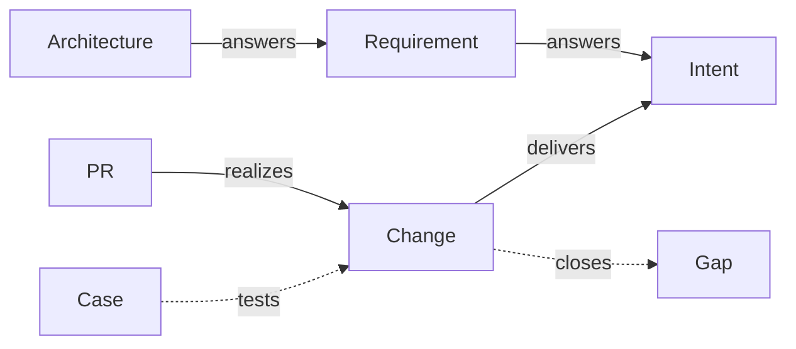

# PLAN view of the KAAL object metamodel

Template: `.github/PULL_REQUEST_TEMPLATE/plan.md`. Global model: [metamodel.md](../metamodel.md). This view selects from the model and defines nothing.

A PLAN proposes a Change: it adds drafts and Cases that run RED, and no behaviour.

## Objects
Change, Intent, Requirement, Architecture, Case, Gap, PR.

## Relationships
delivers, answers, tests, closes, realizes.

## Information the template expects
The Change line (id, name, what it is about); From (the current state); To (the target state); Because (the value delivered).

## What the reviewer should be able to verify
That the Change line resolves to a Change Record that delivers an Intent (Q2); that the Requirements and Architecture drafted answer that Intent, or that Controls do (Q3); that every Case runs RED for the reason the record gives and names what it tests (Q4); the Gap it closes, if the Change uses Gaps (Q5).

## Outside this template
Implementation (DO), the retrospective (ACT), the lifecycle state, delivery to `main`.
