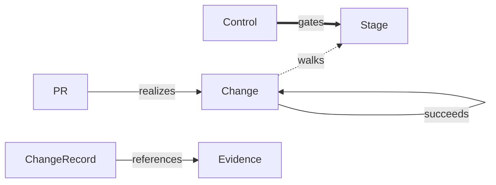

# PROMOTION view of the KAAL object metamodel

Template: `.github/PULL_REQUEST_TEMPLATE/promotion.md`. Global model: [metamodel.md](../metamodel.md). This view selects from the model and defines nothing.

A PROMOTION delivers the Changes a collector holds to `main`.

## Objects
Change, Change Record, Evidence, Stage, Control, PR.

## Relationships
succeeds, walks, gates, references, realizes.

## Information the template expects
One line per Change delivered, `<id> <name>: <phases carried>`; why now.

## What the reviewer should be able to verify
That each Change named is Accepted in the collector and carries the phases it names (Q1, Q6); that no Change it succeeds is missing (Q1); that the Intents delivered are those of the Changes (Q2); that the stage it enters, Promoting, has its gate green at the exact head (Q6).

## Outside this template
The content of each Change; the Requirements and Cases (judged where each Change landed); whether the Intent achieved its Outcome.
