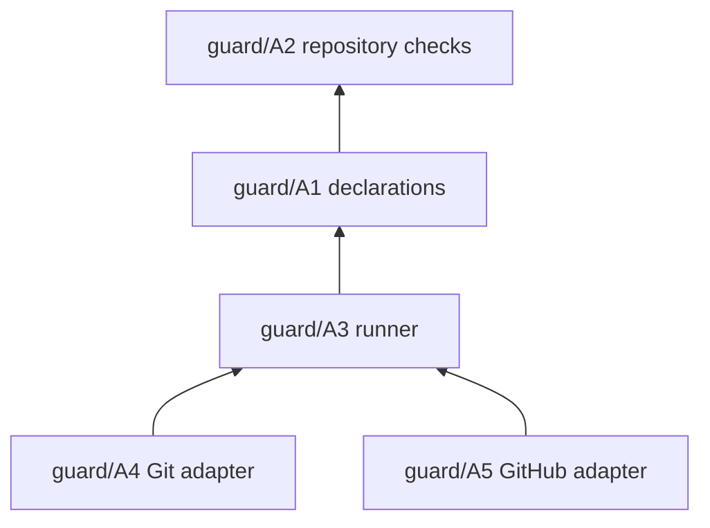

# Guard: Architecture (where)

Architecture places Guard's functions, gives each one positive ownership, and fixes its boundaries, relationships and dependencies. Each element names, in brackets, the [Requirements](requirements.md) it serves. How each function is implemented is the code's.

## Elements

- **guard/A1 Check list** [guard/F1, guard/F7, guard/F18, guard/F28]. The declarations, `.kaal/config/guard/<name>.md`, are owned by the repository. Their frontmatter says which checks exist, their commands, where they run, which facts they need, which checker is trusted and which outcomes are named. It knows nothing of how a check decides.
- **guard/A2 Checks** [guard/F1, guard/F9]. The checks and their test content are the repository's. They know nothing of Git, GitHub or Guard beyond the facts guard/F9 gives them.
- **guard/A3 Runner** [guard/F2, guard/F3, guard/F7, guard/F9, guard/F10, guard/N2, guard/N4]. The runner, in the package at `lib/runner.mjs`, runs a set of checks and reads their verdicts. It knows nothing of branches, remotes, pull requests, GitHub, the adapters or KAAL. It reads a Git object only to take a trusted checker from the base commit (guard/F7).
- **guard/A4 Git adapter** [guard/F4, guard/F6]. The `pre-push` hook, shipped in the package as `templates/pre-push`, passes Git facts to the runner and acts on its verdicts. It knows nothing of GitHub and names no check.
- **guard/A5 GitHub adapter** [guard/F5, guard/F6, guard/F10]. A workflow job passes pull request facts to the runner and acts on its verdicts. Reporting to GitHub (annotations and the step summary, `run --github`) and the static coverage check (`verify`) sit beside the runner, in `lib/github.mjs`. A new consumer is offered `templates/guard.yml`.
- **guard/A6 Lifecycle** [guard/F8, guard/N3]. `init`, `upgrade` and `remove`, in the package at `lib/lifecycle.mjs`, own exactly the managed assets the repository's installation record registers, that record, the `core.hooksPath` they set, and their checkout state in Git's metadata (guard/F29). Nothing else in a repository is theirs, and they never write a declaration.
- **guard/A7 Dependency direction** [guard/F3, guard/F6]. The command (`bin/kaal-guard.mjs`) and the adapters depend on the runner; the runner depends on the declarations, and the declarations name the checks. Nothing depends on an adapter, and the runner depends on neither guard/A5 nor the templates.
- **guard/A8 Package independence** [guard/N6]. The `kaal-guard` package, in `packages/kaal-guard/`, depends on no other KAAL element, declares none, imports none and references no path of its publisher's repository or KAAL Engine. It carries its own tests in `test/`.
- **guard/A13 Skill source** [guard/F19, guard/F20, guard/N11]. The Embed Skill is in the package at `skills/kaal-guard/`, and the package ships it (`files`). Its text names the package's commands. It assumes no host, as KAAL's Agent Skills do. Its publisher checks it against the Agent Skills standard before each release; the package never depends on that check.
- **guard/A14 Skill placement** [guard/F23, guard/F24, guard/F26, guard/F27, guard/N10, guard/N12]. The lifecycle (guard/A6) installs, upgrades and removes the Skill as a managed asset at its canonical location, as the contract (guard/A17) states. It holds no provider convention and reads no provider declaration. The Skill's text depends on no location. It never writes an instruction file.
- **guard/A15 Reminder** [guard/F21, guard/F22]. The reminder is reporting, so it sits with the command and the GitHub reporting (guard/A5). It reads the Skill paths registered in the installation record (guard/F29), or else the package's copy. The runner (guard/A3) and the hook (guard/A4) are unchanged, and the hook shows the reminder only because it forwards `kaal-guard`'s output.
- **guard/A17 Installation contract** [guard/F27, guard/N12]. `contract.json` is in the package, and the package ships it. It is Guard's instance of Core's Installation Contract schema, which Guard neither copies nor imports. The lifecycle (guard/A6) reads its assets and rules from it, so no second list of assets exists in Guard's code. Core reads the same file when it realizes Guard. Core's conformance Test Cases are run against it before each release only.
- **guard/A18 Verification entry** [guard/F31–guard/F36, guard/N13].
  - **Where it lives.** `test/verify.mjs` and its manifest `test/verify.json` are in the package beside the outer acceptance cases (`test/acceptance/`) and the inner Code tests (`test/unit/`), and the package ships all four. The manifest holds the delivered cases' inventory, their loops, the product identifiers with their coverage, allocation or lack of a Test Case, the declared applicability, and the SHA-256 of every shipped file except itself.
  - **What it does.** The entry checks the prerequisites, the installed files and the consumer, runs the delivered cases of every loop by absolute path through `node:test`'s `run()`, reads each case's outcome from the runner's events, judges each loop, each identifier's coverage and each declared applicability, and prints the result and the summary line. It removes an inherited `NODE_TEST_CONTEXT` first, because with it every case would be skipped.
  - **The manifest's form.**
    - `cases` lists each delivered case as `<file> > <suite> > <test>`, the file relative to the package.
    - `loops` maps each loop (Intent, Requirements, Architecture, Code) to its case files.
    - `identifiers` lists every product identifier. `coverage` maps each covered one to its covering cases by loop, the cases whose names cite it. `allocated` maps each identifier allocated to the publisher's Engineering Test Plan to what the publisher runs, and `unverified` maps each one no Test Case verifies to why.
    - `applicability` maps a case, or an identifier, to the platforms where it does not apply and why.
    - `files` maps each other shipped file to its SHA-256. The copy's own `node_modules`, where pnpm links `.bin`, is the package manager's and is not compared. The publisher writes it from a run of the cases and from `npm pack --dry-run`, after any change to a shipped file. A copy whose files do not match it is `cannot verify`, naming the file.
  - **The summary line.** `kaal-guard-verification` is followed by JSON with these members:
    - `result` and `exit`;
    - `package`: name, version and location;
    - `consumer`: root, `unchanged` and `changed`;
    - `lockfile`: integrity, resolved, source, or `unknown` with its reason;
    - `files`: digest, mismatched, missing, extra and `sha256`;
    - `cases`: declared, executed, passed, failed, skipped and todo, with the cases each names;
    - `loops`: for each loop, its files, its declared, executed, passed, failed, skipped and not applicable counts, and its cases;
    - `coverage`: the number of identifiers, and those `covered` by this run, `allocated` (each with what the publisher runs), `unverified` (each with why), `notApplicable` here, `notHere` and `uncovered`;
    - `applicability`: the platform and the cases not applicable on it;
    - `causes`.
  - **What it uses.** It imports nothing from `lib/`, so a broken runtime cannot mask itself, and uses only Node's built-ins. The cases and their harness are reused unchanged.
  - **Where its own tests live.** The Test Cases of the verification itself are the publisher's and are not in the package, so a delivered run never verifies its own verifier.
- **guard/A19 Product contract** [guard/F37, guard/F38, guard/F39, guard/F40].
  - **The contract's files.** In the package:
    - `docs/intent.md`, `docs/requirements.md` and `docs/architecture.md`, holding the product identifiers;
    - `docs/testing.md`, the Product Verification Test Plan, holding the loops, the trace, the allocations and the identifiers no Test Case verifies;
    - `docs/limitations.md`.

    The package ships `docs/`, and the manifest catalogues it.
  - **The two loops.**
    - Outer: the acceptance cases, in `test/acceptance/`.
    - Inner: the Code tests, in `test/unit/`.
  - **The trace.** It is derived from the case titles, which already name their identifiers, for example `guard/T61 [guard/F1, guard/A1]`. Allocations, identifiers no Test Case verifies, and declared applicability are declared once, in `docs/testing.md`.
  - **The manifest.** The generator (guard/A18) reads all of this and writes `loops`, `coverage`, `allocated`, `unverified` and `applicability` into `test/verify.json`. The entry judges them.
  - **What the entry imports.** Still nothing from `lib/`.

## Relationships

